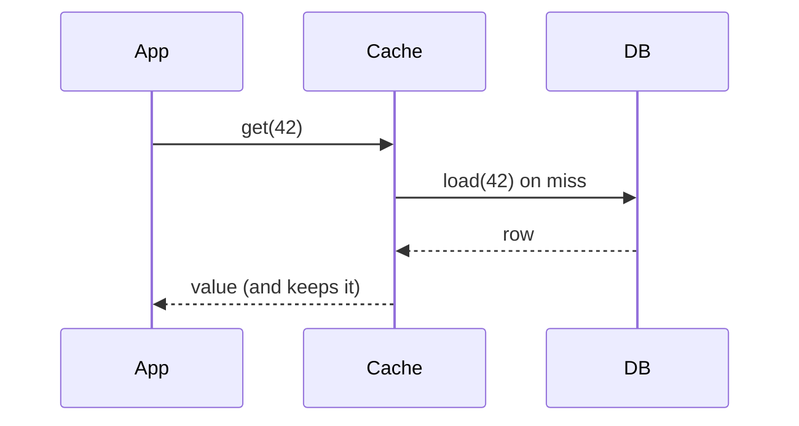
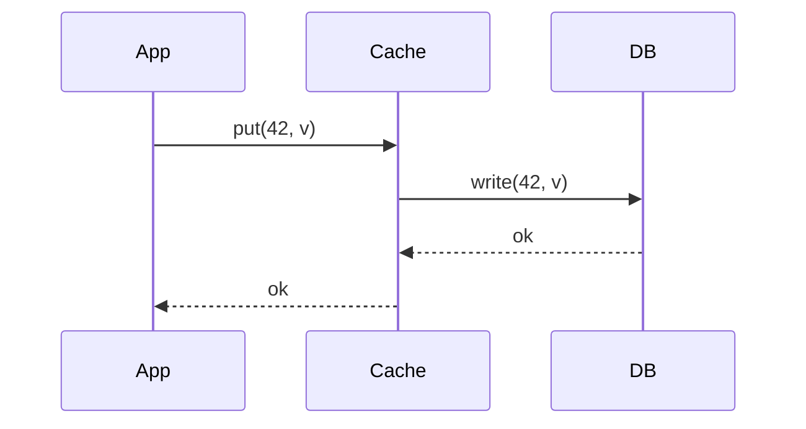

**The short version:** read-through decides how the cache gets filled on a **read miss**; write-through decides how the cache stays fresh on a **write**. They solve different halves of the problem and are often used together.

## Read-through

On a miss, **the cache itself** loads the value from the database (via a configured loader), stores it and returns it.

- Only data that is actually requested is cached (lazy).
- The first read of each key pays the miss penalty.
- Data can be stale until TTL or invalidation.
- App code stays clean; loading logic is centralised (and can coalesce concurrent misses).

## Write-through

On a write, the value is written to the cache **and** the database synchronously before the write is acknowledged.

- The cache is fresh for written keys; a read right after a write hits.
- Each write pays cache + database latency.
- Cache fills with written data even if nobody reads it (use TTLs).
- On its own it doesn't help keys that were never written through the cache, so it's usually combined with read-through or cache-aside.

## Side by side

| | Read-through | Write-through |
|---|---|---|
| Triggered by | Read miss | Every write |
| Main benefit | Simple lazy loading | Fresh cache after writes |
| Main cost | First-read latency, staleness | Slower writes, cache pollution |
| Staleness | Until TTL/invalidation | Low for written keys |
| Best for | Read-heavy data | Data read soon after being written |

## Using them together

**Read-through + write-through** gives a cache that is filled lazily on reads and kept fresh on writes, so reads almost never see stale data for keys that change through the cache. The cost is slower writes.

Alternatives for the write side:
- **Write-around + delete-on-write** (with cache-aside/read-through): cheaper writes; next read reloads. The most common production choice.
- **Write-behind:** fastest writes, risk of loss.

See [Read & Write Caching Strategies](#/l/04-caching/read-write-strategies) for all five patterns.

> [!INTERVIEW] Decide by the read-after-write pattern
> "User settings are read right after they're changed, so I'd use write-through to keep the cache fresh. Product catalogue entries change rarely and are read constantly, so read-through with a TTL plus delete-on-update is enough and keeps writes cheap."

## Key takeaways

- Read-through: cache loads on miss. Write-through: cache updated synchronously on write.
- They address different moments and combine naturally.
- Write-through costs write latency; read-through costs first-read latency.
- Delete-on-write with lazy loading is the cheaper common alternative.
