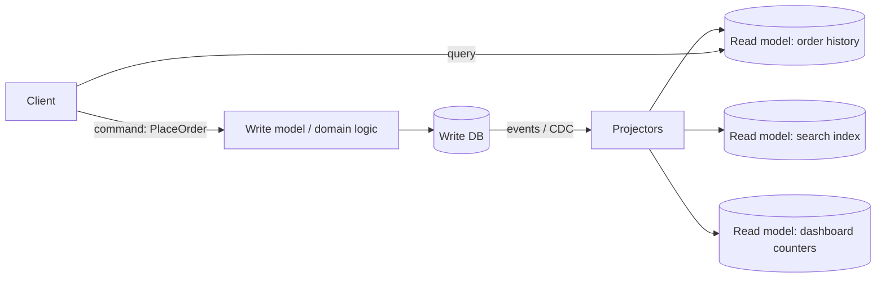

**The short version:** these patterns are not alternatives; they solve different problems. A **saga** keeps a multi-service *write* (a business transaction) consistent through local transactions and compensations. **CQRS** separates the *write model* from *read models* so each can be optimised independently. They are often used together.

## What each solves

| | Saga | CQRS |
|---|---|---|
| Problem | A business transaction spans several services/databases; no distributed ACID | Reads and writes have very different shapes, volumes or scaling needs |
| Core idea | Sequence of local transactions + compensating actions | Commands update a write model; queries read from separate, denormalised read models |
| Focus | Consistency of **writes** across services | Performance and simplicity of **reads** (and writes) |
| Consistency | Eventual across the saga; local ACID per step | Read models are eventually consistent with the write model |
| Coordination | Choreography (events) or orchestration (state machine) | Events/CDC project changes into read stores |
| Typical example | Order → payment → inventory → shipping with refunds on failure | Orders written to PostgreSQL; order history/search served from Elasticsearch and Redis views |

## CQRS in more detail

- **Commands** express intent (`PlaceOrder`, `CancelOrder`), are validated against business rules and change the source of truth.
- **Queries** never change state; they read from **read models** shaped exactly for each screen or API, often denormalised into different databases.
- Read models are updated asynchronously, so a query might briefly not reflect the latest command (handle with read-your-writes tricks in the UI).
- Often paired with **event sourcing** (the write model stores events, and read models are projections of them), but CQRS doesn't require it.

**Use CQRS when:** reads vastly outnumber writes and need different shapes (search, analytics, feeds), or read and write workloads must scale separately, or the domain logic is complex. **Avoid it** for simple CRUD, where it's just extra moving parts.

## Saga in brief

A saga splits a cross-service transaction into steps with compensations (refund, release, cancel), coordinated by events or an orchestrator, with idempotent steps and reliable messaging via the outbox. See [The Saga Pattern](#/l/07-api-design/saga).

**Use sagas when:** a business process must update data owned by several services and you need the whole process to either complete or be compensated.

## Using them together

An e-commerce order flow:
1. `PlaceOrder` command → order service write model (CQRS write side).
2. The order saga orchestrates payment and inventory (saga).
3. Every state change emits events through an outbox.
4. Projectors build the "My orders" view, the admin dashboard and the search index (CQRS read side).

> [!INTERVIEW] Clarify the question
> "They answer different questions. The saga handles *how the order, payment and inventory writes stay consistent* across services. CQRS handles *how we serve fast, varied reads*: order history from a denormalised view, search from Elasticsearch. Both rely on events, so they fit together naturally."

## Key takeaways

- Saga = consistent multi-service writes via local transactions and compensations.
- CQRS = separate write and read models, with read models updated from events.
- Both introduce eventual consistency; both depend on reliable events (outbox).
- Use CQRS only when read and write needs genuinely differ; use sagas only when transactions truly span services.
