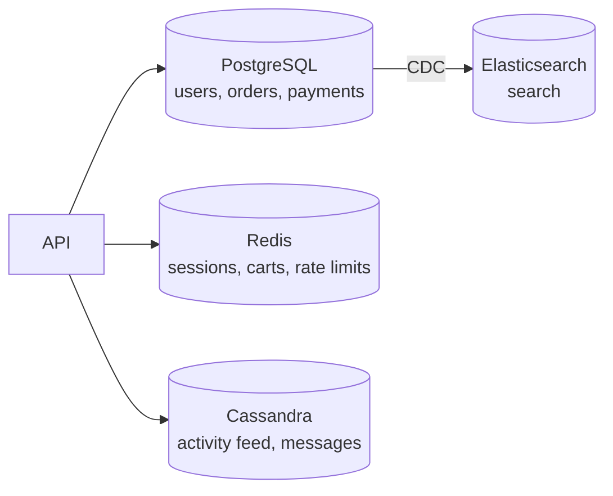

**The short version:** choose SQL when your data is relational and correctness across records matters; choose NoSQL when you need massive scale or flexibility for simple, well-known access patterns. Many systems use both.

## Side by side

| | SQL (relational) | NoSQL |
|---|---|---|
| Data model | Tables, rows, foreign keys | Key-value, document, wide-column, graph |
| Schema | Defined up front, enforced | Flexible, often per record |
| Queries | Rich SQL, joins, ad-hoc | By key / limited, designed per access pattern |
| Transactions | Multi-row, multi-table ACID | Usually single-item; some offer more |
| Consistency | Strong by default | Often eventual or tunable |
| Scaling writes | Vertical, then manual sharding | Horizontal by design |
| Maturity | Decades of tooling | Varies by product |

## Choose SQL when

- Data has **relationships** you'll query across (users → orders → items → products).
- You need **transactions** that touch several records (transfer money, place an order with inventory).
- **Integrity** matters: constraints, uniqueness, foreign keys.
- Queries are **varied or not yet known** (reporting, admin tools, new features).
- Data volume fits one primary (plus replicas) for the foreseeable future. Most products are in this category for longer than people expect.

> [!REAL] The bank ledger
> Money, bookings and inventory need joins, constraints and transactions. That's why core banking and payment ledgers almost always sit on relational databases.

## Choose NoSQL when

- **Huge write volume** or data size beyond one machine, with a simple key-based access pattern (chat messages, events, IoT readings).
- The access pattern is **known and narrow**: "get the latest 50 messages in conversation X".
- **Flexible or varied schema**: products with wildly different attributes, user-generated structures.
- **Low-latency key lookups** at scale: sessions, carts, feature flags.
- **Relationship-heavy traversals** (graph databases).
- Built-in **multi-region replication** and high availability matter more than strict consistency.

> [!REAL] The chat history
> Billions of chat messages written per day, always read by conversation ID: that's a key-based access pattern at a huge scale, where Cassandra-style stores shine.

## Common mistakes

- **Choosing NoSQL "for scale"** for a product that will never outgrow PostgreSQL, then rebuilding joins and transactions in application code.
- **Choosing SQL for append-only firehoses** (clickstreams, telemetry) and fighting write throughput and table bloat.
- Using a document store for highly relational data, ending up with duplicated data that drifts.
- Ignoring that modern SQL databases handle JSON columns well, and modern NoSQL stores offer transactions. The gap has narrowed.

## A mixed architecture

> [!INTERVIEW] How to answer
> "Orders and payments go in PostgreSQL: they're relational and need multi-row transactions. The activity feed is write-heavy, append-only and always read by user and time, so it goes in Cassandra partitioned by user ID. If I had to pick only one to start, PostgreSQL. It covers both well at our current scale."

> [!REAL] Using the right tool for each job
> A typical large app keeps orders and payments in PostgreSQL or MySQL, sessions and counters in Redis, product search in Elasticsearch and analytics in a data warehouse. Most big companies use several databases.

## Key takeaways

- SQL: relationships, transactions, integrity, flexible queries.
- NoSQL: scale-out, high write volume, flexible schemas, known access patterns.
- Decide per dataset, not per company; polyglot persistence is normal.
