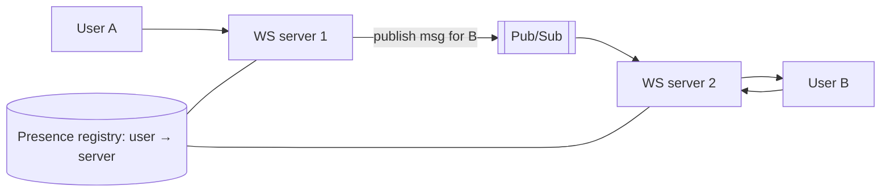

**The short version:** a stateless service keeps nothing about clients between requests, so any instance can serve any request and scaling is easy. A stateful service remembers things locally, which is sometimes necessary and often faster, but makes scaling, failover and deploys harder.

## Side by side

| | Stateless | Stateful |
|---|---|---|
| Where state lives | External stores (DB, cache, token) | In the instance's memory or disk |
| Routing | Any instance | Must reach the instance holding the state |
| Scaling out/in | Trivial | Needs rebalancing or migration of state |
| Failure of an instance | Retry elsewhere | State lost or must fail over |
| Deploys | Easy rolling restarts | Draining, handover, reconnects |
| Latency | Extra hop to fetch state | Can be faster (state is local) |
| Examples | REST APIs, web servers | Databases, caches, WebSocket servers, game servers, stream processors |

> [!REAL] Vending machine vs personal tailor
> A vending machine is stateless: any machine gives the same chips for the same coins. A tailor is stateful: he keeps your measurements, and you must go back to him.

## Making a web tier stateless

- **Sessions:** Redis/Memcached session store, or a signed token (JWT) carried by the client.
- **Uploaded files:** object storage, not local disk.
- **Caches:** a distributed cache; local caches only for data that's fine to lose and recompute.
- **Scheduled jobs:** a job scheduler with leader election, not "whichever server has the cron entry".

Once stateless, servers are cattle, not pets: autoscale, replace, deploy freely. See [Scalability](#/l/02-scalability/scalability).

## When state is unavoidable (or worth it)

- **Long-lived connections:** WebSockets for chat, live updates, multiplayer games. The connection *is* state.
- **Databases and caches:** their whole job is state.
- **Stream processing:** windowed counts and joins keep state per key for speed.
- **In-memory performance:** keeping a working set locally (e.g. a game world, an order book in a matching engine) avoids network hops.

> [!REAL] The multiplayer game room
> A BGMI match is stateful: all players in one game must be on the same server holding the game state. You can't bounce them between servers mid-match.

## Scaling stateful services

- **Partition the state** by key so each instance owns a slice (consistent hashing, Kafka partitions, shard maps).
- **Route requests to the owner**: sticky load balancing on a key, or a lookup service.
- **Replicate** state for failover (leader-follower, Raft).
- **Externalise just enough**: e.g. WebSocket servers keep connections, but message routing uses a pub/sub layer (Redis, Kafka) so any server can deliver to any user via the server holding their connection.
- **Checkpoint** state to durable storage so a replacement can recover (Flink checkpoints, Kafka Streams changelogs).
- **Graceful handover** on deploys: drain connections, migrate partitions, let clients reconnect with resume tokens.

> [!INTERVIEW] Keep state at the edges
> "The API tier is stateless behind a load balancer, with sessions in Redis. The chat gateway is necessarily stateful because it holds WebSocket connections, so we keep it thin: it only maps users to connections, registers them in a presence store, and relays messages through pub/sub. Business logic stays in stateless services."

## Key takeaways

- Stateless services scale, fail over and deploy easily; push state to dedicated stores.
- Some components must be stateful: databases, caches, connections, stream processors.
- Scale stateful parts by partitioning, owner routing, replication and checkpointing.
- Keep stateful layers thin and push logic into stateless services.
