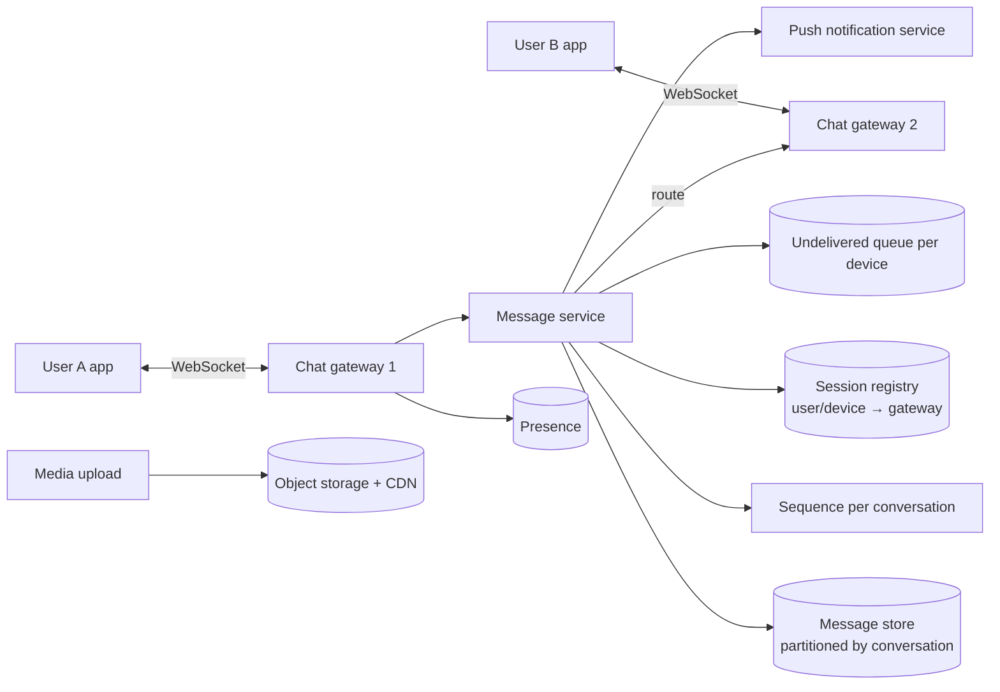
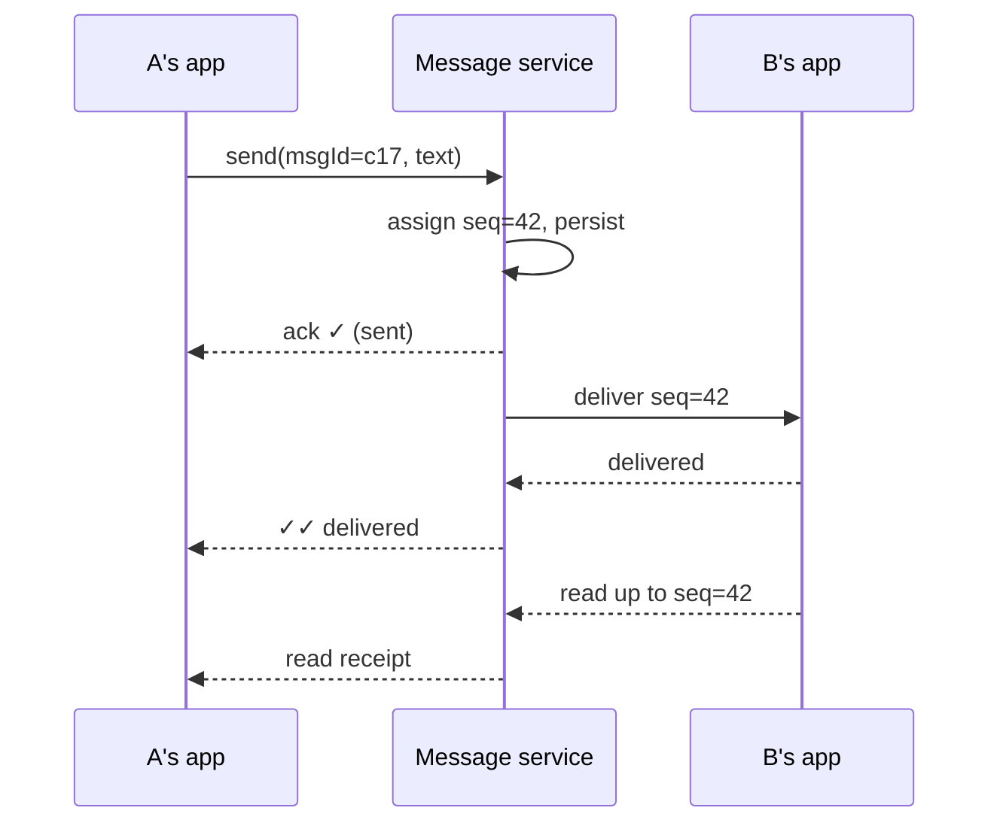

Design a chat app like WhatsApp: one-to-one and group messaging, delivered in real time when the recipient is online and stored for later when they're not, with delivery and read receipts.

## 1. Requirements

**Functional**
- One-to-one chats and groups (up to ~1,000 members).
- Real-time delivery when online; delivery on reconnect when offline.
- Message states: sent ✓, delivered ✓✓, read (blue ✓✓).
- Online/last-seen presence; push notifications when the app is backgrounded.
- Media (images, video, documents) and multi-device support (briefly).

**Non-functional**
- Low latency (< 200 ms when both online).
- **No message loss** once the server acknowledges it; **ordering** within a conversation.
- High availability; mobile networks are flaky.
- Scale: 2B users, 100B messages/day.
- Privacy: end-to-end encryption (the server can't read messages).

## 2. Estimates

- 100B messages/day → ~1.2M messages/s average, ~3M/s peak.
- Concurrent connections: maybe 500M online at peak. At ~100K–1M connections per gateway server (depending on tuning), that's **hundreds to thousands** of connection servers.
- Storage: 100 bytes average text × 100B = 10 TB/day. If messages are deleted from the server after delivery (WhatsApp-style), stored volume stays small; if kept (Slack-style), plan for petabytes.

## 3. Core design

### Connection layer
- Each online device keeps a **persistent connection** (WebSocket or a custom TCP protocol, like XMPP-derived protocols) to a chat gateway, which authenticates it and registers `device → gateway` in a **session registry** (Redis or similar).
- Gateways are thin: they hold connections and forward frames. Business logic lives in stateless message services.
- Heartbeats detect dead connections; clients reconnect with exponential backoff and resume.

### Sending a message
1. A's app assigns a **client message ID** (for idempotent retries) and sends it over its connection.
2. The message service assigns a **per-conversation sequence number** (defines order), stores the message durably, and **acks** A → one tick ✓.
3. It looks up B's devices in the session registry:
   - **Online:** route to B's gateway, which pushes it down B's connection. B's app acks → two ticks ✓✓ sent back to A.
   - **Offline:** keep it in B's **undelivered queue** and send a **push notification** (APNs/FCM).
4. When B opens the conversation, a read receipt flows back → blue ticks.

### Offline sync
On reconnect, each device tells the server the last sequence it has per conversation (or a global per-device cursor); the server sends everything newer from the undelivered queue/message store, in order, in batches. After the device acks, the queue entries can be deleted.

## 4. Deep dives

### Ordering
- A single global order is unnecessary and expensive. Order **per conversation** with a monotonically increasing sequence.
- Generate it in the partition that owns the conversation (e.g. Redis `INCR` per conversation, or the store's partition leader), so it's a local operation.
- Clients sort by sequence and detect gaps (missing seq 41 → fetch it).

### Exactly-once (effectively)
Mobile clients retry over flaky networks. The client message ID makes sends idempotent: the server dedups `(sender, clientMsgId)` and returns the original sequence.

### Storage
- Messages are append-heavy and read by conversation and time: a **wide-column store** (Cassandra/HBase/ScyllaDB) with partition key `conversation_id` (bucketed by time for very active conversations) and clustering key `seq`.
- WhatsApp-style: messages are stored only until delivered to all recipient devices, then removed; history lives on devices (with encrypted backups). Slack-style: keep everything server-side, searchable.

### Group messages
- Small groups (≤ ~1,000): **fan-out on write**. Store the message once per group conversation, then deliver to each member's online devices and enqueue for offline ones.
- The group's member list is cached; delivery fans out in parallel across gateways.
- Receipts in groups are aggregated ("read by 12").
- Very large broadcast channels switch to fan-out on read: members pull from the channel's stream.

### Presence
- Online status = has an active connection; "last seen" = time of last disconnect/heartbeat.
- Presence changes are frequent; don't broadcast every change to every contact. Publish to contacts who currently have the chat open or subscribe on demand, throttle updates, and store last-seen with a TTL.

### Push notifications
For backgrounded apps, the push service sends via APNs/FCM. With end-to-end encryption, the notification carries an encrypted payload or just a "new message" signal, and the app fetches and decrypts.

### End-to-end encryption
Clients exchange keys (e.g. the Signal protocol: identity keys, signed pre-keys, one-time pre-keys uploaded to the server); messages are encrypted on the sender's device for each recipient device. The server routes ciphertext it cannot read. Group chats use sender keys to avoid encrypting per member each time. Consequence: server-side search and moderation of content aren't possible.

### Media
Upload encrypted media to object storage (pre-signed URL), send a message containing the media reference and key; recipients download via CDN and decrypt.

### Multi-device
Each device is a separate endpoint with its own keys and delivery state; the sender encrypts for all of the recipient's (and their own other) devices.

### Scaling and failure
- Gateways scale horizontally; the registry maps users to gateways. A gateway crash drops its connections; clients reconnect elsewhere and resync from their cursors.
- Message services are stateless; the message store is replicated across zones. A message is acked only after it is durably stored.

## 5. Trade-offs

| Decision | Choice | Why |
|---|---|---|
| Transport | Persistent WebSocket/TCP | Real-time, bidirectional, cheap per message |
| Ordering | Per-conversation sequence | Correct where it matters, cheap |
| Idempotency | Client message IDs | Safe retries on flaky networks |
| Storage | Wide-column by conversation; delete after delivery (optional) | Append-heavy, privacy |
| Groups | Fan-out on write (small), pull (huge channels) | Balance latency and amplification |
| Presence | Throttled, on-demand | Avoid broadcast storms |

> [!INTERVIEW] Cover the three hard guarantees
> Interviewers look for: no loss (ack after durable write, retries with client IDs), order (per-conversation sequence numbers), and offline delivery (per-device undelivered queue + push + cursor-based sync).

## Key takeaways

- Thin connection gateways + a session registry + stateless message services.
- Ack after durable storage; dedupe retries with client message IDs.
- Per-conversation sequence numbers give ordering; cursors drive offline sync.
- Fan-out on write for groups; throttle presence; E2EE means the server routes ciphertext only.
