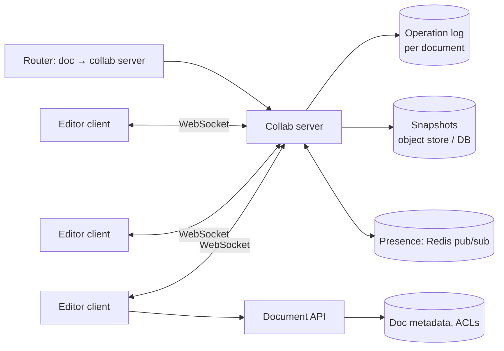

Design a collaborative document editor like Google Docs: many people edit the same document at the same time, see each other's changes and cursors within a fraction of a second, and never lose or corrupt text.

## 1. Requirements

**Functional**
- Create, open and edit rich-text documents.
- Real-time collaboration: concurrent edits merge automatically; everyone converges to the same text.
- Presence: see who's viewing and their cursors/selections.
- Version history; comments; sharing permissions.
- Offline editing that syncs later (nice to have).

**Non-functional**
- Edits appear for others within ~100–300 ms.
- No lost edits; all replicas converge.
- Most documents have few simultaneous editors (1–10); some have hundreds of viewers.
- Durable storage; access control enforced on every operation.

## 2. The core problem: concurrent edits

Document: `"cat"`. Alice inserts `"h"` at position 1 (→ `"chat"`). At the same time Bob deletes position 2 (`"t"`, → `"ca"`). If each simply applies the other's raw operation:
- Alice applies Bob's "delete index 2" to `"chat"` → `"cht"` ✗ (deleted `a`)
- Bob applies Alice's "insert h at 1" to `"ca"` → `"cha"` ✓

They diverge. Positions shift under concurrent changes. Two families of algorithms fix this.

### Operational Transformation (OT)
Before applying a remote operation, **transform** it against concurrent operations already applied, adjusting positions. Bob's "delete 2" transformed against Alice's "insert at 1" becomes "delete 3", and both get `"cha"`.
- Usually relies on a **central server** that defines a single order of operations; clients transform their pending ops against what the server sends.
- Mature and efficient (used by Google Docs), but transformation functions for rich text are intricate.

### CRDTs (Conflict-free Replicated Data Types)
Give every character a **unique, ordered identifier** (e.g. based on site ID and a counter, positioned between its neighbours). Inserts reference identifiers, not indexes, so concurrent operations commute: applying them in any order yields the same result.
- No central ordering needed; great for **offline** and peer-to-peer.
- More metadata per character (tombstones for deletes), mitigated by compaction. Libraries: Yjs, Automerge.

| | OT | CRDT |
|---|---|---|
| Ordering | Central server orders ops | Any order converges |
| Offline / P2P | Harder | Natural |
| Metadata | Small | Larger (IDs, tombstones) |
| Complexity | Transform functions | Data structure design |

Either works in an interview; say which and why. A server-centric OT design is simpler to reason about at scale; CRDTs win for offline-first.

## 3. High-level design

### Session routing: one owner per document
All editors of a document connect to the **same collab server** (the document's owner), chosen by consistent hashing on document ID or a lookup service. The owner:
- holds the current document state in memory,
- assigns each incoming operation a **sequence number** (the authoritative order),
- transforms it if needed (OT), appends it to the operation log, and broadcasts it to the other clients.

This makes ordering simple and avoids distributed coordination per keystroke.

### Client behaviour
- Apply local edits immediately (optimistic), send them to the server with the last seen server version.
- Keep a queue of unacknowledged operations; transform incoming server ops against them.
- Batch keystrokes into small ops (every ~50–100 ms) to reduce traffic.

### Persistence
- **Operation log**: append-only, per document (e.g. a wide-column table or Kafka partition keyed by doc ID). Every acknowledged op is durable here.
- **Snapshots**: periodically (every N ops or minutes) store the full document so loading doesn't replay millions of ops. Load = latest snapshot + ops after it.
- **Version history**: derived from snapshots and ops; named versions are pinned snapshots.

## 4. Deep dives

### Presence and cursors
Cursor positions change constantly and don't need durability. Broadcast them through the collab server (or Redis pub/sub) with throttling (~10 updates/s), and transform cursor positions against edits like any other position.

### Scaling
- Most documents have few editors, so one collab server hosts thousands of documents.
- A very popular document (company-wide doc with 500 viewers): editors on the owner server; read-only viewers can receive the op stream via fan-out replicas.
- Documents with no active editors are unloaded from memory.

### Failover
If the owner server dies, clients reconnect; the router assigns the document to a new server, which loads the snapshot plus the op log tail. Clients resend unacknowledged ops (each op has a client ID + sequence for idempotency). No acknowledged op is lost because it was logged before the ack.

### Offline editing
The client keeps working and queues ops locally. On reconnect, it sends them with its last seen version; the server transforms them against everything that happened meanwhile (OT), or merges them (CRDT). Long offline periods can produce surprising merges, so show a "changes merged" indicator.

### Permissions
Check ACLs when a client connects and on every op (a user whose access was revoked must be disconnected). Comment-only and view-only users can't send edit ops.

### Rich text
Formatting (bold ranges, lists, tables) is modelled as operations on a structured document tree, not raw strings, which makes transformation functions more complex. Libraries such as ProseMirror (with OT-like collab) or Yjs handle much of this.

## 5. Trade-offs

| Decision | Choice | Why |
|---|---|---|
| Concurrency control | OT with central ordering (or CRDT for offline) | Guaranteed convergence |
| Transport | WebSockets | Low-latency, two-way |
| Ownership | One collab server per active doc | Simple total order, no per-op consensus |
| Storage | Op log + periodic snapshots | Durability + fast loading + history |
| Presence | Ephemeral pub/sub, throttled | High frequency, no durability needed |

> [!INTERVIEW] Lead with the conflict example
> Show the "cat" example to explain why naive merging diverges, then present OT or CRDTs as the fix. That demonstrates real understanding before you draw a single box.

## Key takeaways

- Concurrent edits shift positions; OT transforms operations, CRDTs make them commute.
- Route all editors of a document to one owner server that orders operations.
- Persist an operation log plus snapshots; acknowledge only after logging.
- Presence is ephemeral; permissions are checked on connect and on every operation.
