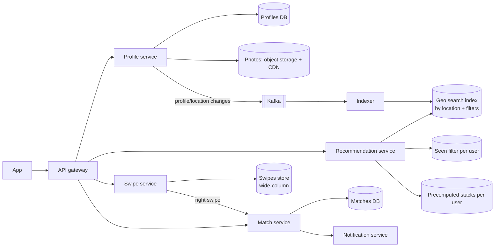
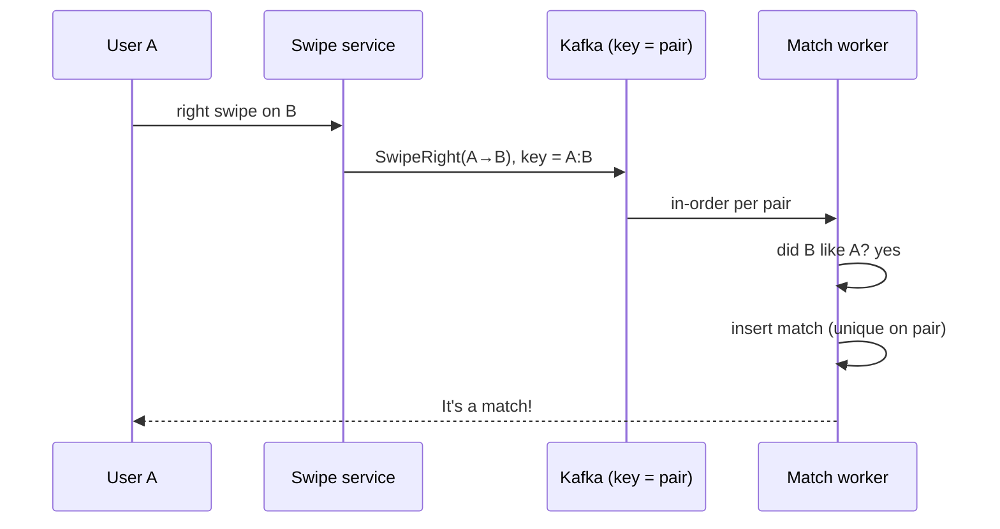

Design a swipe-based dating app like Tinder: users see a stack of nearby profiles that match their preferences, swipe right (like) or left (pass), and when two users like each other, it's a match and they can chat.

## 1. Requirements

**Functional**
- Create a profile with photos, age, gender, bio and preferences (age range, distance, gender).
- See a **recommendation stack** of nearby profiles matching preferences, never showing the same person twice.
- Swipe left/right; a mutual right swipe creates a **match**, and both get notified.
- Chat with matches (reuse a chat design; covered briefly).

**Non-functional**
- The stack loads fast (< 200 ms); swipes feel instant.
- Matches are detected reliably and exactly once.
- Scale: tens of millions of daily users, billions of swipes per day.
- Location changes as users travel.

> [!REAL] Think Tinder or Bumble
> Tinder has reported processing billions of swipes a day. The core loop is: show candidates nearby, record swipes very fast, and detect a match when two people both swipe right.

## 2. Estimates

- 50M DAU, ~100 swipes each per day → **5B swipes/day ≈ 60K swipes/s** average, ~150K/s peak.
- Matches are a small fraction, say 1–2% of right swipes.
- Swipe record ≈ 30 bytes → 150 GB/day. Keep for a long time (to never re-show profiles), so it grows quickly: wide-column store territory.
- Photos: 50M users × 5 photos × 500 KB ≈ 125 TB → object storage + CDN.

## 3. API

```http
GET  /v1/recommendations?limit=20            → [profile cards]
POST /v1/swipes   { targetId, direction }     → { matched: bool, matchId? }
GET  /v1/matches?cursor=
PUT  /v1/me/location { lat, lng }
PUT  /v1/me/preferences { ageMin, ageMax, maxKm, genders[] }
```

## 4. High-level design



## 5. Deep dives

### Recommendations: finding candidates
1. **Filter by location:** a geospatial index (geohash/S2 cells, or Elasticsearch `geo_distance`) finds users within the distance limit.
2. **Filter by preferences** in both directions: I must fit their preferences and they must fit mine (age, gender, distance).
3. **Exclude** anyone already swiped on, blocked or already matched.
4. **Rank:** activity recency, profile completeness, likelihood of mutual interest (a model trained on past swipes), plus some diversity and exploration so new users get seen.

Doing this per request is expensive. Instead **precompute a stack** of, say, 200 candidates per active user in the background (on app open, or when the stack runs low), store it in a cache, and serve 20 at a time. Recompute when location or preferences change.

### Never showing the same profile twice
A user may have swiped on tens of thousands of profiles. Options:
- Query the swipes store for each candidate: accurate but slow.
- Keep a **per-user Bloom filter** of swiped IDs in memory: very compact, with rare false positives (occasionally skipping a profile you hadn't seen, which is harmless). See [Bloom Filter vs Hash Table](#/l/09-tradeoffs/bloom-vs-hashtable).
- Filter the precomputed stack against the Bloom filter before serving.

> [!REAL] A "seen" stamp
> Each user has a record of profiles already shown. A Bloom filter per user can cheaply answer "definitely not seen", so the deck stays fresh.

### Recording swipes at 150K/s
- Writes go to a **wide-column store** (Cassandra/ScyllaDB) partitioned by swiper ID: `(swiper_id, target_id) → direction, ts`. Append-heavy, simple key access: a perfect fit.
- The app can batch swipes and send them in groups to reduce request overhead.

### Detecting matches
When A swipes right on B, check whether B already swiped right on A.

- Store right-swipes so the reverse lookup is cheap: `likes(target_id = A, liker_id = B)` partitioned by target, so "did B like A?" is a single-key read.
- The check and the match creation must be **race-free**: if A and B swipe right on each other at the same moment, both checks might miss. Solutions:
  - Process swipes for a **user pair** in one place: key the event by `min(A,B):max(A,B)` into a Kafka partition, so one consumer sees both swipes in order and creates exactly one match.
  - Or create the match with a unique constraint on the sorted pair (`match_id = hash(min, max)`), so concurrent inserts collapse into one.
- On match: write to the matches DB (per-user lists), notify both users via push/WebSocket, open a chat channel.



> [!REAL] Two keys to open the locker
> A match is a locker that needs both keys. When B swipes right on A, check whether A already swiped right on B. If yes, it's a match and both get notified.

### Location updates
Users move. Update location on app open and periodically (not continuously, to save battery), and re-index. Invalidate the precomputed stack when the user moves far enough.

### Photos
Upload to object storage via pre-signed URLs, generate resized versions asynchronously, serve through a CDN. Run moderation (automatic + human review) before photos go live.

### Chat
Reuse a chat architecture: WebSockets, a messages store partitioned by match ID, push notifications. See [Design a Chat System](#/l/10-hld-case-studies/chat-system).

### Safety and privacy
- Show approximate distance only (round or fuzz), never exact coordinates, to prevent trilateration.
- Rate-limit swipes to stop bots; block and report flows; moderation.

## 6. Trade-offs

| Decision | Choice | Why |
|---|---|---|
| Candidate generation | Precomputed stacks per user | Fast serving; heavy work done in background |
| Seen filter | Bloom filter per user | Memory-efficient; false positives harmless |
| Swipe storage | Wide-column, by swiper | Massive append-only writes |
| Match detection | Pair-keyed partition + unique pair constraint | Exactly one match under concurrency |
| Location | Periodic updates + geo index | Balances freshness and battery |

> [!INTERVIEW] The tricky parts
> Interviewers usually probe three things: generating good candidates fast (precompute + geo index), not showing repeats (Bloom filter), and creating a match exactly once when two people swipe simultaneously (pair-keyed processing or a unique constraint).

## Key takeaways

- Precompute recommendation stacks using geo and preference filters, then rank.
- Bloom filters cheaply exclude already-seen profiles.
- Swipes are a massive append-only workload: wide-column storage.
- Detect matches race-free by processing per user pair or with a unique pair key.
