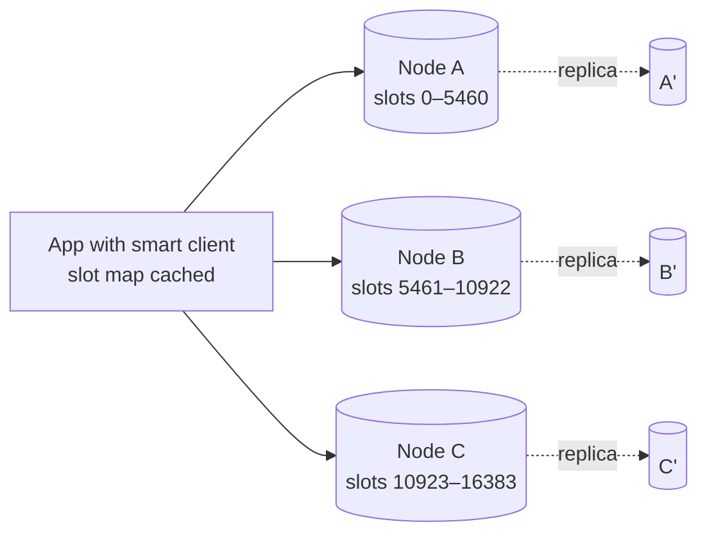

Design a distributed in-memory cache like Redis Cluster or Memcached: a key-value store spread across many nodes, with sub-millisecond reads and writes, that keeps working when nodes fail.

## 1. Requirements

**Functional**
- `GET key`, `SET key value [TTL]`, `DELETE key`; optionally atomic increments and simple data structures.
- Keys expire after their TTL; memory is bounded with an eviction policy.

**Non-functional**
- Latency: p99 < 1 ms within a data centre.
- Throughput: millions of operations per second across the cluster.
- Scale horizontally by adding nodes, with minimal data movement.
- High availability: a node failure shouldn't cause an outage (some cache misses are acceptable).
- Consistency: eventual is acceptable for a cache, but clients shouldn't see wildly stale data.

## 2. Estimates

- 10M ops/s at peak; 1 TB of hot data.
- A node with 64 GB usable memory and ~200K ops/s → ~16 nodes for data, ~50 for throughput. So throughput, not memory, decides the size: ~60 primaries, each with one replica.

## 3. Single-node design

- **Hash table** in memory mapping keys to values (with incremental rehashing so resizing doesn't block).
- **Event loop** with non-blocking I/O (epoll): one thread can serve ~100K+ ops/s because each operation is tiny. Multi-threaded I/O or multiple processes per machine use more cores.
- **Expiry:** store each key's expiry time. Delete lazily (when accessed after expiry) **and** actively (a background task samples keys with TTLs and removes expired ones), so memory isn't held by dead keys.
- **Eviction** when `maxmemory` is reached: approximated LRU/LFU by sampling a few keys and evicting the best candidate. See [Cache Eviction Policies](#/l/04-caching/eviction).
- **Memory efficiency:** compact encodings for small values, a slab allocator (Memcached) to limit fragmentation.

## 4. Distributing keys

### Partitioning
Use **consistent hashing with virtual nodes**, or a fixed set of **hash slots** (Redis Cluster uses 16,384 slots assigned to nodes). Adding a node moves only some slots/arcs, not all keys. See [From Modulo to Consistent Hashing](#/l/03-databases/consistent-hashing).

### Routing: who knows where a key lives?

| Approach | How | Trade-off |
|---|---|---|
| **Smart client** | Client library holds the slot map and talks to the right node directly | Fastest (one hop); clients must refresh the map (nodes reply `MOVED` when it's stale) |
| **Proxy** | Clients talk to a proxy fleet (e.g. Twemproxy, Envoy) that routes | Simple clients; extra hop; proxies must scale |
| **Any node redirects** | Client asks any node, which redirects | Simple, but extra round trips until the client learns the map |

## 5. Replication and failover

- Each primary has one or more **replicas** in other availability zones, updated **asynchronously** (low latency; a failover may lose the last few writes, which is acceptable for a cache).
- **Failure detection:** nodes gossip heartbeats; when a majority of primaries agree a primary is unreachable, its replica is **promoted** (a quorum prevents split brain).
- Clients learn the new topology (redirects or config updates).
- Optionally read from replicas for read-heavy, staleness-tolerant workloads.

## 6. Deep dives

### Adding and removing nodes (resharding)
Move slots one at a time: copy keys for the slot to the new node while the old one keeps serving; during migration, requests for keys already moved get redirected (`ASK`). Once complete, the slot map is updated. No downtime and no full reshuffle.

### Hot keys
One key on one node can saturate it. Mitigations: client-side local caching with short TTL for the hottest keys, replicating hot keys under several names (`key#1..#N`) and reading one randomly, and reading from replicas. Detect hot keys with sampling.

### Persistence (optional)
A pure cache can start empty after a restart, but warm restarts help avoid stampedes on the database:
- **Snapshots** (point-in-time dumps, forked process) for fast reloads.
- **Append-only log** of writes for durability, with periodic rewriting/compaction.
- Trade-off: more disk I/O and latency risk.

### Consistency with the source of truth
The cache isn't authoritative. Clients use cache-aside with TTLs and delete-on-write. Lease tokens can prevent stale re-fills. See [Cache Invalidation Strategies](#/l/04-caching/invalidation).

### Multi-key operations
Operations spanning keys (MGET across nodes, transactions) are expensive in a sharded cache. Use **hash tags** (`{user:42}:profile`, `{user:42}:settings`) to force related keys into the same slot so multi-key operations stay on one node.

### Client-side best practices
Connection pooling, pipelining/batching, sensible timeouts (a cache that's slow should be treated as a miss), circuit breakers so a sick cache node doesn't stall the application.

### Monitoring
Hit ratio, latency percentiles, evictions, memory and fragmentation, ops/s per node (hot-key detection), replication lag, failover events.

## 7. Trade-offs

| Decision | Choice | Why |
|---|---|---|
| Partitioning | Hash slots / consistent hashing | Minimal data movement on scaling |
| Routing | Smart clients | One hop, lowest latency |
| Replication | Async primary-replica | Speed; small loss acceptable for a cache |
| Failover | Gossip + quorum promotion | Automatic, avoids split brain |
| Eviction | Sampled LRU/LFU | Near-optimal with low overhead |
| Persistence | Optional snapshots | Faster warm restarts |

> [!INTERVIEW] Explain the node, then the cluster
> Start with how one node is fast (in-memory hash table, event loop, lazy + active expiry, sampled eviction), then scale out: slots/consistent hashing, smart clients, async replicas with quorum failover, and online resharding.

## Key takeaways

- Single node: hash table, event loop, lazy + active expiry, approximate LRU/LFU eviction.
- Cluster: hash slots or consistent hashing; smart clients route in one hop.
- Async replication with quorum-based failover; resharding moves slots online.
- Watch for hot keys and multi-key operations across shards.
