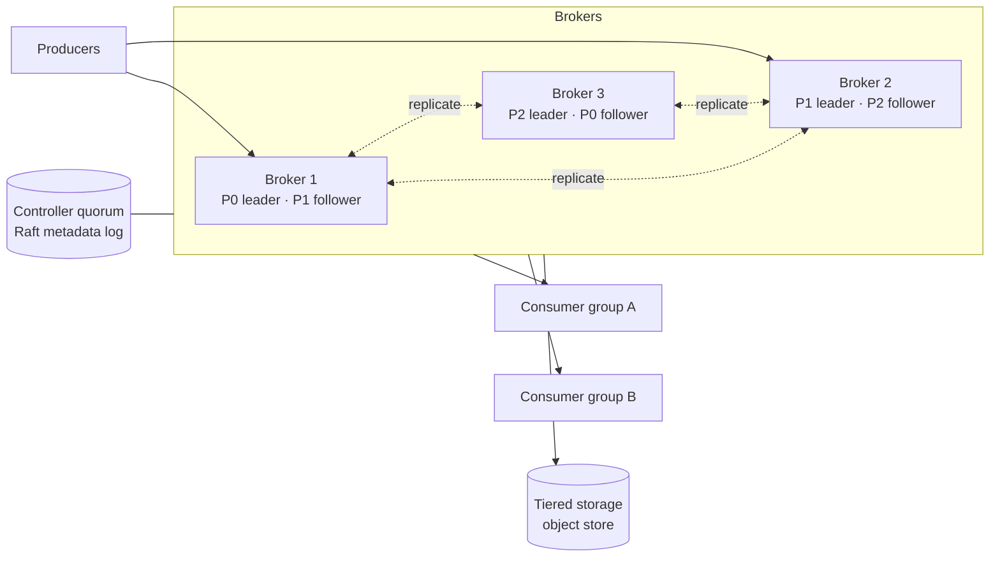
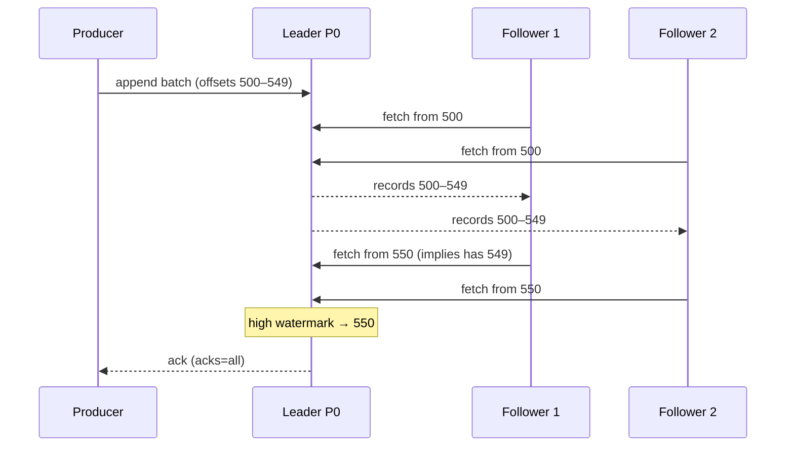

Design a distributed event streaming platform like Apache Kafka: producers append events to topics, consumers read them in order at their own pace, data is retained and replayable, and the system scales to millions of events per second without losing data.

## 1. Requirements

**Functional**
- Create topics; producers publish records (key, value, headers) to topics.
- Consumers read records in order per partition, track their position, and can rewind.
- Consumer groups share the work of a topic; different groups read independently.
- Retention by time/size, plus optional compaction (keep latest per key).

**Non-functional**
- High throughput: millions of records/s per cluster.
- Low latency: single-digit to tens of milliseconds end to end.
- Durability: acknowledged records are never lost if fewer than a quorum of replicas fail.
- Horizontal scalability; high availability through broker failures.
- Ordering guaranteed per partition.

> [!REAL] Designing your own Kafka
> This is designing something like Kafka: an append-only log split into partitions, replicated across machines, which many consumers read at their own pace.

## 2. Estimates

- 2M records/s × 1 KB = 2 GB/s ingest; × 3 replicas = 6 GB/s written cluster-wide.
- 7 days retention: 2 GB/s × 604,800 s ≈ 1.2 PB × 3 ≈ **3.6 PB**. Tiered storage (older segments in object storage) keeps broker disks manageable.
- If one broker sustains ~200 MB/s of writes including replication, we need ~30+ brokers.

## 3. Core abstractions

- **Topic** split into **partitions**; each partition is an ordered, append-only log.
- **Offset**: the position of a record in a partition.
- **Broker**: stores partition replicas and serves clients.
- **Controller**: manages cluster metadata (topics, partition leaders, ISR) via a consensus quorum.

See [Kafka Architecture](#/l/08-distributed/kafka-architecture) for the user-facing view; here we design the internals.

## 4. High-level design

## 5. Deep dives

### Storage layout on a broker
- Each partition is a directory of **segment files** (e.g. 1 GB each). Writes append to the active segment; old segments are immutable.
- Each segment has a sparse **offset index** (offset → file position) and a **time index** (timestamp → offset), so a consumer seeking to offset N or time T finds it with a binary search plus a short scan.
- **Retention** deletes whole old segments (cheap; no per-record deletes). **Compaction** rewrites old segments keeping the latest record per key.
- Writes are sequential; reads of recent data are served from the OS page cache; **zero-copy** (`sendfile`) sends bytes from page cache to sockets without copying through user space.

> [!REAL] Notebooks with numbered pages
> Each partition is a series of notebooks (segments). When one fills, a new one starts. Old notebooks are thrown away after the retention period, all at once, which is very cheap.

### Producing
- The producer fetches metadata (which broker leads each partition) and sends batches directly to leaders.
- Partition choice: hash of key (ordering per key) or sticky round-robin for keyless records.
- Batching (`linger.ms`, `batch.size`) and compression make throughput high.
- **Idempotence:** each producer gets an ID and per-partition sequence numbers; the leader rejects duplicates and out-of-order batches.

### Replication protocol
- Each partition has a **leader** and followers. Followers continuously **fetch** from the leader (pull-based replication, which is the same mechanism consumers use).
- The leader tracks the **ISR** (in-sync replicas): followers caught up within a time bound.
- The **high watermark** = the highest offset replicated to all ISR members. Consumers can only read up to the high watermark, so they never see records that could disappear in a failover.
- With `acks=all`, the leader acknowledges a write once all ISR members have it; `min.insync.replicas` sets a floor (e.g. 2 of 3), below which writes are rejected rather than accepted unsafely.

> [!REAL] Copies that must keep up
> Followers copy the leader's notebook. Only followers that are caught up (the in-sync replicas) can take over if the leader dies, so no confirmed message is lost.

### Leader election and metadata
- A **controller quorum** (Raft-based) stores cluster metadata as a replicated log: topics, partition assignments, leaders, ISR.
- Brokers heartbeat to the controller. When a broker dies, the controller picks new leaders for its partitions **from the ISR only** (no unclean elections), increments the **leader epoch**, and publishes the change.
- Leader epochs let followers truncate any divergent tail after a leadership change, keeping replicas consistent.

### Consuming and consumer groups
- Consumers **pull** batches from partition leaders starting at an offset (pull lets slow consumers go at their own pace and enables batching).
- A **group coordinator** (a broker) manages membership, assigns partitions to group members, and stores committed offsets in an internal compacted topic.
- Rebalances reassign partitions when members join/leave; cooperative assignment limits disruption. See [Kafka Consumer Rebalancing](#/l/08-distributed/kafka-rebalancing).

### Exactly-once processing
A **transaction coordinator** lets a producer atomically write to several partitions and commit consumer offsets; transaction markers in the log tell `read_committed` consumers which records to expose. See [Kafka Delivery Guarantees](#/l/08-distributed/kafka-delivery).

### Scaling and balancing
- Add brokers, then **reassign partitions** to them (copy replicas in the background, throttled, then switch leadership).
- Spread leaders evenly so no broker handles disproportionate traffic; rack/zone-aware replica placement so one zone failure doesn't lose all replicas.
- **Tiered storage** offloads old segments to object storage, decoupling retention from broker disk.

### Multi-region
Mirror topics between clusters asynchronously (replication tools) for disaster recovery and locality; or run a stretched cluster across nearby zones with synchronous replication when RPO must be zero.

## 6. Trade-offs

| Decision | Choice | Why |
|---|---|---|
| Storage | Append-only segmented logs | Sequential I/O; cheap retention |
| Replication | Leader-follower, pull-based, ISR | Durability with tunable latency |
| Read visibility | Up to high watermark | Never expose records that could be lost |
| Metadata | Raft controller quorum | Consistent leader election |
| Consumption | Pull with committed offsets | Independent pace, replay |
| Retention | Time/size + compaction + tiering | Flexible use cases, controlled cost |

> [!INTERVIEW] Show the durability chain
> Producer idempotence → leader append → followers fetch → ISR + high watermark → `acks=all` with `min.insync.replicas` → no unclean leader election. Walking through that chain shows you understand why acknowledged data survives failures.

## Key takeaways

- Partitions are segmented, append-only logs with offset and time indexes.
- Pull-based replication with ISR and a high watermark gives durability without exposing unsafe data.
- A Raft controller quorum handles metadata and leader election using leader epochs.
- Pull consumers, coordinator-managed groups and transactions complete the platform.
