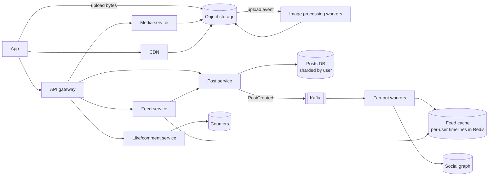
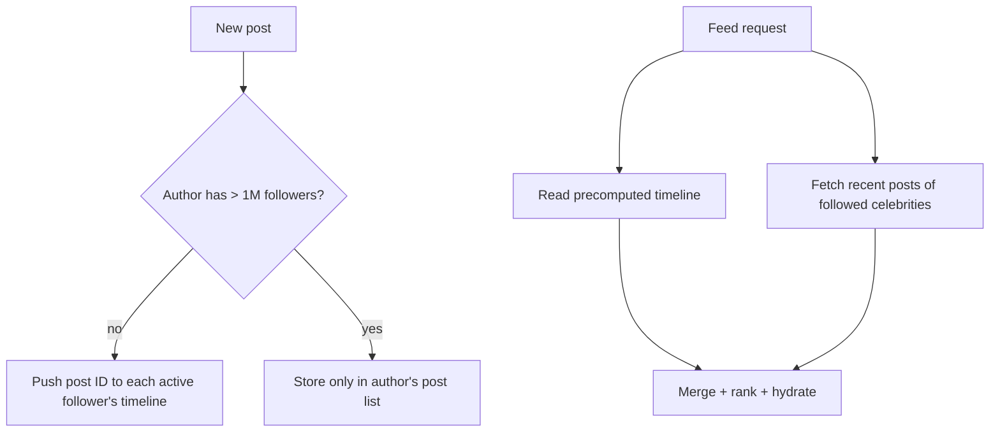

Design a photo-sharing service like Instagram: users upload photos, follow others, and scroll a home feed of posts from people they follow, with likes and comments.

## 1. Requirements

**Functional**
- Upload photos with captions.
- Follow / unfollow users.
- Home feed: recent posts from followed accounts (reverse-chronological or ranked).
- Like and comment on posts; view a user's profile grid.

**Non-functional**
- Feed loads fast (p99 < 300 ms) and is highly available.
- Uploads are durable; a few seconds' delay before followers see a post is fine (eventual consistency).
- Extremely read-heavy.
- Global users; celebrity accounts with 100M+ followers.

> [!REAL] Think Instagram
> When Facebook bought Instagram in 2012, it had over 30 million users and about 13 employees, running on PostgreSQL, Redis and object storage. The basic shape (upload to object storage, metadata in a database, feeds from caches) still holds at much larger scale.

## 2. Estimates

- 500M DAU; 100M photo uploads/day → ~1,200 uploads/s avg, ~3,500/s peak.
- Feed views: 500M × 10 = 5B/day → ~60K feed requests/s, ~150K/s peak.
- Photo storage: 100M × ~2 MB (original + several resized versions) ≈ 200 TB/day → **~70 PB/year**. Object storage, tiered.
- Metadata: 100M posts/day × 1 KB ≈ 100 GB/day.

## 3. API

```http
POST /v1/media/upload-url          → { uploadUrl, mediaId }   (pre-signed)
POST /v1/posts  { mediaId, caption }  Idempotency-Key → { postId }
GET  /v1/feed?cursor=&limit=20     → posts
POST /v1/users/{id}/follow | DELETE ...
POST /v1/posts/{id}/likes | DELETE ...
GET  /v1/users/{id}/posts?cursor=
```

## 4. High-level design



## 5. Deep dives

### Uploads
1. The client asks for a **pre-signed URL** and uploads the image **directly to object storage**, so app servers never handle the bytes.
2. An upload event triggers workers that validate, strip metadata (EXIF location!), create resized versions (thumbnail, 320, 640, 1080 px) and modern formats (WebP/AVIF), and run moderation.
3. The client then creates the post referencing the `mediaId`. Images are served via the CDN with long cache TTLs (immutable, versioned URLs).

> [!REAL] Dropping the parcel at the warehouse
> Your phone uploads the photo straight to object storage using a pre-signed URL, like dropping a parcel at the warehouse with a pre-paid slip. The app servers never have to carry the heavy bytes.

### Data model
- **Posts:** `(user_id, post_id, media_keys, caption, created_at)`, sharded by `user_id` so a profile grid is a single-shard range query. Use time-sortable IDs (Snowflake-style) so sorting by ID sorts by time.
- **Follow graph:** `followers(user_id → follower_ids)` and `following(user_id → followee_ids)`, both stored (denormalised) because both directions are queried. Wide-column or a graph-friendly store.
- **Likes:** `(post_id, user_id)` for "did I like this", plus **counters** kept separately.

### The feed: fan-out on write vs read

**Fan-out on write (push):** when a user posts, insert the post ID into each follower's precomputed timeline (a Redis list/sorted set capped at ~500 entries).
- Feed reads are a single fast cache read.
- A celebrity with 100M followers turns one post into 100M writes. Slow and wasteful, especially for inactive followers.

**Fan-out on read (pull):** when a user opens the feed, fetch recent posts from everyone they follow and merge.
- No write amplification.
- Slow reads for users following thousands of accounts.

**Hybrid (the standard answer):**
- Regular accounts: fan-out on write to followers' timelines (skip followers inactive for 30+ days; build theirs on demand).
- Celebrities (above a follower threshold): **not** fanned out. At read time, the feed service merges the user's precomputed timeline with recent posts from the few celebrities they follow.



> [!REAL] Newspaper delivery vs going to the stall
> Fan-out on write is delivering a copy of the newspaper to every subscriber's door as soon as it's printed. Fan-out on read is each reader walking to the stall when they want it. For a celebrity with 600 million followers, door-to-door delivery is impossible, so celebrity posts are fetched on read.

### Hydration and ranking
Timelines hold **post IDs only**. The feed service fetches post details, author info, like counts and "liked by me" in batched multi-gets from caches, then ranks (recency, engagement, affinity with the author) if the feed is ranked. Paginate with a cursor.

### Likes and counters at scale
A viral post can receive thousands of likes per second, so a single counter row is a hot spot.
- Record the like `(post_id, user_id)` idempotently (unique per pair).
- Increment a **sharded counter** (N sub-counters summed on read) or aggregate likes in a stream processor and update counts every few seconds. Exact real-time counts aren't required.

> [!REAL] The tally counter at the gate
> Instead of updating one number on every like, the system adds up likes in memory or in several counter shards and writes the total every few seconds. Nobody needs the exact like count to the millisecond.

### Caching
- CDN for all images.
- Redis for timelines, hot posts, user profiles, counters.
- Posts and profiles are read far more than written: cache-aside with delete-on-update.

### Availability and consistency
- A post appearing in followers' feeds a few seconds late is fine.
- The author must see their own post immediately (read-your-writes: insert into their own timeline synchronously, or merge their latest posts at read time).
- Deletes must propagate: remove from timelines asynchronously and filter deleted IDs at hydration time.

## 6. Trade-offs

| Decision | Choice | Why |
|---|---|---|
| Upload path | Pre-signed direct upload | Keeps large bytes off app servers |
| Feed | Hybrid fan-out | Fast reads without celebrity write storms |
| Timeline content | IDs only, hydrate at read | Small timelines, fresh details |
| Counters | Sharded / stream-aggregated | Avoid hot rows |
| Media storage | Object storage + CDN, tiered | Cost and global performance |

> [!INTERVIEW] The question behind the question
> "Design Instagram" is really "design a feed with a celebrity problem". Get to the fan-out discussion quickly and explain the hybrid approach with numbers: "a celebrity post with 100M followers would mean 100M timeline writes, so accounts above ~1M followers are pulled at read time instead".

## Key takeaways

- Upload directly to object storage with pre-signed URLs; process images asynchronously; serve via CDN.
- Hybrid fan-out: push for normal accounts, pull for celebrities.
- Timelines store IDs; hydrate and rank at read time.
- Handle hot counters with sharding or stream aggregation.
