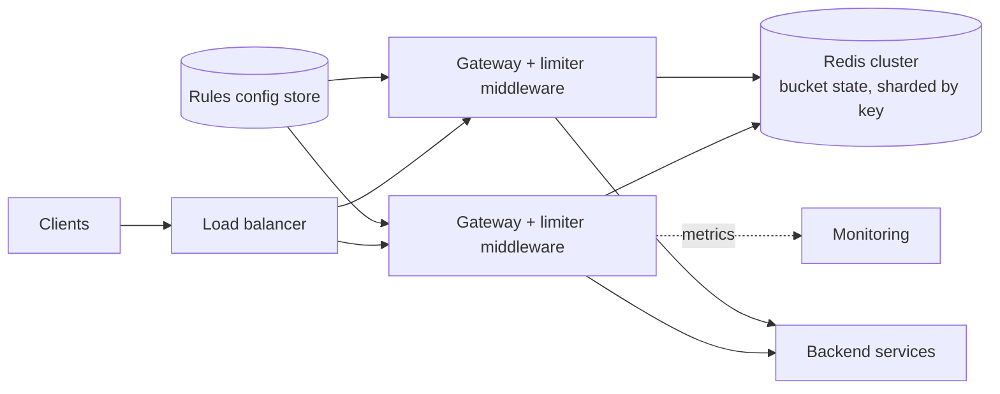

Design a distributed rate limiter that protects a fleet of API servers: limit each client to a configured number of requests per time window, consistently across all servers, with minimal added latency.

## 1. Requirements

**Functional**
- Limit requests per client key (user ID, API key, IP) and optionally per endpoint, e.g. 100 requests/minute per user, 5 logins/minute per IP.
- Different limits per plan (free vs paid) and per endpoint, configurable without deploys.
- Rejected requests get `429 Too Many Requests` with `Retry-After` and remaining-quota headers.

**Non-functional**
- Low latency: adds < 1–2 ms to each request.
- Accurate enough across many servers (small overshoot acceptable).
- Highly available: the limiter failing must not take down the API.
- Scales to millions of clients and hundreds of thousands of requests per second.

> [!REAL] OTP and login limits
> "Too many OTP requests, try after 30 minutes" is a rate limiter. Without it, an attacker could trigger thousands of paid SMSs or try every 4-digit PIN.

## 2. Estimates

- 500K requests/s across the API fleet; 10M distinct client keys per day.
- State per key for a token bucket: ~2 numbers + key ≈ 50–100 bytes → 10M keys ≈ 1 GB. Fits in memory on a small Redis cluster.
- Redis handles ~100K ops/s per node with scripts; 500K checks/s → ~6–10 shards with headroom.

## 3. Where does it run?

| Placement | Pros | Cons |
|---|---|---|
| Client-side | Saves server work | Can't be trusted |
| Edge/CDN/WAF | Stops floods early | Coarse (usually per IP) |
| API gateway / middleware | Central, per-user/key aware | Needs shared state across instances |
| Inside each service | Business-specific quotas | Duplicated logic |

Typical design: coarse per-IP limits at the edge, per-user/key limits at the gateway, and business quotas in services. We'll design the gateway limiter.

> [!REAL] The guard at the gate vs inside every flat
> Rate limiting at the API gateway is the society guard stopping a flood of visitors at the gate. Limiting inside each service is every flat checking for itself: more precise, but slower to set up everywhere.

## 4. Algorithm

Use a **token bucket** per (key, rule): capacity B allows bursts, refill rate R sets the sustained limit. Alternatives (sliding window counter for strict "N per minute") are covered in [Rate Limiting Algorithms](#/l/08-distributed/rate-limiting).

## 5. High-level design



**Per request**
1. Middleware identifies the client (API key → plan; else user ID; else IP) and matches rules for the endpoint (rules cached locally, refreshed from the config store).
2. For each applicable rule, run one atomic Redis Lua script that refills and takes a token. Use pipelining to check multiple rules in one round trip.
3. If allowed, forward the request and add `RateLimit-Remaining` headers; if not, return 429 with `Retry-After`.

### Atomicity
A naive `GET` then `SET` from two gateways races and lets extra requests through. A Lua script runs atomically in Redis, so refill-check-decrement is one step. Keys auto-expire when idle (`PEXPIRE`), so inactive clients cost no memory.

> [!REAL] Two clerks, one counter
> If two servers both read "9 of 10 used" and both allow a request, the user gets 11. A Redis Lua script or `INCR` makes "check and add" a single step so that can't happen.

### Rules configuration

```yaml
- match: { plan: free, path: "/v1/*" }
  limit: { capacity: 20, refillPerSec: 1.67 }   # ~100/min, bursts of 20
- match: { path: "/v1/login" }
  key: ip
  limit: { capacity: 5, refillPerSec: 0.083 }    # 5/min
- match: { plan: enterprise }
  limit: { capacity: 2000, refillPerSec: 500 }
```

## 6. Deep dives

### Scaling the state
- Shard Redis by key hash (Redis Cluster). All rules for a key can use a hash tag (`{user42}:...`) so they land on the same shard and one script can check them together.
- Replicas for failover. Rate-limit state is soft, so losing a few seconds of it on failover is acceptable.

### Reducing latency and load
- **Local pre-check:** each gateway keeps a small in-memory token bucket per hot key and only consults Redis periodically or when near the limit.
- **Batching/sync:** gateways count locally and sync increments to Redis every ~100 ms, accepting slight overshoot in exchange for far fewer Redis calls.
- **Sticky routing:** consistent-hash clients to gateways so each key is mostly handled by one node, making local state accurate.

### Failure handling
If Redis is unreachable or slow (check with a tight timeout, e.g. 5 ms):
- **Fail open** with a conservative local limit: the API stays up; abuse is temporarily less constrained. The usual choice.
- **Fail closed** for highly sensitive endpoints (e.g. OTP sending), protecting downstream at the cost of availability.
- Circuit-break Redis calls so a degraded Redis doesn't add latency to every request.

> [!REAL] If the guard is missing, open or shut the gate?
> If Redis is down, do you allow everyone (fail open) or block everyone (fail closed)? Most products fail open for normal APIs and fail closed for sensitive ones like login attempts.

### Multi-region
Options: independent limits per region (simple; a client could get N× limit across regions), or a global budget split across regions with periodic rebalancing. Most APIs accept per-region limits.

### Clock and accuracy
Use Redis server time (inside the script) rather than gateway clocks to avoid skew. Accept small overshoot; exactness across a distributed system costs far more than it's worth.

### Observability and abuse response
- Metrics: allowed vs throttled by rule, plan and endpoint; top throttled keys.
- Alert on sudden throttling spikes (could be an attack, or a customer's broken retry loop).
- Allow temporary overrides for specific customers.

### Client experience
Return clear headers, document limits, and encourage exponential backoff with jitter on 429.

> [!REAL] "Try again in 30 seconds"
> A good limiter returns HTTP 429 with a `Retry-After` header, so well-behaved apps wait the right amount of time instead of hammering the server.

## 7. Trade-offs

| Decision | Choice | Alternative |
|---|---|---|
| Algorithm | Token bucket | Sliding window counter for strict per-minute fairness |
| State | Central Redis, Lua for atomicity | Local only (fast, inaccurate across nodes) |
| Failure mode | Fail open + local fallback | Fail closed for sensitive endpoints |
| Accuracy vs latency | Local caching / batched sync | Redis call per request |

> [!INTERVIEW] What makes the answer strong
> Name the algorithm and why, show the atomic Redis script idea, discuss fail-open vs fail-closed explicitly, and mention layered limits (edge per IP, gateway per user, service per business rule).

## Key takeaways

- Token buckets per key and rule, stored in a sharded Redis, updated atomically with Lua.
- Rules are configuration, cached locally in gateways.
- Reduce latency with local pre-checks or batched sync; decide fail-open vs fail-closed.
- Layer limits from the edge to services, and return clear 429 responses.
