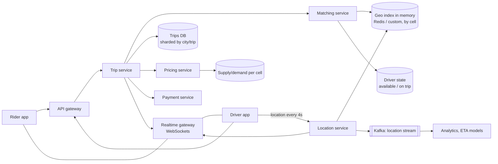

Design a service like Uber or Ola: riders request a trip, nearby drivers are matched within seconds, both see each other's live location, and the trip is priced and paid for.

## 1. Requirements

**Functional**
- Riders request a ride from pickup to drop-off and see an estimated fare and ETA.
- The system matches the rider with a nearby available driver; the driver accepts or declines.
- Rider and driver see each other's live location during pickup and trip.
- Trip lifecycle: requested → matched → driver arriving → in progress → completed / cancelled.
- Fare calculation (with surge pricing), payment and receipts.
- Out of scope today: pooling, scheduled rides, ratings deep dive, driver onboarding.

**Non-functional**
- Matching within a few seconds; location updates feel real-time (1–2 s lag).
- High availability: a city must not go dark.
- Consistency: a driver must never be assigned to two trips at once; payments exactly once.
- Scale: global, with heavy city-level hot spots (stadiums, airports, rain).

> [!REAL] Think Uber, Ola or Rapido
> Every few seconds, each active driver's phone sends its GPS location. A rider's request must find nearby free drivers within a second or two, offer the trip to one, and never give the same driver to two riders.

## 2. Estimates

- 20M daily trips; peak ~3× average → ~700 trip requests/s at peak.
- 5M drivers online at peak, each sending a GPS update every 4 s → **~1.25M location writes/s**. This is the dominant load.
- Location update ≈ 100 bytes → ~125 MB/s of ingest; we only need the **latest** position for matching (history goes to cold storage for analytics).

The key insight: location writes are huge in volume but tiny, ephemeral and only the latest value matters. That points to an in-memory geospatial store, not a relational database.

## 3. API (simplified)

```http
POST /v1/trips/estimate        { pickup, dropoff } → { fare, eta, surge }
POST /v1/trips                 { pickup, dropoff, estimateId }  Idempotency-Key → { tripId, status }
GET  /v1/trips/{id}            → trip details and status
POST /v1/trips/{id}/cancel
WS   /v1/realtime              driver location pushes, trip status events

Driver app:
POST /v1/drivers/me/location   { lat, lng, heading, ts }   (or over the WebSocket)
POST /v1/offers/{id}/accept | /decline
```

## 4. High-level design



**Request flow**
1. Rider asks for an estimate: the pricing service computes base fare from route distance/time (from a routing/ETA service) and a surge multiplier for the pickup cell.
2. Rider confirms: the trip service creates a trip (`REQUESTED`) idempotently and asks matching for a driver.
3. Matching queries the geo index for available drivers near the pickup, ranks them by ETA, and sends an offer to the best one with a short timeout (~10 s). If declined or timed out, it offers to the next.
4. On accept, matching **atomically** flips the driver from `AVAILABLE` to `ON_TRIP` (only if still available), and the trip becomes `MATCHED`.
5. During the trip, the driver's location flows through the location service; the realtime gateway pushes it to the rider.
6. On completion, the final fare is computed from the actual route, and payment is charged.

## 5. Deep dives

### Finding nearby drivers: geospatial indexing
Scanning all drivers is impossible. Divide the map into cells:
- **Geohash:** encode lat/lng into a string where nearby points share prefixes; a cell of ~1.2 km × 0.6 km is 6 characters. Search the cell plus its 8 neighbours.
- **Quadtree:** recursively split dense areas into smaller cells, so dense downtowns get fine cells and rural areas coarse ones.
- **Hexagonal grids (H3)** or Google **S2**: uniform neighbour distances and hierarchical resolutions; popular for ride-sharing because distances to all neighbours are equal.

Store `cell → set of available driver IDs` in memory (e.g. Redis `GEOADD`/`GEOSEARCH`, or a custom in-memory service partitioned by cell or city). Each location update moves the driver between cells only when they cross a boundary.

**Partitioning:** shard the geo index by city/region. Hot cells (airport) can be split further or handled by more replicas.

> [!REAL] Grid squares on a city map
> Draw a grid over the city. To find drivers near you, look in your square and the eight around it, not the whole city. Geohash, quadtrees and Uber's open-source H3 hexagon grid are all versions of that grid.

### Matching
- Candidates: available drivers within N km (expand the radius if too few).
- Rank by **ETA** from a routing engine, not straight-line distance (a driver across a river is far away).
- Consider fairness (driver idle time), acceptance rates and vehicle type.
- **Batch matching:** instead of greedy one-by-one, collect requests in a city over ~1–2 s and solve an assignment problem across all of them to reduce total pickup time.

### Never double-assign a driver
Two matchers might pick the same driver for different riders at the same moment. Use an atomic conditional update on driver state:

```text
SET driver:981:state ON_TRIP:trip_55 only if current = AVAILABLE   (Redis WATCH/Lua, or DB conditional UPDATE)
```

Only one succeeds; the loser moves to its next candidate. Driver state lives in one partition per driver so the check is local.

> [!REAL] The last seat in the auto
> Two riders mustn't both get the same driver. A short lock or an atomic "set driver status from available to offered" ensures only one request wins.

### Location ingestion at 1.25M writes/s
- Drivers send updates over a persistent connection; the location service validates and updates the in-memory index (last position only).
- Updates are also published to **Kafka** for trip tracking, ETA model training, fraud detection and billing (distance travelled).
- Clients can adapt the frequency: every 4 s when available, every 1–2 s during a trip, less when stationary.

### Real-time updates to riders
A WebSocket gateway keeps a connection per active app. The gateway registers `user → gateway node` in a presence store; trip and location events are routed through pub/sub to the node holding the rider's connection. Fall back to push notifications when the app is in the background.

### Surge pricing
Per cell, compute demand (open requests) vs supply (available drivers) over a sliding window with a stream processor; publish a multiplier per cell every ~30–60 s. Lock the quoted price with the estimate ID for a few minutes so the rider pays what they saw.

> [!REAL] Rain in Mumbai at 6 p.m.
> When demand in an area outruns supply, prices rise there to pull in more drivers and cool demand. The system computes demand and supply per grid cell every minute or so.

### Trip state and payments
- Trip service is the source of truth; state transitions are validated (can't complete a cancelled trip) and stored in a sharded relational/NewSQL database (shard by trip ID or city).
- Payment: authorise an estimated amount at request time, capture the final amount at completion, with idempotency keys. See [Design a Payment System](#/l/11-payments-uploads/payment-architecture).

### Failures
- Location service node dies → drivers reconnect to another; the index rebuilds from the next updates within seconds (state is ephemeral by design).
- Matching unavailable in a region → retry; riders see "finding a driver" a bit longer.
- Region outage → city traffic fails over to another region; in-flight trips continue using the last known state replicated from the trips DB.

## 6. Trade-offs to mention

| Decision | Choice | Why |
|---|---|---|
| Location storage | In-memory latest position + Kafka history | Volume is huge, only latest needed for matching |
| Spatial index | H3/S2 or geohash cells | Constant-time neighbourhood lookup |
| Matching | ETA-ranked, optionally batched | Better pickup times than straight-line greedy |
| Driver assignment | Atomic conditional state update | Prevents double booking |
| Trip data | Strongly consistent, sharded store | Correctness of lifecycle and billing |
| Analytics | Eventual, via streams | Doesn't block the ride |

> [!INTERVIEW] Where to spend your time
> The interesting parts are geospatial indexing, the location write volume and preventing double assignment. Spend the deep-dive time there, not on login or ratings.

## Key takeaways

- Location updates dominate load: keep only the latest position in memory and stream history.
- Index drivers by geographic cells (geohash, quadtree, H3/S2) and rank candidates by ETA.
- Assign drivers with an atomic state transition to avoid double booking.
- WebSockets plus pub/sub deliver live updates; trips and payments stay strongly consistent.
