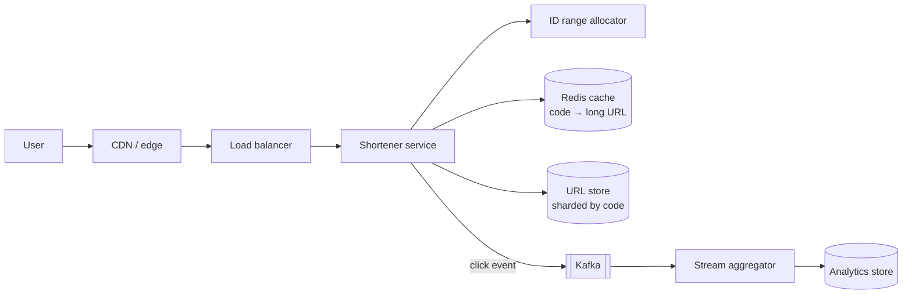

Design a service like TinyURL or bit.ly: turn a long URL into a short code, redirect visitors from the short code to the original URL, and count clicks.

## 1. Requirements

**Functional**
- Create a short URL for a long URL; optionally a custom alias and expiry.
- Visiting the short URL redirects to the long URL.
- Basic analytics: click counts, by day, country, referrer.

**Non-functional**
- Redirects are **very fast** (p99 < 50 ms) and **highly available**: broken links are very visible.
- Read-heavy: ~100 redirects per creation.
- Short codes must be unique and should not be easily guessable in sequence (to avoid enumeration).
- Durable: links shouldn't disappear.

## 2. Estimates

- 100M new URLs/month → ~40 writes/s average, ~100/s peak.
- 100:1 read ratio → ~4,000 redirects/s average, ~10–20K/s peak (viral links spike far higher).
- Storage: 100M × 12 months × 5 years = 6B URLs × ~500 bytes ≈ **3 TB**. Comfortable for a sharded or NoSQL store.
- Code length: base62 (`a–z`, `A–Z`, `0–9`) with 7 characters = 62⁷ ≈ **3.5 trillion** codes, which is plenty.

## 3. API

```http
POST /v1/urls        { longUrl, alias?, expiresAt? }  → 201 { code, shortUrl }
GET  /{code}         → 301/302 Location: longUrl   (or 404 / 410 if expired)
GET  /v1/urls/{code}/stats → { clicks, daily[], topCountries[] }
DELETE /v1/urls/{code}
```

**301 vs 302:** a 301 (permanent) lets browsers cache the redirect, which reduces load but means you miss analytics for repeat visits and can't change the target. A 302 (or 307) always comes back to you. Use 302 when analytics matter; 301 when they don't.

## 4. Data model

```text
urls
  code        (PK)  "aZ3k9Qx"
  long_url          "https://example.com/very/long/path?..."
  owner_id
  created_at
  expires_at
```

The only hot query is "get long_url by code", a pure key lookup. A key-value or wide-column store (DynamoDB, Cassandra) fits perfectly; a sharded relational database also works.

## 5. Generating short codes

### Option A: hash the URL
`base62(first 43 bits of SHA-256(longUrl))`. Same URL → same code (natural deduplication). But collisions must be detected and resolved (append a salt and retry), and two users shortening the same URL share a code (bad if they want separate analytics).

### Option B: counter + base62 encoding
A global unique number, encoded in base62: `125 → "21"`. Short and collision-free. Problems: a single counter is a bottleneck and SPOF, and sequential codes are guessable.

### Option C: pre-allocated ID ranges (recommended)
A **key-generation service** hands out ranges of IDs (e.g. blocks of 10,000) to each app server, which encodes them locally. Coordination happens once per block, not per request.
- Store range allocation in a small strongly consistent store (ZooKeeper/etcd or a DB row with an atomic increment).
- To avoid guessable sequences, apply a reversible scramble (e.g. a keyed permutation / Feistel network over the 42-bit ID) before base62 encoding.
- A server that crashes wastes the rest of its block. That's fine with trillions available.

### Option D: random codes
Generate 7 random base62 characters and insert with a uniqueness check (`PUT if not exists`). Simple and unguessable; collisions are rare at first but grow as the space fills, so retry on conflict.

**Custom aliases:** insert with a conditional "only if not exists"; return `409` if taken.

## 6. High-level design



**Redirect path (the hot path)**
1. `GET /aZ3k9Qx` reaches the nearest edge/region.
2. Look up `code` in Redis. On a hit, redirect immediately (~1 ms).
3. On a miss, read from the URL store, populate the cache, redirect.
4. Asynchronously publish a click event (code, timestamp, country from IP, referrer, user agent) to Kafka. **Never** make the redirect wait for analytics.

**Create path**
1. Validate the URL (scheme, length, optional malware/phishing check).
2. Get the next ID from the local block, scramble, encode.
3. Write to the URL store; optionally pre-warm the cache.

## 7. Deep dives

### Caching
Link popularity follows a power law, so a modest cache gives a very high hit ratio. Cache-aside with LRU/LFU eviction; a long TTL is fine because mappings rarely change (delete on update or delete). For extremely viral links, cache at the CDN edge too: the redirect response itself can be cached briefly.

### Scaling the store
Shard by `code` (hash-based) so lookups go to exactly one shard. Replicate for availability. 3 TB over five years is modest.

### Analytics
Count clicks via a stream processor that aggregates per code per minute/hour/day and writes rollups to a time-series or columnar store. Raw events go to a data lake for deeper analysis. Approximate counts (HyperLogLog) work for unique visitors.

### Expiry and cleanup
Store `expires_at`; the redirect path checks it (return 410 Gone). A background job, or the store's native TTL, deletes expired rows. Codes can be recycled only after a long quarantine, or never.

### Abuse
Rate-limit creation per user/IP, scan target URLs against malware/phishing lists, allow reporting and disabling links, and avoid sequential codes.

### Availability
Multi-AZ replicas for the store, Redis with replicas, stateless app servers, and multi-region with replicated data for the redirect path (it's read-only, so active-active is easy). Creation can go to one primary region.

## 8. Trade-offs

| Decision | Choice | Alternative |
|---|---|---|
| Code generation | ID ranges + scramble + base62 | Hashing (dedup, collisions), random (simple, retries) |
| Redirect code | 302 for analytics | 301 for less load |
| Store | KV/wide-column sharded by code | Sharded SQL |
| Analytics | Async via Kafka | Synchronous counter updates (slows redirects, hot rows) |

> [!INTERVIEW] Emphasise the asymmetry
> "Reads are 100× writes and latency-critical, so the redirect path is a single cache lookup with the database behind it, and analytics are fully asynchronous. Writes are rare, so generating IDs from pre-allocated ranges is cheap and avoids collision checks."

## Key takeaways

- Base62 with 7 characters gives trillions of codes.
- Pre-allocated ID ranges avoid a central bottleneck; scramble to prevent enumeration.
- The redirect path is cache → store, with analytics sent asynchronously.
- Choose 301 vs 302 based on whether you need every click.
