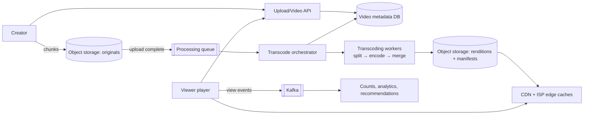
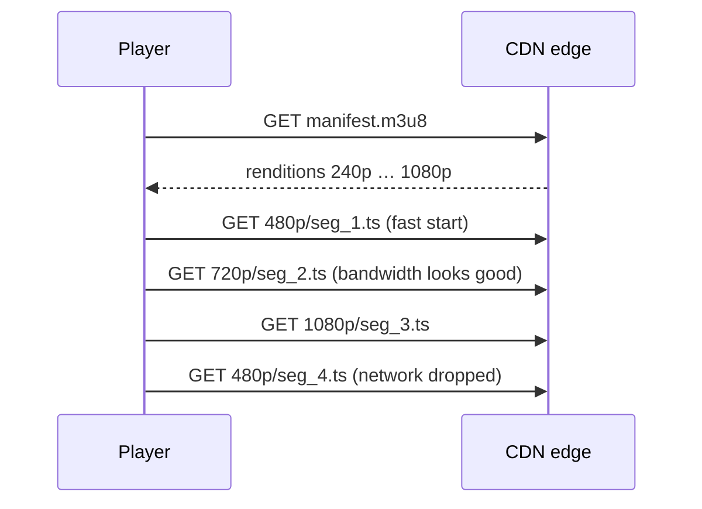

Design a video platform like YouTube: creators upload videos, the platform processes them into streamable formats, and viewers around the world watch smoothly on any device and network.

## 1. Requirements

**Functional**
- Upload videos (up to several GB) with title, description, thumbnail.
- Watch videos with adaptive quality, seeking, and resume.
- Search and browse; view counts, likes, comments; recommendations (brief).

**Non-functional**
- Playback starts fast (< 2 s) and rarely buffers, worldwide.
- Uploads are reliable and resumable; processing can take minutes.
- Massive scale: ~500 hours of video uploaded per minute; billions of views per day.
- Cost efficiency: storage and bandwidth dominate the bill.

## 2. Estimates

- Uploads: 500 h/min ≈ 720K hours/day. Raw ~1 GB/hour (compressed source) → ~720 TB/day of originals.
- Processed renditions (240p–4K, 2 codecs) add maybe 2–3× → **~2 PB/day** of new storage before replication.
- Views: 5B/day; average 5 min at ~3 Mbps ≈ 110 MB per view → **~550 PB/day of egress**. Only a CDN with a very high hit ratio, plus edge caches inside ISPs, makes this feasible.

Clearly: storage tiers and CDN design are the heart of this problem.

## 3. API

```http
POST /v1/uploads            { filename, size, contentType } → { uploadId, partUrls[] }
PUT  {partUrl}              (direct to object storage, per chunk)
POST /v1/uploads/{id}/complete
POST /v1/videos  { uploadId, title, description, visibility } → { videoId, status: PROCESSING }
GET  /v1/videos/{id}        → metadata + manifest URL when READY
GET  /v1/videos/{id}/manifest.m3u8 (via CDN)
POST /v1/videos/{id}/views  (batched heartbeats from player)
```

## 4. High-level design



## 5. Deep dives

### Uploading large files
- Split into chunks (e.g. 5–16 MB); upload each directly to object storage with pre-signed URLs, in parallel and **resumable** (retry only failed chunks). See [Design a Scalable File Upload System](#/l/11-payments-uploads/file-upload).
- On completion, the storage event triggers processing. Metadata status: `UPLOADING → PROCESSING → READY` (or `FAILED`).

### Transcoding pipeline
One upload must become many outputs:
- **Renditions:** multiple resolutions and bitrates (240p … 4K), plus codecs (H.264 for compatibility; VP9/AV1 for efficiency).
- **Segmentation:** cut each rendition into 2–6 second segments with a **manifest** (HLS `.m3u8` / DASH `.mpd`) listing them.
- **Extras:** thumbnails, preview sprites, audio tracks, captions, content checks (copyright fingerprinting, moderation).

To process fast, the orchestrator **splits the video into chunks** (by GOP/scene boundaries) and encodes them **in parallel** across many workers, then stitches the results. The pipeline is a DAG of tasks, each retryable and idempotent, so a failed worker just reruns its chunk.

Popular videos can be **re-encoded** later with more expensive, more efficient settings; long-tail videos get cheaper encodes. Encoding effort follows popularity.

### Adaptive bitrate streaming (ABR)
The player downloads the manifest, starts with a low/medium bitrate for a fast start, measures throughput and buffer level, and switches rendition **per segment**. Bad network → lower quality instead of buffering. Segments are plain HTTP objects, so CDNs cache them perfectly.



### Delivery: CDN and edge caching
- Segments are immutable → long TTLs and very high hit ratios.
- **Tiered caching:** edge PoPs → regional shields → origin storage.
- **ISP-embedded caches** (appliances inside ISPs' networks) serve popular content without crossing the internet.
- **Pre-positioning:** push expected-popular content (a new episode) to edges ahead of demand.
- **Long tail:** most videos are rarely watched; they're served from origin/regional tiers, and that's fine.

### Storage tiers and cost
- Hot (recently uploaded/popular): standard object storage, many renditions.
- Cold (rarely watched): infrequent-access tiers; drop rarely used renditions and regenerate on demand.
- Originals: archived to the cheapest tier for re-encoding later.

### Metadata, search and views
- Video metadata in a sharded database (by video ID), cached heavily; search via an inverted index (Elasticsearch) fed by change events.
- **View counts:** the player sends batched heartbeats; events flow into Kafka; a stream job deduplicates (per user/session) and aggregates; counts update every few seconds. Never increment a DB row per view.
- Watch history and resume position stored per user (wide-column), written periodically during playback.

### Recommendations (briefly)
Candidate generation (collaborative filtering, embeddings) + ranking models over watch history, computed offline and refreshed with streaming signals. Served from precomputed per-user lists.

## 6. Trade-offs

| Decision | Choice | Why |
|---|---|---|
| Upload | Chunked, resumable, direct to storage | Reliability for multi-GB files |
| Processing | Parallel chunked transcoding DAG | Speed; retry granularity |
| Formats | Several resolutions × codecs, segmented | ABR + device compatibility |
| Encoding effort | Proportional to popularity | Cost control |
| Delivery | Multi-tier CDN + ISP caches | Egress cost and latency |
| Counts | Stream-aggregated, approximate in real time | Avoid hot rows |

> [!INTERVIEW] Follow the bytes
> Organise the answer around the life of a video: upload → transcode → store → deliver. Most of the cost and complexity is in transcoding and delivery, so spend your deep-dive time there.

## Key takeaways

- Chunked, resumable uploads straight to object storage.
- Parallel transcoding into segmented multi-bitrate renditions with manifests.
- Adaptive bitrate players switch quality per segment; segments cache perfectly on CDNs.
- Tier storage and encoding effort by popularity; aggregate views via streams.
