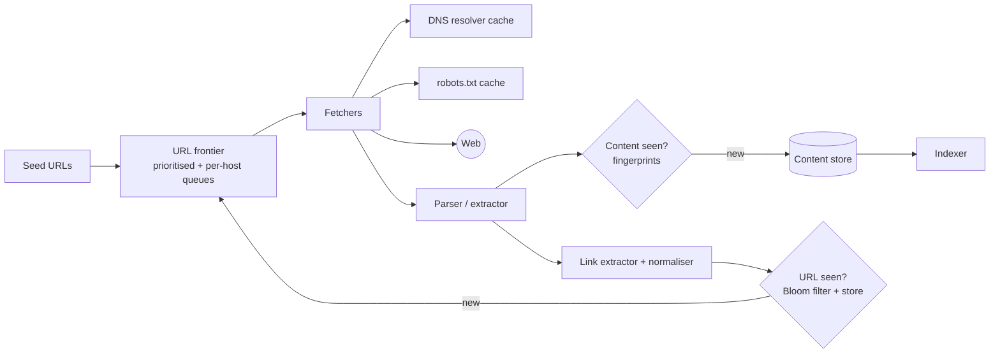
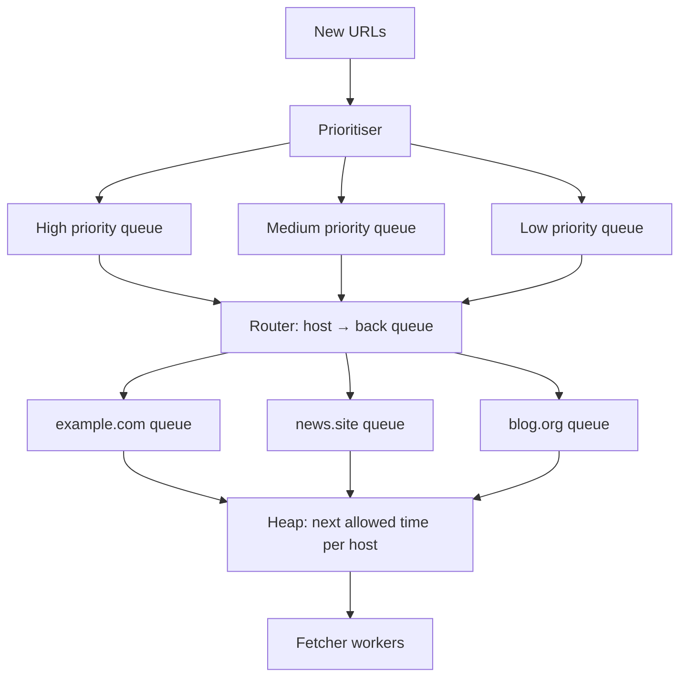

Design a web crawler like Googlebot: starting from seed URLs, continuously discover and download billions of web pages, politely and efficiently, and hand them to an indexer.

## 1. Requirements

**Functional**
- Fetch pages starting from seed URLs; extract links; crawl newly discovered URLs.
- Store page content for indexing.
- Re-crawl pages periodically based on how often they change.

**Non-functional**
- **Scale:** billions of pages; thousands of pages per second.
- **Politeness:** never overload a website; obey `robots.txt` and crawl-delay.
- **Robustness:** malformed HTML, slow servers, spider traps, huge files, redirects loops.
- **Freshness and priority:** important and frequently changing pages are crawled more often.
- **Extensible:** add new content types or processing later.

> [!REAL] Think Googlebot
> Googlebot visits billions of pages, again and again, without overloading any one website. The crawler is a huge, polite to-do list of URLs.

## 2. Estimates

- Target: 1B pages per month → ~400 pages/s average; aim for ~1,000+/s.
- Average page ~100 KB (HTML) → 100 TB/month raw; compressed ~20–30 TB.
- URL frontier: tens of billions of known URLs → frontier and "seen" sets must live on disk/distributed stores, with Bloom filters in memory.

## 3. The crawl loop

1. **Frontier** picks the next URL respecting priority and politeness.
2. **Fetcher** resolves DNS (cached), checks `robots.txt` (cached per host), downloads the page with timeouts and size limits.
3. **Parser** extracts text, metadata and links.
4. **Content dedup**: skip pages whose content we've already stored (mirrors, duplicates).
5. **Link processing**: normalise URLs, filter, check whether seen, add new ones to the frontier.
6. **Store** content and hand it to indexing.

## 4. Deep dives

### The URL frontier: priority + politeness
The frontier has two jobs that pull in different directions: crawl important URLs first, but never hit one host too hard.

A common design (Mercator-style):
- **Front queues (priority):** URLs are assigned a priority (PageRank-like importance, freshness need, sitemap hints) and placed in one of several priority queues. A selector biases toward high-priority queues.
- **Back queues (politeness):** each back queue holds URLs for **one host**; a heap tracks the earliest time each host may be contacted again (based on crawl-delay or our own minimum gap, e.g. 1 request per second per host). A fetcher thread takes the host whose time has come, fetches one URL, and reschedules the host.

> [!REAL] A delivery agent's route
> A delivery agent visits many houses but never rings the same doorbell 50 times a minute. The frontier keeps one queue per website and waits between requests to the same site.

### Distribution
- Partition the work **by host** (hash of hostname → crawler node). Each node owns its hosts' politeness state, DNS and robots caches. No cross-node coordination per request.
- Newly discovered URLs are routed to the owning node via a queue (Kafka).
- Nodes can be placed in several regions to crawl sites geographically close.

### Have we seen this URL?
- **Normalise** first: lowercase host, remove default ports, resolve relative links, strip fragments and tracking parameters, sort query params.
- Check a **Bloom filter** (fast, in memory, small false-positive rate means occasionally skipping a new URL, which is acceptable), backed by a persistent URL store for exact state (last crawl time, status, priority).

> [!REAL] The visitors' register
> Before visiting, check the register: have we already been here? With billions of URLs, a Bloom filter answers "definitely not seen" cheaply.

### Have we seen this content?
Different URLs often serve the same content. Compute a **fingerprint**:
- Exact duplicates: a hash (e.g. SHA-256) of normalised content.
- Near-duplicates: **SimHash** or MinHash, where similar documents produce similar fingerprints, so pages differing only by ads or timestamps are detected.

> [!REAL] The same news article on 50 sites
> A news agency story is republished on 50 websites. Content fingerprints (hashes) stop the crawler from storing and indexing 50 copies.

### Politeness and robots.txt
- Fetch and cache `robots.txt` per host (refresh daily); obey disallow rules and crawl-delay.
- Limit concurrent connections per host and per IP (many hosts share one server).
- Identify the crawler in the User-Agent with a contact URL.
- Back off on 429/503 responses and slow responses.

### Robustness and traps
- **Spider traps:** infinite calendars, session IDs in URLs, endlessly deep paths. Limit URL length and depth, cap pages per host per crawl cycle, detect repeating path patterns.
- Timeouts (connect and read), maximum page size, limited redirect hops, content-type filtering.
- Parsing in sandboxed workers; malformed pages shouldn't crash the pipeline.

> [!REAL] An endless calendar
> A calendar page with a "next month" link goes on forever. Limit depth, URL length and pages per site so the crawler doesn't wander into infinity.

### DNS
DNS lookups can be a major bottleneck at thousands of fetches per second. Run local caching resolvers and asynchronous resolution; cache results per host for their TTL.

### Freshness: re-crawl scheduling
Estimate each page's change rate from history (did the content fingerprint change since last time?). Recrawl news home pages every few minutes, stable pages every few weeks. Use sitemaps, `Last-Modified`/`ETag` conditional requests (`If-Modified-Since` → 304 saves bandwidth) and RSS feeds as hints.

### Storage
- Raw content in compressed batches in object storage or a distributed file system (WARC-like files), keyed by URL hash and crawl time.
- URL metadata (status, last crawl, fingerprint, priority) in a distributed key-value/wide-column store.
- Extracted text and links streamed to the indexing pipeline.

### JavaScript-heavy sites
Some content appears only after JS runs. A separate **rendering service** (headless browsers) handles a subset of pages, since rendering is far more expensive than plain fetching.

## 5. Trade-offs

| Decision | Choice | Why |
|---|---|---|
| Work partitioning | By host | Politeness state stays local |
| Frontier | Priority front queues + per-host back queues | Importance and politeness together |
| URL dedup | Normalisation + Bloom filter + store | Memory-efficient at billions of URLs |
| Content dedup | Hash + SimHash | Exact and near-duplicates |
| Freshness | Adaptive recrawl by change rate | Spend effort where pages change |

> [!INTERVIEW] Politeness is the differentiator
> Many candidates design a fast crawler and forget it would DDoS small websites. Explaining per-host back queues with a next-allowed-time heap, robots.txt and adaptive backoff signals real-world awareness.

## Key takeaways

- The crawl loop: frontier → fetch → parse → dedup → store → extract links → frontier.
- The frontier balances priority (front queues) and politeness (per-host back queues).
- Partition by host; dedup URLs with normalisation + Bloom filters and content with fingerprints.
- Guard against traps, cache DNS and robots.txt, and recrawl adaptively.
