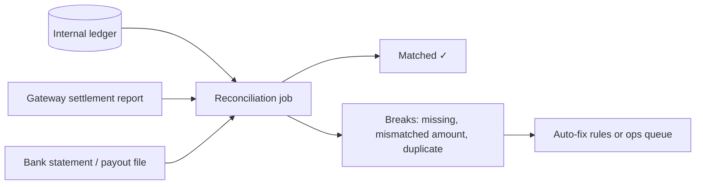

A ledger is the system of record for money. The accounting world solved "how do we never lose track of money" centuries ago with **double-entry bookkeeping**. Payment systems use the same idea, and add **reconciliation** to make sure the ledger agrees with banks and gateways.

## Why not just a balance column?

`UPDATE wallets SET balance = balance - 500 WHERE user_id = 42` works until:
- a bug or race leaves the balance wrong and there's no record of how it got there,
- auditors ask "where did this ₹500 go?",
- you need the balance as of last Tuesday.

A balance should be **derived from immutable entries**, not edited in place.

> [!REAL] The shopkeeper's khata
> If a shopkeeper only writes "Sharma ji owes ₹540" and erases it each time, he can't prove how it got there. A ledger lists every entry, so the balance can always be recomputed and checked.

## Double-entry in one rule

Every transaction is recorded as **at least two entries** that **sum to zero**: money always comes *from* somewhere and goes *to* somewhere.

Asha pays Ravi ₹500 in a wallet app:

| Entry | Account | Debit | Credit |
|---|---|---|---|
| 1 | Asha's wallet | ₹500 | |
| 2 | Ravi's wallet | | ₹500 |

(Using "debit reduces a user wallet liability, credit increases it" conventions; the exact sign convention matters less than the rule that **debits = credits** for every transaction.)

A card payment of ₹1,000 with a ₹20 fee might post:

| Account | Debit | Credit |
|---|---|---|
| Gateway receivable | ₹1,000 | |
| Merchant payable | | ₹980 |
| Fee revenue | | ₹20 |

If any transaction doesn't balance, something is wrong and the system rejects it. Money can't be created or destroyed by accident.

> [!REAL] Money never appears or disappears
> When you send ₹500 to a friend, your account gets −₹500 and theirs gets +₹500. Every transaction's entries add up to zero, so the books always balance. Accountants have worked this way for over 500 years.

## Data model

```sql
CREATE TABLE accounts (
  id          BIGINT PRIMARY KEY,
  owner_type  TEXT,           -- user, merchant, system
  owner_id    BIGINT,
  currency    CHAR(3),
  type        TEXT            -- asset, liability, revenue, expense
);

CREATE TABLE journal_entries (       -- one per business transaction
  id              BIGINT PRIMARY KEY,
  reference_type  TEXT,               -- payment, refund, payout
  reference_id    TEXT,
  created_at      TIMESTAMPTZ,
  UNIQUE (reference_type, reference_id)   -- idempotent posting
);

CREATE TABLE postings (              -- the legs of each entry
  journal_id  BIGINT REFERENCES journal_entries(id),
  account_id  BIGINT REFERENCES accounts(id),
  amount      BIGINT NOT NULL,        -- minor units (paise); +debit / −credit
  currency    CHAR(3)
);
-- invariant: for each journal_id, SUM(amount) = 0 per currency
```

Key properties:
- **Append-only:** entries are never updated or deleted. Mistakes are fixed with **reversing entries**.
- **Integer minor units** (paise, cents), never floating point.
- **Idempotent posting:** the unique reference prevents double-posting on retries.
- **Balance** = sum of postings for an account. For speed, keep a **cached balance** updated in the same transaction as the postings (with optimistic locking), and periodically verify it against the sum.

### Preventing overdrafts
Insert the postings and update the cached balance in one transaction, with a check:

```sql
UPDATE account_balances SET balance = balance - 500, version = version + 1
WHERE account_id = :asha AND balance >= 500 AND version = :v;
-- 0 rows → insufficient funds or concurrent change
```

### Hot accounts
A system account (e.g. "fee revenue") receives a posting from every transaction and becomes a write hot spot. Options: shard it into N sub-accounts and sum them, or batch its postings asynchronously, since system accounts rarely need real-time balances.

> [!REAL] The company's main collection account
> Every customer payment credits the same "merchant receivable" account, so it becomes a bottleneck. Split it into many sub-accounts and add them up when you need the total.

## Reconciliation

Your ledger says one thing; the gateway, the bank and the card network each have their own records. **Reconciliation** compares them and explains every difference.



> [!REAL] Matching your bank statement
> At the end of the month you tick your expenses against the bank statement. Payment companies do the same every day with the bank's settlement file and investigate every mismatch.

### Typical steps (daily)
1. **Ingest** external files: gateway transaction and settlement reports, bank statements.
2. **Normalise** formats, currencies and identifiers.
3. **Match** records by reference (payment ID, gateway transaction ID), amount and date: one-to-one, and one-to-many for payouts that bundle many payments.
4. **Classify breaks:**
   - In our ledger but not the gateway's → maybe our call timed out and never reached them, or it's still pending.
   - In the gateway's but not ours → a payment succeeded but we marked it failed or never recorded it (dangerous: customer charged, no order).
   - Amount mismatch → fees, partial captures, currency conversion.
5. **Resolve:** automatic rules for known patterns (fees, timing differences), alerts and a queue for humans for the rest. Corrections are posted as new ledger entries.

### Also reconcile internally
- Payment state machine vs ledger: every `CAPTURED` payment has a ledger entry, and vice versa.
- Cached balances vs summed postings.
- Totals across all accounts sum to zero.

## Why this matters in interviews

Payment questions are as much about **correctness** as scale. Showing that you'd never edit balances in place, that every transaction balances, that postings are idempotent and that a daily reconciliation catches what slips through signals real-world experience.

> [!INTERVIEW] How to describe the ledger
> "Money movements are recorded in an append-only double-entry ledger in PostgreSQL: each payment creates a journal entry whose postings sum to zero, in minor units, with a unique reference so retries can't double-post. Balances are maintained transactionally with overdraft checks and verified against the postings nightly. A daily job reconciles the ledger with gateway settlement files and bank statements and routes any breaks to an ops queue."

## Key takeaways

- Never edit balances directly; derive them from immutable, balanced entries.
- Every transaction's debits and credits sum to zero; fix mistakes with reversing entries.
- Use integer minor units, idempotent postings and transactional balance checks.
- Reconcile daily against gateways and banks, and internally against your own state.
