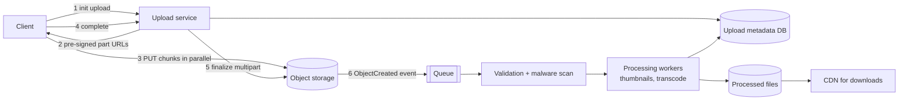
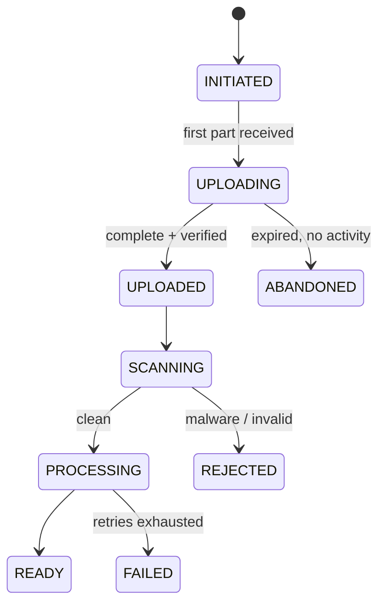

Design a system that lets users upload files, from small images to multi-gigabyte videos, reliably and quickly, even on unstable mobile networks, then processes and serves them.

## 1. Requirements

**Functional**
- Upload files up to, say, 10 GB.
- Resume interrupted uploads without starting over.
- Show progress; allow cancel.
- After upload: validate, scan for malware, process (thumbnails, transcoding), then make available for download/streaming.
- Access control on who can read each file.

**Non-functional**
- Uploads shouldn't overload application servers.
- High throughput: many concurrent uploads; fast for users (parallelism, nearby endpoints).
- Durable: once confirmed, never lost.
- Secure: no unauthorised uploads, no malicious files served.

> [!REAL] Think Google Drive or WeTransfer
> Users upload files from a few KB to tens of GB, over unreliable mobile networks, and expect a failed upload to resume rather than start again.

## 2. The naive approach and why it fails

Client → app server → object storage, streaming the whole file through the app:
- App servers spend CPU, memory and bandwidth on bytes they don't need to touch.
- Long uploads tie up connections and threads; a server restart kills them.
- A dropped connection at 95% means starting over.
- Request size and timeout limits on load balancers break large uploads.

> [!REAL] Carrying a sofa through the reception
> Sending a 5 GB file through your API servers is like carrying a sofa through the office reception: it blocks the door for everyone else. Send big files to object storage directly.

## 3. The design: direct, chunked, resumable

### Step by step
1. **Initiate:** the client sends file name, size, type and checksum to the upload service, which checks auth and quota, creates an `upload` record (`INITIATED`), starts a **multipart upload** in object storage, and returns an `uploadId`.
2. **Get URLs:** the service returns **pre-signed URLs**, one per part (e.g. 8–16 MB chunks), each valid for a limited time and only for that object and part.
3. **Upload parts directly to storage**, several in parallel (e.g. 4–6 at a time). The storage returns an ETag per part; the client records which parts succeeded.
4. **Complete:** the client sends the list of part numbers + ETags; the service tells storage to assemble the object and verifies the size/checksum.
5. **Post-processing** is triggered asynchronously by the storage event.

App servers only exchange small JSON messages; the bytes go straight to the storage service, which is built to absorb them.

### Resumability
If the connection drops, the client asks the service (or storage) which parts are already uploaded and re-sends only the missing ones. Parts are independent, so failure costs at most one chunk. For browsers, the upload state can be saved in local storage so a page reload can resume. The open **tus** protocol standardises resumable uploads if you want a ready-made approach.

> [!REAL] Bookmarking a long download
> If your Wi-Fi drops at 80% of a 2 GB upload, chunked uploads restart at chunk 81 instead of from zero. S3 multipart upload and Google Drive's resumable upload work like this.

### Chunk size
Too small → too many requests and overhead; too large → expensive retries on flaky networks. 5–16 MB is a common middle ground; adapt to network quality on mobile.

## 4. Deep dives

### Integrity
- The client computes checksums per part (and/or for the whole file); storage verifies them on receipt (`Content-MD5` or SHA-256 headers).
- On completion, compare the final size and checksum with what was declared at init.

### Security
- Pre-signed URLs are short-lived, scoped to one key and method, and can include size limits.
- Validate **file type by content** (magic bytes), not just the extension or declared MIME type.
- **Malware scanning** before the file is made available; quarantine bucket until clean.
- Store uploads under random keys, not user-controlled paths; strip metadata (e.g. photo GPS EXIF) when appropriate.
- Serve user content from a **separate domain** (e.g. `usercontent.example.com`) to avoid cookie theft via uploaded HTML/SVG; set `Content-Disposition` and correct `Content-Type`.

### Status model

The client polls the status or gets a WebSocket/push notification when the file is `READY`.

### Cleaning up
Abandoned multipart uploads still consume storage. A lifecycle rule aborts incomplete uploads after N days; a job marks stale records `ABANDONED`.

### Processing pipeline
Queue-driven workers (idempotent, retryable): generate thumbnails/previews, transcode video into streamable renditions, extract text for search, compute perceptual hashes for duplicate detection. Large jobs are split and parallelised. See [Design a Video Streaming Platform](#/l/10-hld-case-studies/video-streaming).

### Deduplication (optional)
If the same file is uploaded many times (popular attachments), store content by hash (content-addressed storage) and keep per-user references. Be careful: hash checks before upload can leak whether a file exists, so do it server-side after upload or only within one user's own files.

> [!REAL] The same forwarded video
> The same viral video is uploaded by thousands of people. Store it once (keyed by its hash) and point every user's file entry at it.

### Speed for global users
- Upload to a **nearby region or edge** (accelerated upload endpoints), then replicate to the home region.
- Parallel part uploads saturate available bandwidth.

### Downloads
Serve via CDN with signed URLs for private files; support range requests so downloads can resume and videos can seek.

### Quotas and abuse
Enforce per-user storage quotas and rate limits at initiation; cap file sizes in the pre-signed policy.

## 5. Trade-offs

| Decision | Choice | Why |
|---|---|---|
| Data path | Direct to object storage via pre-signed URLs | Keeps app servers out of the byte path |
| Reliability | Multipart chunks, resumable | Flaky networks, huge files |
| Integrity | Per-part + final checksums | Detect corruption |
| Safety | Scan + quarantine + separate serving domain | No malicious content served |
| Processing | Async, event-driven, idempotent workers | Upload stays fast; retries safe |

> [!INTERVIEW] The three phrases to hit
> "Pre-signed URLs so bytes go straight to object storage", "multipart, resumable uploads with per-part checksums", and "event-driven async processing with a status the client can poll". Then add security (type sniffing, malware scan, separate domain) and cleanup of abandoned uploads.

## Key takeaways

- Don't stream big files through app servers; use pre-signed URLs straight to object storage.
- Split into parts uploaded in parallel and resumably; verify checksums.
- Process asynchronously after a storage event; expose a clear status lifecycle.
- Validate, scan, quarantine and serve user files safely; clean up abandoned uploads.
