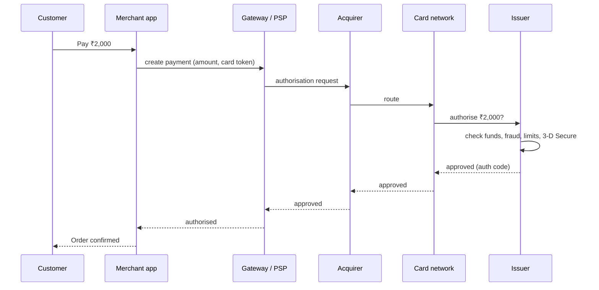

Before designing a payment system, you need a mental model of what actually happens when someone pays. "Charge the card" hides a chain of companies, messages and settlement steps that take seconds to authorise and days to settle.

## The players in a card payment

| Party | Role |
|---|---|
| **Customer (cardholder)** | Pays with a card or wallet |
| **Merchant** | Sells something; wants the money |
| **Payment gateway / PSP** | Your integration point (e.g. Stripe, Razorpay, Adyen). Collects card details securely, talks to the networks, gives you an API |
| **Acquirer (merchant's bank)** | Holds the merchant's account; receives funds on their behalf |
| **Card network** | Visa, Mastercard, RuPay: routes messages and money between banks, sets rules |
| **Issuer (customer's bank)** | Issued the card; approves or declines; debits the customer |

## Phase 1: authorisation (seconds)

- The issuer checks the balance or credit limit and fraud rules, possibly asking the customer to verify (3-D Secure / OTP).
- If approved, the issuer **places a hold** on the funds. **No money has moved yet.**

## Phase 2: capture

The merchant tells the gateway to **capture** the authorised amount, typically when the order ships (e-commerce) or immediately (digital goods).
- Capture can be for less than the authorised amount (partial shipment), never more (with some exceptions such as tips).
- Uncaptured authorisations expire after some days; the hold is released.
- **Void:** cancel an authorisation before capture, with no money movement.

## Phase 3: clearing and settlement (1–3 days)

- At the end of the day, captured transactions are sent in batches through the network (**clearing**).
- The issuer pays the network, the network pays the acquirer (**settlement**), and the acquirer credits the merchant's account, **minus fees** (interchange to the issuer, network fees, acquirer/gateway margin).
- The merchant receives a **payout**, often aggregated over many payments, days later.

## After the payment

- **Refund:** the merchant returns money (a new transaction moving funds back), taking days to appear on the customer's statement.
- **Chargeback / dispute:** the customer disputes with their issuer; funds are pulled back from the merchant, who can contest with evidence.
- **Reconciliation:** the merchant matches its own records against the gateway's reports and bank payouts to make sure every payment, fee and refund is accounted for. See [Double-Entry Ledgers & Reconciliation](#/l/11-payments-uploads/double-entry-ledger).

## Real-time account-to-account payments (UPI-style)

Systems such as India's UPI move money directly between bank accounts in seconds:
- The customer's app (a payment service provider) sends a request through a central switch (NPCI for UPI) to the payer's bank, which debits the account after the customer authorises with a PIN, and the payee's bank credits the receiver.
- Interbank settlement still happens in batches between banks behind the scenes, but the customer sees money move instantly.
- Status can be **pending/unknown** when a bank times out. Apps must query status and reconcile rather than assume failure, which is a classic source of "money debited but payment failed" complaints, resolved by automatic reversal.

## Wallets and stored balances

A wallet is a ledger the company keeps: top-ups move real money into the company's pooled bank account, and transfers between users are just ledger entries inside the company's system. That's why wallet-to-wallet transfers are instant: no bank is involved until someone withdraws.

## What this means for system design

1. **Payments are multi-step and asynchronous.** Authorisation, capture, settlement, refunds and disputes happen at different times. Model them as a **state machine**. See [Payment State Machines & Idempotency](#/l/11-payments-uploads/state-machine-idempotency).
2. **External calls can time out with an unknown outcome.** You must be able to ask "what happened?" and retry safely: **idempotency keys** everywhere.
3. **Your database is not the only source of truth.** The gateway and bank have their own records; you **reconcile** daily.
4. **Money must be recorded with an audit trail** that never loses or invents value: **double-entry ledgers**.
5. **Card data is highly sensitive.** Use the gateway's hosted fields or tokenisation so raw card numbers never touch your servers, keeping you mostly out of PCI DSS scope.

> [!INTERVIEW] Set the scene in 30 seconds
> "When a customer pays, we ask the gateway to authorise; the issuer places a hold. We capture when the order ships, and settlement reaches the merchant's account a day or two later, minus fees. So our system models a payment as a state machine across those steps, uses idempotency keys for every external call, and reconciles our ledger with the gateway's settlement reports daily."

## Key takeaways

- Card payments involve the merchant, gateway, acquirer, network and issuer.
- Authorisation places a hold; capture claims it; settlement moves money days later.
- Refunds, chargebacks and timeouts with unknown results are normal; design for them.
- Use tokenisation, state machines, idempotency, ledgers and reconciliation.
