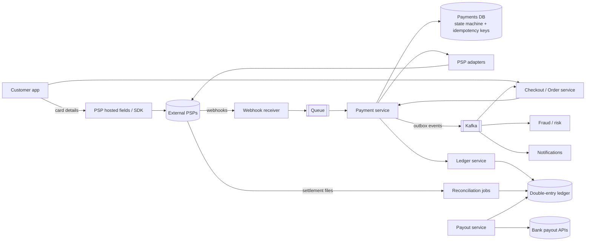
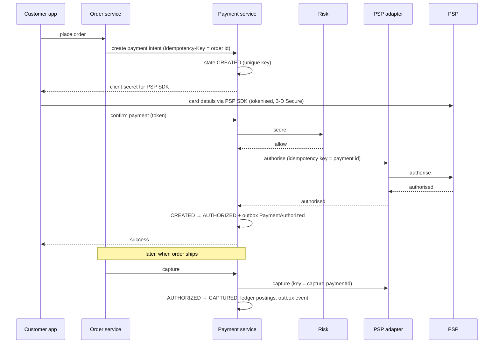

Design the payment system for an e-commerce marketplace: customers pay for orders with cards, UPI and wallets via external payment providers; merchants get paid out; refunds and failures are handled correctly. The focus is **correctness first, then availability and scale**.

## 1. Requirements

**Functional**
- Accept payments for orders via one or more payment service providers (PSPs).
- Support authorise/capture, refunds (full and partial) and payment status queries.
- Pay out merchants (minus commission) on a schedule.
- Receive and process PSP webhooks.
- Ledger of all money movement; daily reconciliation.

**Non-functional**
- **Never double-charge; never lose a payment.** Exactly-once effect.
- Strong consistency for payment state and ledger.
- High availability for the checkout path (lost payments = lost revenue).
- Security and compliance: PCI DSS, encryption, audit trails.
- Scale: e.g. 10M payments/day → ~120/s average, ~2,000/s at flash-sale peaks. Modest throughput; correctness dominates.

## 2. High-level design

### Components
- **Payment service:** owns payment intents and their state machines, idempotency, orchestration of PSP calls.
- **PSP adapters:** one per provider, translating a common internal API to each provider's API; enables routing and failover between providers.
- **Webhook receiver:** verifies signatures, acknowledges quickly, enqueues events for idempotent processing.
- **Ledger service:** double-entry postings for every money movement. See [Double-Entry Ledgers & Reconciliation](#/l/11-payments-uploads/double-entry-ledger).
- **Risk service:** fraud scoring before authorisation (rules + ML), velocity checks.
- **Reconciliation:** daily matching against PSP settlement reports and bank statements.
- **Payout service:** aggregates merchant balances and initiates bank transfers.

## 3. The payment flow

**Card data never touches our servers:** the PSP's SDK/hosted fields collect it and return a token. That keeps us largely out of PCI scope.

## 4. Deep dives

### Exactly-once charging
Layered defences:
1. **Client idempotency key** (e.g. order ID) on create/confirm: double-taps and retries return the same result.
2. **State machine with conditional transitions**: a payment can only go `CREATED → PROCESSING` once.
3. **PSP idempotency key** derived from our payment ID: retries after a crash don't create a second charge at the provider.
4. **Unique constraints** on ledger postings and webhook event IDs.

See [Payment State Machines & Idempotency](#/l/11-payments-uploads/state-machine-idempotency).

### Timeouts and unknown outcomes
If the PSP call times out, mark the payment `UNKNOWN`, **not failed**. A recovery worker queries the PSP status API with backoff (and the webhook may arrive first). Only after a definitive answer do we transition and inform the customer. Show "processing" in the UI meanwhile.

### Webhooks
- Verify the signature, check timestamp freshness, return `200` fast, and enqueue.
- Process idempotently by event ID; webhooks may be duplicated or arrive out of order (e.g. `captured` before `authorized`), so apply them through the state machine, ignoring transitions that are no longer valid.
- Webhooks can be missed: the reconciler and status polling are the safety net.

### Reliable events: outbox
State change + outbox event in one DB transaction; CDC/poller publishes `PaymentAuthorized`, `PaymentCaptured`, `PaymentRefunded`. The order service reacts (confirm order, release inventory on failure). See [The Transactional Outbox](#/l/07-api-design/outbox).

### Orchestrating checkout across services
Checkout is a saga: reserve inventory → authorise payment → confirm order → capture on shipment. Failure compensations: void authorisation, release inventory. See [The Saga Pattern](#/l/07-api-design/saga).

### Multiple PSPs: routing and failover
- Route by method, currency, cost, success rate.
- If a PSP has elevated errors, a circuit breaker routes new payments to a backup PSP. **Never** retry the *same* payment on a different PSP while the first attempt's outcome is unknown; that's a double charge risk. Only re-route when the first attempt definitively failed.

### Data and consistency
- Payments DB: relational (PostgreSQL/MySQL), synchronous replication to a standby in another zone (RPO ≈ 0), automatic failover.
- Partition by merchant or payment ID if volume grows; at ~2K/s peak, one well-sized primary is usually enough.
- Ledger in its own strongly consistent store, append-only.
- Read models (merchant dashboards, analytics) built from events, eventually consistent.

### Refunds
A refund is a new operation against a captured payment, with its own idempotency key and state (`REFUND_PENDING → REFUNDED/FAILED`), limited to the remaining refundable amount (enforced with a conditional update), and its own ledger entries.

### Payouts
Merchant balances accumulate in the ledger. A scheduled job computes payable amounts (minus commission, refunds, reserves for disputes), creates payout instructions idempotently, calls bank APIs, tracks status, and reconciles against bank statements.

### Security and compliance
Tokenisation, TLS everywhere, encryption at rest, secrets in a vault, least-privilege access, audit logs for every state change and admin action, PII minimisation, and fraud checks (3-D Secure, velocity rules, device fingerprinting).

### Observability
Track authorisation success rate per PSP/method/bank, latency, count of `UNKNOWN` payments and their age, webhook lag, reconciliation breaks. Alert on drops in success rate: they often signal a provider problem before they announce it.

## 5. Trade-offs

| Decision | Choice | Why |
|---|---|---|
| Card data | PSP tokenisation | Security, PCI scope |
| Consistency | Strong for payments + ledger | Money correctness |
| Retries | Idempotency keys at every layer | Exactly-once effect |
| Timeouts | UNKNOWN state + status polling | Never double-charge |
| Events | Outbox → Kafka | No lost or phantom events |
| Multi-PSP | Adapters + health-based routing | Availability, cost |
| Safety net | Daily reconciliation | Catch everything else |

> [!INTERVIEW] Priorities, out loud
> "Throughput here is modest, a couple of thousand payments per second at peak. The hard part is correctness under failure. So I'll spend most of the time on idempotency, the state machine, handling unknown outcomes, the ledger and reconciliation, rather than on sharding."

## Key takeaways

- Tokenise cards via the PSP; never handle raw card data.
- Payment intents are state machines; every call is idempotent, including to the PSP.
- Timeouts lead to UNKNOWN, resolved by status checks, webhooks and reconciliation.
- Outbox events drive the rest of the system; a double-entry ledger records every movement; daily reconciliation catches the rest.
