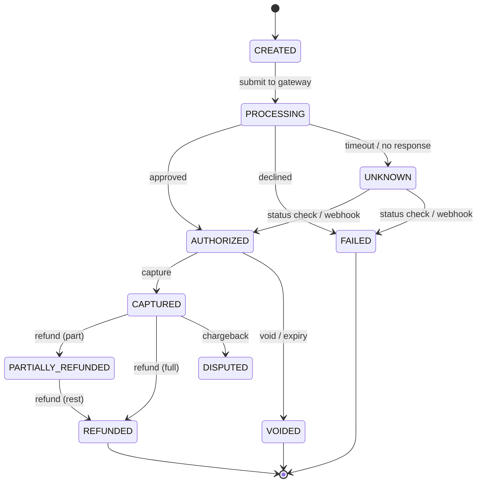
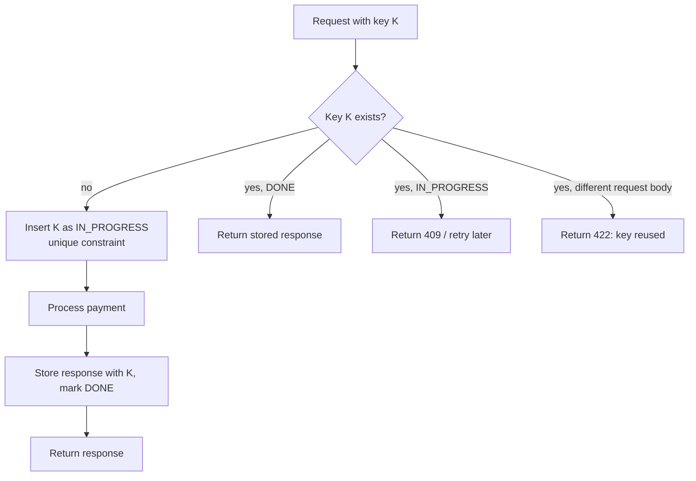

Two ideas make payment code safe: model every payment as an explicit **state machine**, and make every operation **idempotent** so retries can never charge twice.

## Why payments need a state machine

A payment passes through several stages, some driven by your code and some by external callbacks that arrive late, out of order or twice. Ad-hoc boolean flags (`isPaid`, `isRefunded`) quickly produce impossible combinations. A state machine makes the allowed transitions explicit.



### Implementation rules
1. **Store the state** in the payments table with a version column.
2. **Allow only defined transitions.** Reject `FAILED → CAPTURED`.
3. **Transition atomically** with a conditional update, so concurrent updates (your code and a webhook) can't both win:

```sql
UPDATE payments
SET status = 'CAPTURED', version = version + 1, updated_at = now()
WHERE id = :id AND status = 'AUTHORIZED' AND version = :v;
-- 0 rows → someone else changed it; reload and decide.
```

4. **Record every transition** in an append-only `payment_events` table (who, when, from, to, gateway reference). That's your audit trail and debugging tool.
5. **Handle UNKNOWN explicitly.** A timeout doesn't mean failure. Never retry a charge blindly; query the gateway for status (or wait for its webhook), then transition.

```java
enum Status { CREATED, PROCESSING, AUTHORIZED, CAPTURED, PARTIALLY_REFUNDED, REFUNDED, VOIDED, FAILED, UNKNOWN, DISPUTED }

static final Map<Status, Set<Status>> ALLOWED = Map.of(
    Status.CREATED,     Set.of(Status.PROCESSING),
    Status.PROCESSING,  Set.of(Status.AUTHORIZED, Status.FAILED, Status.UNKNOWN),
    Status.UNKNOWN,     Set.of(Status.AUTHORIZED, Status.FAILED),
    Status.AUTHORIZED,  Set.of(Status.CAPTURED, Status.VOIDED),
    Status.CAPTURED,    Set.of(Status.PARTIALLY_REFUNDED, Status.REFUNDED, Status.DISPUTED),
    Status.PARTIALLY_REFUNDED, Set.of(Status.REFUNDED, Status.DISPUTED)
);

void transition(Payment p, Status to) {
    if (!ALLOWED.getOrDefault(p.status(), Set.of()).contains(to))
        throw new IllegalStateException(p.status() + " -> " + to + " not allowed");
    if (repo.compareAndSetStatus(p.id(), p.status(), to, p.version()) == 0)
        throw new ConcurrentModificationException("payment " + p.id() + " changed concurrently");
    events.append(p.id(), p.status(), to);
}
```

## Idempotency: charging exactly once

Retries happen everywhere: the user double-taps "Pay", the mobile network drops the response, a service times out and retries, a message is redelivered. Without protection, each retry is a new charge.

### Idempotency keys
The client generates a unique key per logical operation (e.g. a UUID when the checkout screen opens) and sends it with the request:

```http
POST /v1/payments
Idempotency-Key: 8c0e2a7c-3f5b-4f4e-9d1a-2b9c0a1d5e77
{ "orderId": "ord_981", "amount": 200000, "currency": "INR" }
```

Server logic:



Details that matter:
- **Insert the key first, under a unique constraint**, so two concurrent requests with the same key can't both proceed.
- Store a hash of the request body; if the same key arrives with a **different body**, reject it.
- Store the **final response** and return it verbatim to retries.
- Keep keys for a retention window (24 h – 30 days).
- Scope keys per merchant/user.

### Idempotency all the way down
Your service being idempotent isn't enough if it calls a gateway that isn't:
- Pass an idempotency key **to the gateway** too (most PSP APIs accept one). Derive it from your payment ID so a retry after a crash reuses the same key.
- Webhook handlers dedupe by the gateway's event ID.
- Message consumers dedupe by event ID (inbox pattern).
- Ledger entries reference the payment ID with a unique constraint, so a retried posting can't double-count.

### Natural idempotency
Some operations are idempotent by design: "set status to CAPTURED if AUTHORIZED" (the conditional update above) or "insert ledger entry for payment X" with a unique key. Prefer these shapes.

## Putting it together: a capture flow

1. `POST /payments/{id}/capture` with an idempotency key.
2. Check/insert the key.
3. Load the payment; verify state `AUTHORIZED`.
4. Transition to `CAPTURING` (or record intent in the outbox) in a local transaction.
5. Call the gateway with idempotency key `capture-{paymentId}`.
6. On success: transition to `CAPTURED`, post ledger entries, emit `PaymentCaptured` via the outbox, all in one transaction. On timeout: leave as `CAPTURING`, and let a reconciler query the gateway and finish the job.
7. Store and return the response for the idempotency key.

> [!WARNING] Never treat a timeout as a failure
> If you mark a timed-out payment as failed and let the user retry, and the original charge actually succeeded, you have charged them twice. Timeouts mean "unknown", and unknown must be resolved by asking.

> [!INTERVIEW] The two sentences to say
> "Every payment is a state machine with conditional, versioned transitions and an append-only event log, so concurrent updates and out-of-order webhooks can't corrupt it. Every mutating call carries an idempotency key, stored under a unique constraint with its response, and we pass derived keys to the gateway, so retries at any layer can't charge twice."

## Key takeaways

- Model payments as explicit states with allowed transitions, enforced by conditional updates.
- Keep an append-only event history for audit and debugging.
- Idempotency keys (unique constraint + stored response) make retries safe.
- Propagate idempotency to gateways, webhooks, consumers and ledger postings; treat timeouts as unknown.
