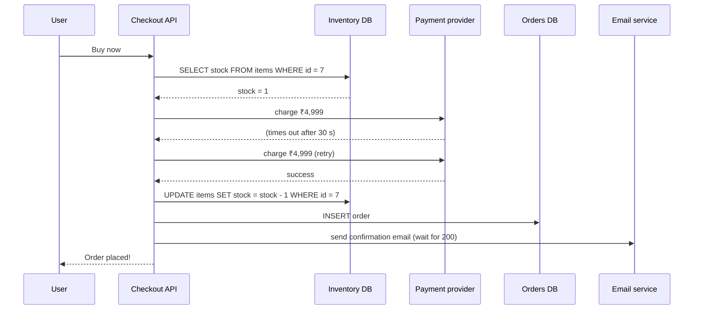
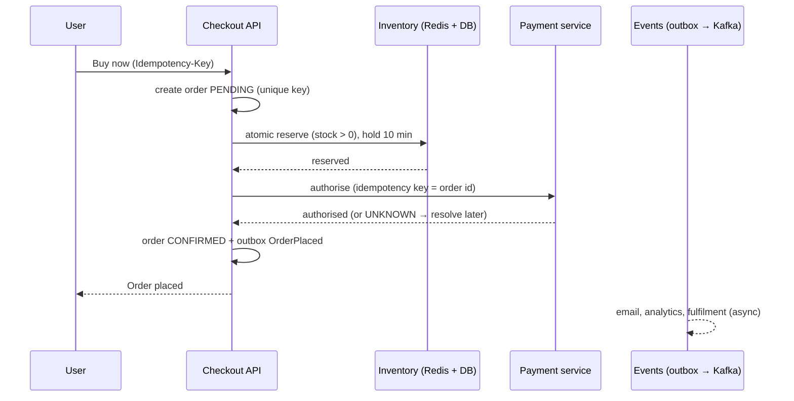

Here is a proposed checkout flow for an online store that runs flash sales with **50,000 buyers competing for 1,000 units**. Find the problems before opening the review.

> [!REAL] The Diwali sale counter
> Picture 50,000 shoppers at a store with 1,000 TVs and one clerk checking stock in a paper register. Two clerks can both read "1 left" and sell it twice. The flaws below are exactly that, in software.

## The proposed design

Notes from the design doc:
- Stock is checked with a plain `SELECT` before charging.
- If the payment call times out, the API retries the charge.
- The order row is written after the payment and stock update, in separate statements.
- The confirmation email is sent synchronously, and if it fails the API returns an error to the user.
- The "Buy now" button can be clicked repeatedly; each click calls the API.
- The product page shows live stock by querying `items` on every page view.

## The review

Flaw 1: check-then-act race causes overselling

Thousands of requests read `stock = 1` at the same time and all proceed to charge. Fix: reserve atomically **before** charging: `UPDATE items SET stock = stock - 1 WHERE id = 7 AND stock > 0` (1 row = reserved), or a Redis atomic decrement for flash sales, with a unique reservation per user and a hold that expires if payment doesn't complete.

Flaw 2: retrying a timed-out charge can double-charge

A timeout means the outcome is **unknown**. The first charge may have succeeded. Fix: send an idempotency key to the PSP (derived from the order/payment ID) so a retry returns the original result; or mark the payment `UNKNOWN` and query the PSP's status before doing anything else.

Flaw 3: no idempotency for repeated clicks

Double-clicks and client retries create multiple orders and charges. Fix: an idempotency key generated when checkout starts (or the cart/order ID), enforced with a unique constraint server-side; disable the button client-side as a convenience, not a guarantee.

Flaw 4: no atomicity between payment, stock and order

If the process crashes after charging but before inserting the order, the customer paid for nothing and nobody knows. Fix: create the order first (`PENDING`), reserve stock, then authorise payment, and drive the flow as a saga/state machine with compensations (release stock, void authorisation). Use the outbox for events. Reconciliation catches anything left.

Flaw 5: charging (capture) before the item is secured

The design charges money first and decrements stock after, so a sold-out item still gets charged and must be refunded. Fix: reserve → authorise → confirm → capture on fulfilment. Do the likely-to-fail step (stock) before the hard-to-undo step (money).

Flaw 6: synchronous email on the critical path

A slow or failing email provider makes checkout slow or reports an error **after** the order and charge succeeded, so the user retries and may buy twice. Fix: publish `OrderPlaced` and send email asynchronously with retries; email failure never fails checkout.

Flaw 7: a 30-second timeout ties up resources

Waiting 30 s per request during a 50K-user spike exhausts threads and connections. Fix: tight timeouts with a separate "pending" flow (respond `202`, show "processing", resolve via webhook/status polling), circuit breakers on the PSP, and bulkheads.

Flaw 8: live stock queries on every page view

50K users refreshing the product page hammer the inventory table that checkout needs. Fix: serve displayed stock from a cache or approximate counter updated every second or two ("Only a few left"); only the reservation path touches the authoritative count.

Flaw 9: no protection against the spike itself

Bots and 50K simultaneous buyers will overwhelm the API. Fix: a virtual waiting room / queue that admits users at a sustainable rate, rate limits per user/IP, bot detection, and pre-warmed capacity.

## A corrected flow

## What this exercise trains

- **Check-then-act** is almost always a race; make the check and the write one atomic step.
- **Timeouts are unknown outcomes**, never failures.
- **Order the steps** so the likely failure happens before money moves.
- Keep **non-essential work asynchronous** and protect the system during spikes.
