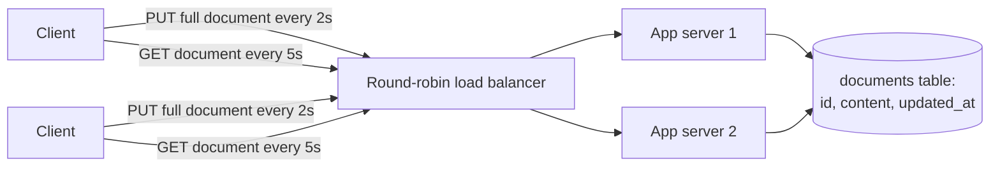
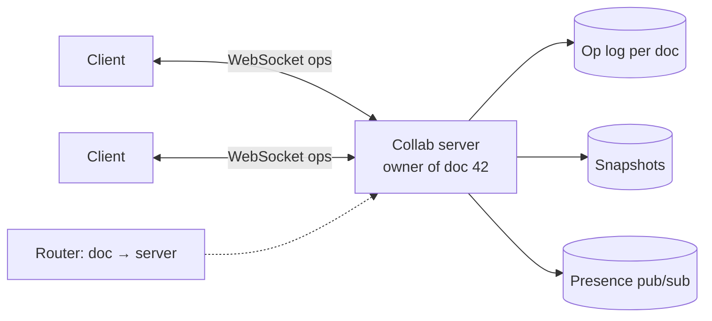

A team proposes this design for a real-time collaborative editor. Up to **50 people** may edit a document at once. Find the problems before opening the review.

> [!REAL] Emailing the whole Word file back and forth
> Imagine 50 people each saving the full document every two seconds: whoever saves last wipes out everyone else's sentences. Watch for that "last save wins" smell in the design below.

## The proposed design

Notes from the design doc:
- Each client sends the **entire document** every 2 seconds; the server saves it with `UPDATE documents SET content = ? WHERE id = ?`.
- Clients poll every 5 seconds and replace their local text with what the server returns.
- Conflicts are handled by "last write wins" using the client's `updated_at` timestamp.
- Cursor positions of other users aren't shown ("not needed for v1").
- Version history is kept by a nightly backup of the database.
- Any server can handle any request; servers keep no state.

## The review

Flaw 1: last-write-wins on the whole document destroys concurrent edits

If Alice edits paragraph 1 and Bob edits paragraph 5 in the same 2-second window, whichever save lands second overwrites the other's work entirely. Fix: send **operations** (insert/delete at a position), not whole documents, and merge them with OT or CRDTs so concurrent edits converge without loss.

Flaw 2: client clocks decide the winner

Using the client's `updated_at` means a user with a fast clock always wins, and a skewed clock can make old content "newer". Fix: the server assigns order (sequence numbers per document), never trusting client clocks for ordering.

Flaw 3: polling every 5 seconds isn't real-time and replaces local text

Users see others' edits up to 5–7 s late, and replacing the local document wipes out whatever the user typed since their last save, which is jarring and lossy. Fix: a persistent WebSocket connection; the server pushes operations as they happen; the client applies remote operations on top of its pending local ones.

Flaw 4: sending the full document is wasteful

A 2 MB document from 50 users every 2 seconds is ~50 MB/s for one document, mostly unchanged text. Fix: send small operations (bytes per keystroke batch), with periodic server-side snapshots.

Flaw 5: stateless round-robin routing prevents a single ordering point

Edits for one document land on different servers, so no component sees them in order to transform/merge them. Fix: route all sessions for a document to the same collaboration server (consistent hashing on document ID), which holds the live state and orders operations. Other servers stay stateless.

Flaw 6: version history from nightly backups

Backups are for disaster recovery, not product features. Users can't see or restore a version from 10 minutes ago, and an accidental mass delete is unrecoverable until the next day. Fix: an append-only operation log per document plus periodic snapshots; history and restore come from those.

Flaw 7: no durability guarantee per edit

Edits made in the last 2 seconds before a crash, or a dropped connection, are lost silently. Fix: acknowledge each operation only after it is appended to the durable op log; clients keep unacknowledged ops and resend after reconnecting (idempotent by client ID + sequence).

Flaw 8: missing presence and permission checks

Without cursors and presence, users unknowingly type over each other. And there is no mention of authorisation per edit: revoked users would keep saving. Fix: ephemeral presence via the collab server (throttled), and ACL checks on connect and on each operation.

## A corrected design

Full design in [Design a Collaborative Editor](#/l/10-hld-case-studies/collaborative-editor).

## What this exercise trains

- **Whole-object last-write-wins** is almost never acceptable for user-generated content.
- **Server-assigned order** beats client clocks.
- **Real-time means push**, not frequent polling.
- **Stateless everywhere** isn't always right; some workloads need an owner.
