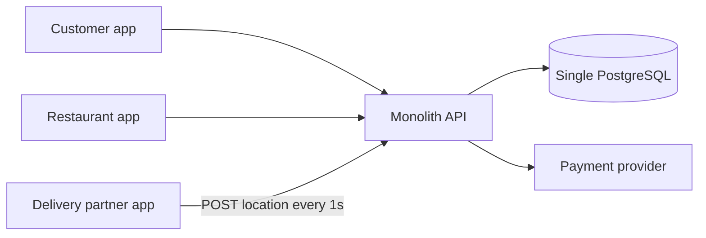
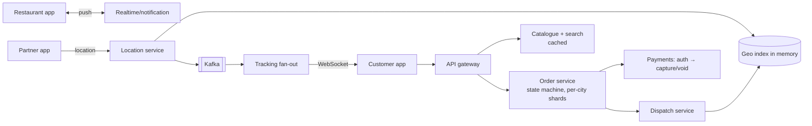

A team designs a food-delivery platform: customers order from restaurants, restaurants accept, a delivery partner is assigned and tracked live. Expected peak: **dinner rush, 20,000 orders per minute** across many cities. Find the problems.

> [!REAL] Dinner rush at 8 p.m.
> At 8 p.m. on a Friday, Swiggy and Zomato see their sharpest spike: orders, restaurant updates and rider pings all jump at once. Ask of every box below: what happens to it at 8 p.m.?

## The proposed design

Notes from the design doc:
- All entities, including **delivery partner locations**, are stored in one PostgreSQL database; each location ping is an `UPDATE partners SET lat=?, lng=? WHERE id=?`.
- To assign a partner, the API runs `SELECT * FROM partners WHERE status='FREE'`, computes the straight-line distance to each in application code, and picks the nearest.
- The assigned partner is set with `UPDATE partners SET status='BUSY' WHERE id=?`.
- Restaurants receive new orders by polling `GET /orders/new` every 30 seconds.
- The customer's "track order" screen polls the partner's location every second.
- Menus and restaurant listings are read from the database on every request.
- The order is charged when placed; if the restaurant rejects it, a refund is issued manually by support.

## The review

Flaw 1: high-frequency location pings overwhelm the relational database

Hundreds of thousands of partners × 1 update/s means a massive write load and row churn on the same table used for orders. Fix: keep live locations in an in-memory geo store (Redis GEO, or a geo-indexed location service), stream history to Kafka for analytics, and reduce ping frequency when idle.

Flaw 2: assignment scans every free partner

`SELECT * WHERE status='FREE'` across all cities then computing distances in code is O(N) per order. Fix: a geospatial index (geohash/H3 cells) to query only partners near the restaurant; rank by **travel time/ETA**, not straight-line distance; consider batching assignments per area.

Flaw 3: the same partner can be assigned to two orders

Two orders can pick the same nearest free partner simultaneously; the plain `UPDATE ... SET status='BUSY'` doesn't check the old status. Fix: conditional update `WHERE id=? AND status='FREE'` (check rows affected) or an atomic Redis state transition; on failure, try the next candidate. Also allow partners to accept/decline with a timeout.

Flaw 4: restaurants polling every 30 seconds delays orders

Up to 30 s before a restaurant even sees an order hurts food prep times and customer experience. Fix: push new orders via WebSockets/push notifications (with an acknowledgement and re-alert/phone-call escalation if not accepted within N seconds).

Flaw 5: per-second tracking polls multiply load

Every customer watching the map polls every second, a load spike at dinner. Fix: push location updates over WebSocket/SSE from a tracking service subscribed to that partner's location stream; throttle to every 3–5 s and interpolate smoothly on the client.

Flaw 6: uncached, read-heavy menus and listings

Browsing restaurants and menus is the most frequent action and rarely changes. Fix: cache listings and menus (CDN for images, Redis for menu JSON), use a search index for discovery (cuisine, rating, location), invalidate on menu edits.

Flaw 7: charging before acceptance with manual refunds

Capturing payment before the restaurant accepts means frequent refunds, which are slow for customers and costly for support. Fix: **authorise** at order time, **capture** on restaurant acceptance (or delivery), and automatically **void** the authorisation on rejection or timeout. Drive it with an order state machine.

Flaw 8: one database and one monolith for every city

A single PostgreSQL is a scaling limit and a single point of failure for the entire country at dinner time. Fix: separate hot domains (orders, locations, catalogue, payments), partition data by city/region (natural for this business), replicate across zones, and isolate cities so one city's spike or outage doesn't affect others.

Flaw 9: no explicit order lifecycle or timeouts

What happens if no partner accepts, or the restaurant never responds? Fix: an order state machine (`PLACED → ACCEPTED → PREPARING → PICKED_UP → DELIVERED`, plus cancellation paths) with timers that escalate, reassign or cancel and compensate automatically.

## A corrected design

## What this exercise trains

- **Match the store to the data:** ephemeral, high-frequency location data doesn't belong in the orders database.
- **Spatial problems need spatial indexes.**
- **Push beats polling** for time-sensitive events.
- **Authorise, then capture** when an order might not be fulfilled.
