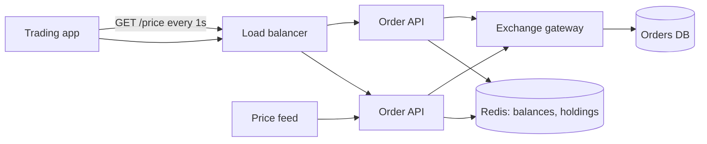
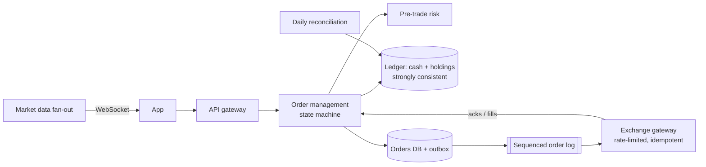

This is a proposed design for a retail stock-trading app. Users place market and limit orders, see live prices, and track their holdings. **Correctness and fairness are critical**; peak load at market open is ~200,000 orders per minute. Find the problems first.

> [!REAL] 9:15 a.m. on the NSE
> When Indian markets open at 9:15, brokers like Zerodha and Groww see a burst of orders within seconds, and any mistake costs real money. Fairness (first come, first served) and correctness beat everything else here.

## The proposed design

Notes from the design doc:
- Before placing a buy order, the API checks the user's **cash balance in Redis** and, if sufficient, sends the order to the exchange.
- After the exchange confirms, the API deducts the balance in Redis; a nightly job syncs Redis to the database.
- Orders are sent to the exchange **first** and written to the orders DB afterwards.
- The app polls prices every second; prices come from whichever API server answers.
- Order IDs are generated as `timestamp_ms + random(0..999)`.
- If the exchange gateway times out, the API returns "Order failed, please retry".

## The review

Flaw 1: Redis is used as the source of truth for money

Balances and holdings live in a cache synced nightly. A Redis failover or eviction loses real money state, and the database is up to a day stale. Fix: balances and holdings live in a strongly consistent, durable ledger (double-entry, relational). Caches may serve **display** values only.

Flaw 2: check-then-act on the balance allows overspending

Two concurrent orders both see ₹10,000 available and both send ₹10,000 buys. Fix: **reserve funds atomically** before routing the order (`UPDATE ... SET available = available - X WHERE available >= X`), move them to a "blocked" bucket, and settle or release when the order fills or is cancelled.

Flaw 3: sending to the exchange before recording the order

If the API crashes after the exchange accepts but before the DB write, a real order exists with no record. You can't show it, cancel it or reconcile it. Fix: write the order (`NEW`, with funds reserved) durably first, then route it via an outbox/reliable sender; update state from exchange acknowledgements and fills.

Flaw 4: timeouts reported as failures invite duplicate orders

The order may have reached the exchange. Telling the user to retry can double their position. Fix: idempotent client order IDs (exchanges support client order IDs), status `PENDING_UNKNOWN`, query the exchange for the order status, and never resend blindly.

Flaw 5: order IDs can collide and aren't ordered

`timestamp + random(0..999)` collides at 200K orders/minute (~3,300/s → many per millisecond). Fix: a proper unique ID scheme (Snowflake-style: time + node ID + sequence) or database sequences, plus a client-supplied idempotency key.

Flaw 6: price polling from inconsistent servers

Polling every second adds load and latency, and different API servers may hold different snapshots, so prices can jump backwards between polls. Fix: stream prices over WebSockets/SSE from a market-data fan-out service; include sequence numbers/timestamps so clients ignore out-of-order ticks; conflate updates for slow clients.

Flaw 7: no fairness or ordering guarantees at market open

Load-balanced API servers send orders to the exchange in arbitrary order with arbitrary delays; there is no queueing or backpressure for the 200K/minute burst. Fix: a durable, sequenced order pipeline (e.g. partitioned log per user/instrument) feeding exchange gateways, rate-limited to exchange limits, with clear acceptance timestamps.

Flaw 8: missing pre-trade risk checks and audit

No checks for price bands, order size limits, short-selling rules or margin, and no immutable audit trail of every order event, which regulators require. Fix: a pre-trade risk service in the order path and an append-only event log for every state change.

Flaw 9: holdings not reconciled with the exchange/depository

Fills, partial fills, corporate actions and end-of-day positions must match the exchange and clearing records. Fix: process execution reports as events into the ledger and run daily reconciliation against clearing/depository statements.

## A corrected design

## What this exercise trains

- **Caches are never the source of truth for money.**
- **Reserve before you act**, atomically.
- **Record intent before calling the outside world**, and make calls idempotent.
- **Push, sequenced market data** and **audited state machines** are table stakes in finance.
