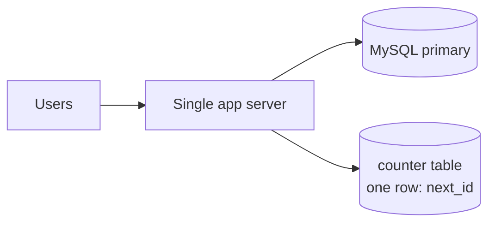
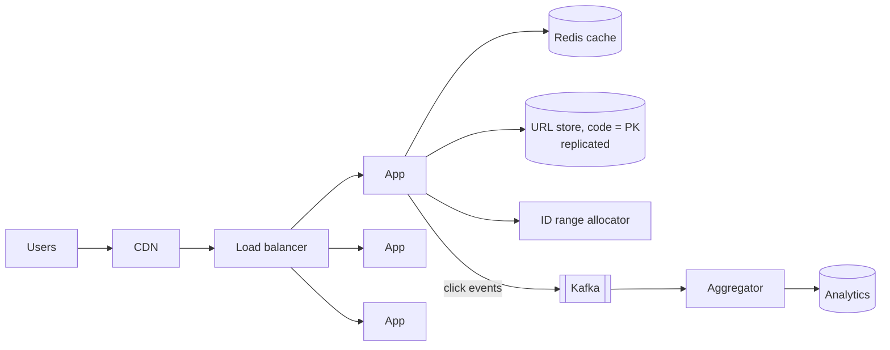

A teammate proposes the design below for a URL shortener expected to serve **20,000 redirects per second** with **99.99% availability**. Read it carefully and list every problem you can find **before** opening the review.

> [!REAL] A link shared in every WhatsApp group
> One election-result link can be clicked 100,000 times in a minute. A design that hits the database on every click, or has one server, falls over the first time something goes viral.

## The proposed design

1. To create a short URL, the app runs `SELECT next_id FROM counter`, then `UPDATE counter SET next_id = next_id + 1`, and base62-encodes the value it read.
2. Short codes are therefore sequential: `1`, `2`, … `a`, `b`, … `zz`, `100`…
3. Every redirect queries MySQL: `SELECT long_url FROM urls WHERE code = ?`.
4. Each redirect also runs `UPDATE urls SET clicks = clicks + 1 WHERE code = ?` before responding with `301 Moved Permanently`.
5. The `urls` table has a primary key on an auto-increment `id`; `code` has no index.
6. One app server is enough "because redirects are simple".

> [!TIP] Take two minutes
> Write down your list, then compare. There are at least seven issues.

## The review

Flaw 1: the ID counter has a race condition

`SELECT` then `UPDATE` as two statements lets two concurrent requests read the same `next_id` and hand out the **same code** for two different URLs. Fix: an atomic increment (`UPDATE ... SET next_id = LAST_INSERT_ID(next_id + 1)`), or better, pre-allocated ID ranges per server so the counter is touched once per thousands of IDs.

Flaw 2: the counter row is a bottleneck and single point of failure

Every creation serialises on one row on one database. Even atomic, it caps throughput and fails if MySQL is down. Fix: a range allocator (each server leases blocks of 10,000 IDs) or random/hashed codes with uniqueness checks.

Flaw 3: sequential codes are guessable

Anyone can enumerate `/1`, `/2`, `/3`… and discover private links (shared documents, invitations). Fix: scramble the ID with a keyed reversible permutation before encoding, or use random codes.

Flaw 4: redirect lookups use an unindexed column

`WHERE code = ?` without an index is a full table scan on billions of rows. Fix: make `code` the primary key (or a unique index). It's the only hot query.

Flaw 5: every redirect hits the database

20K reads/s on one MySQL primary, with a long tail of hot links, is unnecessary load and latency. Fix: cache `code → long_url` in Redis (very high hit ratio due to power-law popularity), add read replicas, and optionally cache the redirect at the CDN edge for viral links.

Flaw 6: synchronous click counting on the redirect path

An `UPDATE` per redirect doubles database work, adds latency, and turns viral links into hot-row lock contention. Fix: publish a click event asynchronously (Kafka) and aggregate counts in a stream processor; the redirect never waits on analytics.

Flaw 7: 301 contradicts the analytics requirement

`301 Moved Permanently` lets browsers cache the redirect, so repeat visits never reach the server and are never counted. If click analytics matter, use `302`/`307`. If they don't, 301 is fine, but then the counter work is pointless.

Flaw 8: one app server and one database can't give 99.99%

Both are single points of failure; any deploy or crash is an outage, and four nines allows only ~4 minutes of downtime a month. Fix: multiple stateless app servers across zones behind a load balancer, database replicas with automatic failover, Redis with replicas, and ideally multi-region read serving (redirects are read-only, so active-active is easy).

Bonus: no validation or abuse controls

No checks for malformed URLs, malware or phishing destinations, and no rate limits on creation. Shorteners are abused heavily. Add URL validation, reputation checks, per-user rate limits and a takedown path.

## A corrected design

See the full walkthrough in [Design a URL Shortener](#/l/10-hld-case-studies/url-shortener).

## What this exercise trains

- Spotting **races** in read-modify-write sequences.
- Noticing **synchronous side work** on a hot path.
- Checking every **requirement** (availability, analytics) against the design.
- Thinking about **security** (enumeration, abuse) even when not asked.
