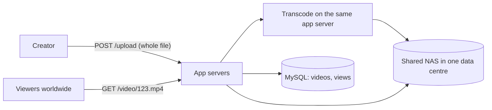
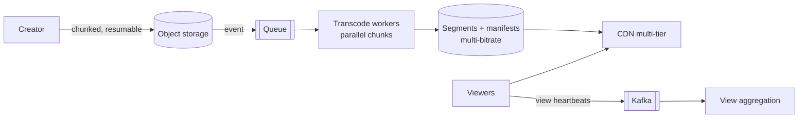

Here is a proposed design for a video platform with **10 million daily viewers worldwide** and creators uploading files of up to 4 GB. Find the problems before opening the review.

## The proposed design

Notes from the design doc:
- Uploads are a single HTTP POST of the whole file to an app server.
- The app server transcodes the upload into **one 1080p MP4** right after receiving it, then responds to the creator.
- Viewers download the single MP4 progressively from the app servers.
- Every play runs `UPDATE videos SET views = views + 1 WHERE id = ?`.
- Thumbnails are generated on the fly when the page loads.
- All storage is a NAS in the company's single data centre.

## The review

Flaw 1: whole-file uploads through app servers

4 GB POSTs tie up app servers, hit request size/time limits, and restart from zero on any network drop. Fix: chunked, resumable multipart uploads directly to object storage via pre-signed URLs.

Flaw 2: synchronous transcoding on the app server

Transcoding takes minutes to hours of CPU; doing it in the request path blocks the creator, starves the app server and fails on restarts. Fix: event-driven asynchronous pipeline with a queue and dedicated, autoscaled transcoding workers that split the video into chunks and encode them in parallel; creators see a "processing" status.

Flaw 3: one rendition doesn't fit every viewer

A single 1080p MP4 buffers constantly on mobile networks and wastes bandwidth on small screens. Fix: multiple resolutions/bitrates (and modern codecs), segmented into short chunks with HLS/DASH manifests, so the player can switch quality per segment (adaptive bitrate).

Flaw 4: serving video bytes from app servers in one data centre

Viewers worldwide pull huge files across continents from the origin: high latency, buffering, enormous egress cost, and the app tier becomes a bandwidth bottleneck. Fix: serve segments through a CDN (multi-tier caching, origin shield), with long TTLs because segments are immutable.

Flaw 5: a single-data-centre NAS for all media

A NAS doesn't scale to petabytes and is a single point of failure (and a single fire away from losing everything). Fix: durable object storage replicated across zones/regions, with storage tiers by popularity, and archived originals for re-encoding.

Flaw 6: a hot-row UPDATE per view

A viral video gets thousands of plays per second, all updating one row: lock contention and database overload. Fix: send view events asynchronously (batched heartbeats → Kafka), deduplicate, aggregate in a stream processor, and update counts every few seconds.

Flaw 7: generating thumbnails on page load

Every page view of a listing triggers image processing: wasted CPU and slow pages. Fix: generate thumbnails and preview sprites once in the processing pipeline, store them, and serve via the CDN.

Flaw 8: no content safety or access control

No malware/format validation, copyright or moderation checks, and no protection for private or paid videos. Fix: validation and scanning in the pipeline, moderation before publishing, and signed URLs (plus DRM where licensing requires it).

## A corrected design

Full design in [Design a Video Streaming Platform](#/l/10-hld-case-studies/video-streaming).

## What this exercise trains

- **Keep heavy bytes and heavy compute off the request path.**
- **Design delivery for the viewer's network**, not the creator's file.
- **CDNs are mandatory** for media at scale.
- **Hot counters belong in streams**, not in row updates.
