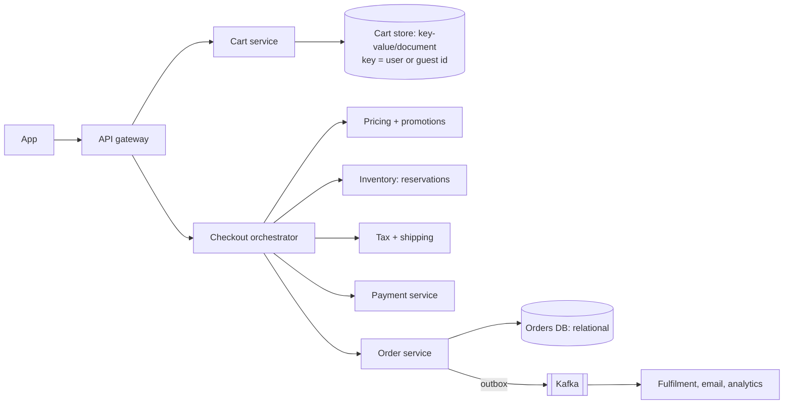

## The brief

Design the **shopping cart and checkout** for a large e-commerce site:

- Add/remove items; the cart persists across devices and sessions (logged-in) and for guests.
- Checkout: validate prices and stock, apply coupons, compute tax and shipping, take payment, create the order.
- Prices and stock change; the customer must never be charged a price they didn't see without being told, and items must not be oversold.
- Scale: 30M DAU; carts are written often; checkout peaks at 5,000 orders/s during sales.

**Your turn:** 35 minutes on your canvas.

## Hints

Hint 1: the cart and the order have different needs

A cart is a frequently changing, low-stakes, per-user document. An order is an immutable, high-stakes record. They probably belong in different stores with different consistency.

Hint 2: when do you re-check price and stock?

Prices shown in the cart may be stale. Checkout must re-price and re-validate everything authoritatively, and tell the user about changes before charging.

Hint 3: checkout spans several services

Inventory, pricing/promotions, payment and orders are separate domains. How do you keep them consistent without a distributed transaction? Think saga, reservations and idempotency.

Hint 4: guest carts and merging

What happens when a guest with items in their cart logs in, and their account already has a cart?

## Reference design

Open the reference design (after you've finished yours)

**Architecture**

**Cart**
- Stored as a document per cart (`cartId`, items with SKU, quantity, the price **seen** when added, timestamps) in a key-value/document store (DynamoDB, Redis with persistence, MongoDB). High write rate, simple key access.
- Guest carts keyed by a cookie ID with a TTL (e.g. 30 days). On login, **merge** guest items into the user's cart (sum quantities, cap by limits) and delete the guest cart.
- Optimistic concurrency (version) handles edits from two devices at once.
- The cart shows current prices from a cached pricing service and flags changes ("price dropped").

**Checkout (orchestrated saga)**
1. `POST /checkout` with an idempotency key (the checkout session ID).
2. **Re-price** every line authoritatively (base price, promotions, coupons, tax, shipping). If the total differs from what the user saw, return a confirmation step instead of charging.
3. **Reserve inventory** atomically per SKU (`available >= qty`), with a hold that expires in ~15 minutes.
4. **Authorise payment** with a PSP idempotency key derived from the order ID.
5. **Create the order** (`CONFIRMED`) with the final priced lines (an immutable snapshot) and emit `OrderPlaced` via the outbox.
6. **Capture** payment on shipment; **commit** the inventory reservation.
7. **Compensations:** payment declined → release reservations; reservation fails → don't authorise; order creation fails after auth → void the authorisation.

**Coupons**
- Single-use codes redeemed with a conditional update/unique constraint (`coupon_id, user_id`) inside the checkout saga; released on failure.

**Sales peak (5K orders/s)**
- Hot SKUs: inventory counters for hot items in Redis with atomic decrements, reconciled to the database; or split stock into sub-buckets.
- Queue-based checkout during extreme spikes (accept and confirm asynchronously), waiting room for flash sales.

**Trade-offs**
- Cart: availability and speed over strict consistency (eventual is fine).
- Order and payment: strong consistency and idempotency.
- Prices are verified at checkout; carts store "price seen" only to detect changes.

## Self-review checklist

- [ ] Cart and order stored differently, for different needs.
- [ ] Guest carts and merge on login.
- [ ] Authoritative re-pricing and user confirmation on changes.
- [ ] Inventory reservations with expiry; payment authorise → capture.
- [ ] Saga with compensations; idempotency end to end.
- [ ] Hot-SKU and sale-spike strategy.
