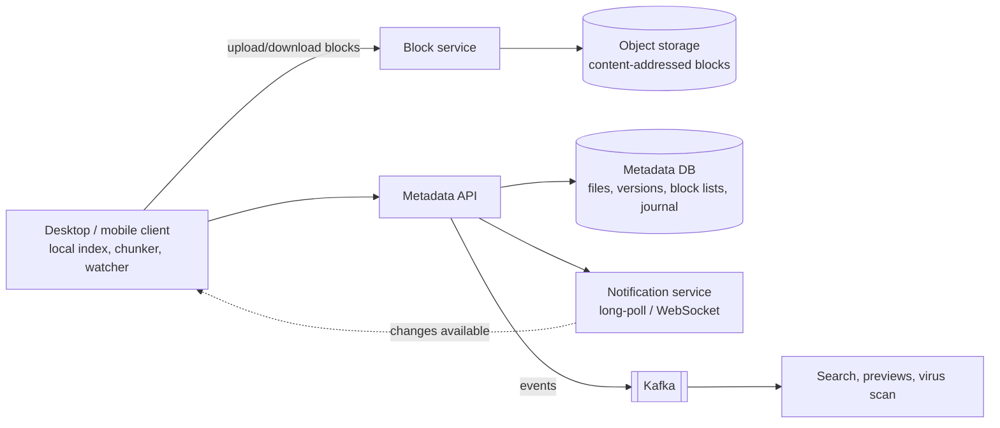

## The brief

Design a **cloud file storage and sync** service like Dropbox or Google Drive:

- Users upload, download, organise (folders), share and delete files.
- A desktop client **syncs** a local folder across a user's devices automatically.
- Files can be large (GBs); edits to large files should not re-upload everything.
- Version history (restore previous versions for 30 days).
- Scale: 100M users, 500M devices, 1B file changes per day.

**Your turn:** 35 minutes on your canvas.

> [!REAL] Think Google Drive or Dropbox
> You save a file on your office laptop and it appears on your home laptop a few seconds later. Edit a 1 GB file slightly, and only the changed part is uploaded again.

## Hints

Hint 1: split files into blocks

If a 2 GB file changes slightly, re-uploading 2 GB is wasteful. Split files into blocks (e.g. 4 MB), hash each block, and upload only blocks the server doesn't already have.

Hint 2: separate metadata from content

File names, folders, versions and block lists are small, relational and need consistency. Block contents are large, immutable blobs. Different stores.

Hint 3: how does device B learn that device A changed something?

Polling every device every few seconds is expensive. Consider a per-user change journal with a cursor, plus a long-poll/WebSocket notification channel saying "something changed, fetch from your cursor".

Hint 4: conflicts

Two devices edit the same file offline. What happens on sync? Silent overwrite loses work.

## Reference design

Open the reference design (after you've finished yours)

**Uploading a changed file**
1. The client's watcher detects a change; the chunker splits the file into blocks (fixed 4 MB, or content-defined chunking so an insertion near the start doesn't shift every block) and hashes each (SHA-256).
2. The client asks the metadata API: "here is the new block list for file F (base version v7)". The server replies with the blocks it doesn't have.
3. The client uploads only the missing blocks (in parallel, resumable) to the block service via pre-signed URLs; blocks are stored by hash (**content-addressed**, so identical blocks across users can deduplicate, with care around privacy).
4. The client commits: "file F, version v8 = [h1, h2, h9, h4]", conditional on the current version being v7.
5. The metadata service writes the new version and appends an entry to the user's **change journal**, then notifies other devices.

**Sync to other devices**
- Each device holds a **cursor** into the user's journal. The notification channel (long-poll/WebSocket) wakes it up; it fetches changes since its cursor, downloads only the blocks it lacks, and reconstructs files locally.
- Offline devices simply catch up from their cursor when they reconnect.

**Conflicts**
- The commit is conditional on the base version. If another device committed v8 first, the server rejects the commit; the client keeps both: it saves its copy as "File (Device B's conflicted copy).docx" and syncs both. Never silently overwrite.

**Metadata store**
- Relational/NewSQL, sharded by user or namespace (a shared folder is its own namespace). Holds the folder tree, file versions, block lists, sharing ACLs and the journal. Strong consistency within a namespace.

**Versions and deletion**
- Every commit is a new version; old versions keep their block lists for 30 days. Deleted files go to trash. Garbage collection removes blocks no longer referenced by any version (reference counting or mark-and-sweep), carefully, because blocks are shared.

**Sharing**
- Shared folders are separate namespaces with ACLs; members' journals include changes from shared namespaces they can access. Links use signed tokens.

**Bandwidth and performance**
- Compress blocks, upload/download in parallel, use nearby upload endpoints, and LAN sync between devices on the same network (optional).

**Trade-offs**
- Content-defined chunking costs CPU but drastically improves dedup for edited files.
- Conflicted copies are less magical than merging but never lose data.

## Self-review checklist

- [ ] Files split into hashed blocks; only missing blocks uploaded.
- [ ] Metadata (consistent, relational) separated from blocks (object storage).
- [ ] Per-user change journal with cursors + push notifications for sync.
- [ ] Conditional commits and conflicted copies.
- [ ] Versioning, trash and safe garbage collection.
- [ ] Sharing via namespaces and ACLs.
