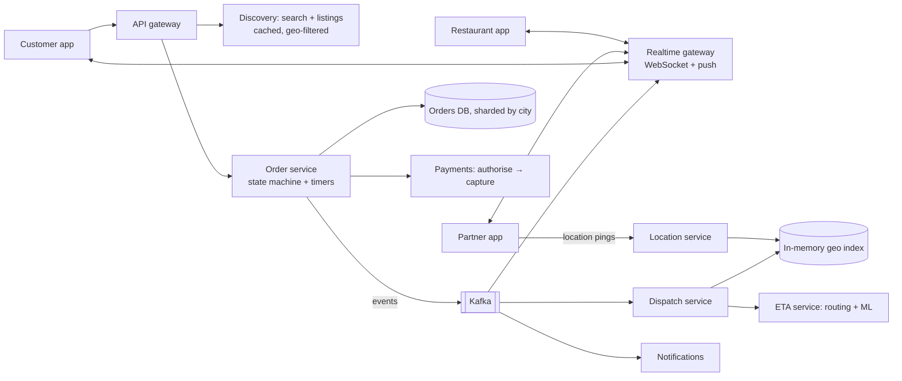

## The brief

Design a **food delivery platform** (think Swiggy, Zomato, DoorDash):

- Customers browse nearby restaurants and menus, place orders and pay.
- Restaurants receive orders instantly, accept them and update preparation status.
- The platform assigns a delivery partner, who picks up and delivers; the customer tracks the partner live.
- ETAs shown at browsing time and during delivery.
- Scale: 500 cities, 3M orders/day, dinner peak 5× average; 300K partners online at peak.

**Your turn:** 35 minutes on your canvas. (If you did the related "Find the Flaw" review, try not to reuse its answer.)

## Hints

Hint 1: three apps, three real-time needs

Customer (tracking), restaurant (new-order alerts) and partner (assignments, navigation) all need push. What connection mechanism, and how do you route a message to the right device?

Hint 2: the order is a state machine with timers

PLACED → ACCEPTED → PREPARING → READY → PICKED_UP → DELIVERED, plus cancellations. What happens if the restaurant doesn't respond in 2 minutes, or no partner accepts?

Hint 3: dispatch is a geo + optimisation problem

Find partners near the restaurant (geo index), estimate who'll arrive just as the food is ready, avoid double assignment, and consider batching two orders from the same restaurant.

Hint 4: the business is naturally partitioned by city

Orders, partners and restaurants rarely cross city boundaries. How can you use that for scaling and isolation?

## Reference design

Open the reference design (after you've finished yours)

**Discovery**
- Restaurants indexed with location, cuisine, rating, open hours, average prep time; search via a geo-aware index; menus cached (CDN for images, Redis for menus), invalidated on edits.
- Listing ETA = predicted prep time + predicted travel time from an ML model fed by historical orders and live traffic.

**Order lifecycle**
- Order service owns a state machine with **timers**: restaurant must accept within N minutes (else auto-cancel and void payment); escalate via phone call before cancelling.
- Payment authorised at placement, captured on acceptance or delivery.
- Each transition emits an event (outbox) that drives notifications, dispatch and tracking.

**Dispatch**
- Triggered when the restaurant accepts (or at a predicted time so the partner arrives as food is ready).
- Query nearby available partners from the geo index; rank by ETA to restaurant, current load, fairness; offer to the best candidate with an accept timeout; atomic state change `AVAILABLE → ASSIGNED` prevents double assignment.
- Batch orders from the same restaurant/direction to one partner when it doesn't hurt delivery times.

**Live tracking**
- Partners send location every 3–5 s to the location service (in-memory latest position + Kafka stream).
- The tracking path forwards the assigned partner's updates to the customer via WebSocket; the app interpolates movement.

**Scaling and isolation**
- **Cell-based architecture by city/region:** each cell has its own order shards, dispatch workers and geo index partitions. A dinner spike or incident in one city stays there. Global services (accounts, payments, catalogue admin) are shared.

**Trade-offs**
- Strong consistency for order state, payments and partner assignment; eventual for listings, ETAs and tracking.
- Predictive dispatch improves food freshness but risks partners waiting if prep runs late.

## Self-review checklist

- [ ] Real-time push to all three apps with routing to the right device.
- [ ] Order state machine with timers and compensations.
- [ ] Geo index + ETA-based dispatch with atomic assignment.
- [ ] Location ingestion separated from transactional data.
- [ ] City-based partitioning/cells.
- [ ] Payment authorise/capture/void tied to the lifecycle.
