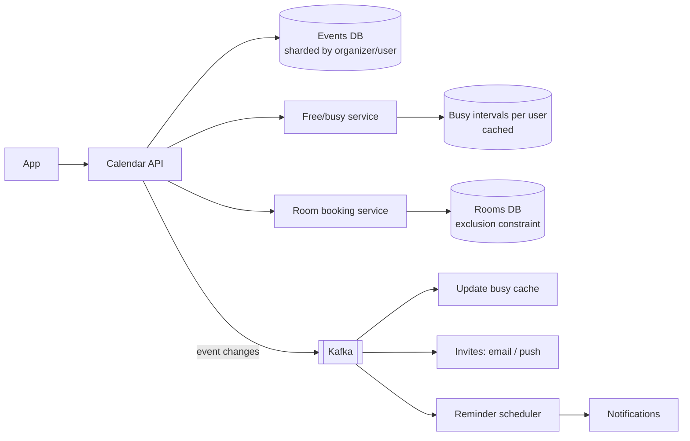

## The brief

Design a **meeting scheduler** like the scheduling part of Google Calendar or Outlook:

- Users have calendars with events; they can create meetings and invite others.
- Show **free/busy** for invitees and suggest available time slots.
- Book **meeting rooms**; a room must never be double-booked.
- Recurring meetings ("every Tuesday at 10:00"), time zones, reminders.
- Scale: a large enterprise or a SaaS product with 50M users; reads (viewing calendars) far exceed writes.

**Your turn:** 35 minutes on your canvas.

## Hints

<details>
<summary>Hint 1: how do you store recurring events?</summary>

Storing every occurrence of "every Tuesday forever" is impossible. Consider storing a **recurrence rule** plus exceptions, and expanding occurrences for the window being viewed.

</details>

<details>
<summary>Hint 2: where does strong consistency matter?</summary>

Viewing a colleague's calendar a few seconds stale is fine. Booking a room is not. What mechanism prevents two people booking the same room for overlapping times?

</details>

<details>
<summary>Hint 3: free/busy across many people</summary>

Finding a slot for 8 people means intersecting their busy intervals. How do you fetch and compute that quickly? Could you precompute busy intervals?

</details>

<details>
<summary>Hint 4: time zones and reminders</summary>

Store times in UTC with the event's IANA time zone (so "10:00 every Tuesday" survives daylight-saving changes). Reminders need a scheduler that fires at the right time at scale.

</details>

## Reference design

<details>
<summary>Open the reference design (after you've finished yours)</summary>

**Data model**

```text
events(event_id, organizer_id, title, start_utc, end_utc, tz, rrule?, exdates[], room_id?, version)
attendees(event_id, user_id, response)              -- accepted / declined / tentative
calendar_index(user_id, start_utc, end_utc, event_id)  -- per-user, for range queries
room_bookings(room_id, start_utc, end_utc, event_id)   -- with an exclusion constraint
```

- **Recurring events:** store the RRULE (e.g. `FREQ=WEEKLY;BYDAY=TU`) and exceptions; expand occurrences on read for the requested window, and materialise occurrences for the near future (e.g. next 12 months) into the calendar index for fast range queries and room bookings.

**Architecture**



**Room booking without double-booking**
- PostgreSQL exclusion constraint makes overlaps impossible at the database level:

```sql
ALTER TABLE room_bookings ADD CONSTRAINT no_overlap
  EXCLUDE USING gist (room_id WITH =, tstzrange(start_utc, end_utc) WITH &&);
```

- Or serialise per room (one partition/lock per room) and check overlaps inside a transaction. Concurrent requests for the same slot: one succeeds, the other gets a conflict and picks another room or time.

**Free/busy and slot suggestions**
- Maintain each user's busy intervals (from accepted events) in a cache, updated from event-change events.
- To suggest slots: fetch the attendees' busy intervals for the window, merge them, intersect with working hours in each attendee's time zone, and return the earliest gaps of the requested length. Privacy: free/busy exposes times, not titles.

**Reminders**
- A scheduler stores upcoming reminders in time buckets (e.g. a table or sorted set keyed by minute); workers poll the current bucket and enqueue notifications. Recurring events generate the next reminder when the current one fires.

**Consistency and sync**
- Event edits use optimistic concurrency (`version`); attendees receive updates asynchronously.
- External calendars sync via standards (CalDAV/iCalendar) or provider APIs with incremental sync tokens.

**Trade-offs**
- Expanding recurrence on read vs materialising: materialise a bounded horizon for queries, keep the rule as the source of truth.
- Free/busy caches are eventually consistent; room bookings are strongly consistent.

</details>

## Self-review checklist

- [ ] Recurrence stored as rules + exceptions, expanded/materialised sensibly.
- [ ] Room double-booking prevented by a database-level guarantee.
- [ ] Free/busy computed efficiently and privately.
- [ ] Time zones handled (UTC + IANA zone).
- [ ] Reminders scheduled at scale.
- [ ] Invites/updates delivered asynchronously.
