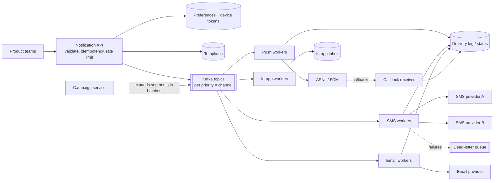

## The brief

Design a notification service used by every team in a large company to send **push notifications, SMS, emails and in-app messages** to users.

- Product teams call one API: "send this template to these users on these channels".
- Some notifications are **critical** (OTP, payment alerts: seconds matter), others are **marketing** (millions of recipients, can be slower).
- Users have preferences (opt-outs per channel/category, quiet hours) that must be respected.
- Scale: 1B notifications/day, with campaign bursts to 50M users at once.

**Your turn:** 35 minutes. Requirements → estimates → API → data → diagram → deep dives.

> [!REAL] Think OTPs, order updates and offers
> Your OTP must arrive in seconds, your "order delivered" update within a minute, and the "50% off" offer whenever, but never at 3 a.m. One system, very different priorities.

## Hints

<details>
<summary>Hint 1: separate accepting from delivering</summary>

The API should validate and **enqueue**, then return immediately. Delivery happens asynchronously through queues per channel, so a slow SMS provider never slows down the caller.

</details>

<details>
<summary>Hint 2: priorities need isolation</summary>

If OTPs and a 50M-user campaign share one queue, OTPs wait behind the campaign. Use separate queues (or topics) per priority and channel, with dedicated workers.

</details>

<details>
<summary>Hint 3: think about what can go wrong with third parties</summary>

Providers (APNs, FCM, SMS gateways, email services) rate-limit, time out and fail. Consider retries with backoff, provider failover, idempotency so retries don't send twice, and dead-letter queues.

</details>

<details>
<summary>Hint 4: preferences, dedup and tracking</summary>

Where do you check opt-outs and quiet hours? How do you avoid sending the same notification twice? How do you track delivered/opened status?

</details>

## Reference design

<details>
<summary>Open the reference design (after you've finished yours)</summary>

**Requirements & numbers**
- 1B/day ≈ 12K/s average; campaigns spike far higher, but marketing can be throttled. Critical messages must deliver in < 5 s p99.

**API**

```http
POST /v1/notifications
Idempotency-Key: <caller-generated>
{ "template": "payment_success", "userIds": ["u42"], "channels": ["push","sms"],
  "priority": "critical", "data": { "amount": "₹4,999" } }
→ 202 { "notificationId": "n_981" }

POST /v1/campaigns { template, segmentId, channels, schedule }  → 202
GET  /v1/notifications/{id}/status
```

**Architecture**



**Key decisions**
- **Accept fast, deliver async.** The API checks idempotency (unique key per caller), validates the template, applies per-caller rate limits, writes a record and publishes to Kafka.
- **Topics per priority and channel** (`critical.sms`, `bulk.email`…) with separate consumer groups and capacity, so campaigns never delay OTPs.
- **Preferences checked at send time** in workers (so late opt-outs are respected), including quiet hours (delay non-critical sends) and frequency caps.
- **Campaigns** expand large segments in batches and are throttled to provider limits; rendering (templates + personalisation) happens in workers.
- **Providers:** adapters with circuit breakers; failover to a secondary SMS provider when error rates rise; retries with exponential backoff; DLQ after N attempts.
- **Dedup:** each (notificationId, userId, channel) is sent once. Workers record sends in the delivery log with a unique key before calling the provider (and pass provider idempotency keys where supported).
- **Tracking:** delivery receipts and open/click events update status; analytics consume the same events.
- **Device tokens:** stored per user/device; invalid tokens reported by APNs/FCM are removed.

**Trade-offs**
- At-least-once delivery with dedup, not exactly-once: an occasional duplicate is better than a missing OTP.
- Marketing sends are deliberately slower (throttled) to protect providers and critical traffic.

</details>

## Self-review checklist

- [ ] API returns quickly (202) and is idempotent.
- [ ] Critical and bulk traffic are isolated.
- [ ] Preferences, quiet hours and opt-outs are enforced.
- [ ] Provider failures handled: retries, backoff, failover, DLQ.
- [ ] Duplicates prevented; status tracking exists.
- [ ] Campaign fan-out is batched and throttled.
