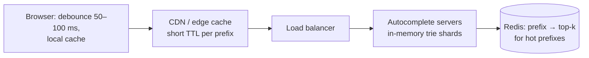
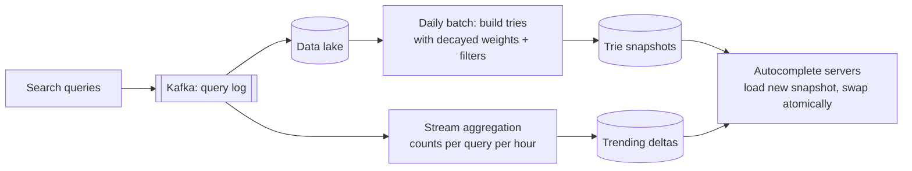

## The brief

Design **search autocomplete** (typeahead) for a large search engine or e-commerce site: as the user types each character, show the top 5–10 suggested queries.

- Suggestions should appear within **~100 ms** of each keystroke.
- Ranked mostly by popularity, with freshness (trending queries surface within minutes to hours).
- Scale: 100M DAU, ~10 searches each, ~6 keystrokes per search.
- Filter offensive suggestions; support multiple languages (briefly).

**Your turn:** 35 minutes on your canvas.

> [!REAL] Think Google's search box
> Type "how to m" and suggestions like "how to make tea" appear before you finish. That has to happen in under ~100 ms for every keystroke, for millions of people.

## Hints

Hint 1: estimate the read load first

100M × 10 × 6 ≈ 6B prefix requests/day ≈ 70K/s average, maybe 200K/s at peak. This is overwhelmingly read-heavy and latency-critical. What does that suggest about precomputation and caching?

Hint 2: a data structure built for prefixes

A **trie** maps prefixes to nodes. If each node stores its top-k completions, a lookup is just walking to the prefix node: O(length of prefix).

Hint 3: don't update the trie on every search

Separate the **data collection** path (log every query) from the **serving** path (read-only, precomputed). How often do you rebuild, and how do you get trending queries in sooner?

Hint 4: reduce requests from the client

Debounce keystrokes, cache responses in the browser and at the CDN, and consider fetching results for a prefix once and filtering locally as the user keeps typing.

## Reference design

Open the reference design (after you've finished yours)

**Serving path**

- Each server holds a **trie in memory**, where each node stores the **top-k** completions for that prefix (precomputed), so a request is a walk + return, in well under a millisecond.
- **Sharding:** the full trie may not fit one machine; shard by prefix range (e.g. first 1–2 characters, rebalanced by traffic since `s` is far more popular than `x`), replicated for throughput.
- **Caching:** very short prefixes ("a", "ip") are requested constantly; cache them in Redis/CDN. Browsers cache recent prefixes.
- **Client tricks:** debounce, cancel in-flight requests when a new key is pressed, prefetch the next likely prefix.

**Data path**

- **Collection:** every executed search is logged (not every keystroke). Sampling is fine at this scale.
- **Weighting:** frequency with **time decay** (recent searches count more), normalised and filtered (spam, offensive terms, PII).
- **Batch rebuild** (daily/hourly): build new trie snapshots offline and roll them out; servers load and swap atomically. No live writes to the serving structure.
- **Trending:** a streaming job detects queries spiking in the last minutes/hours and serves a small "fresh" overlay merged with the trie's results.
- **Personalisation (optional):** merge in the user's own recent searches on the client or from a small per-user store.

**Trade-offs**
- Precomputed top-k per node trades memory and rebuild time for O(prefix) lookups.
- Suggestions can be hours stale except for the trending overlay. That's acceptable.
- Prefix sharding can be uneven; shard by traffic, not alphabet.

## Self-review checklist

- [ ] Read-heavy estimate drives a precomputed, in-memory design.
- [ ] Trie (or equivalent) with top-k stored per node.
- [ ] Data collection separated from serving; periodic rebuilds with safe swaps.
- [ ] Trending/freshness handled.
- [ ] Client-side debouncing and caching; edge caching of hot prefixes.
- [ ] Filtering of offensive/sensitive suggestions.
