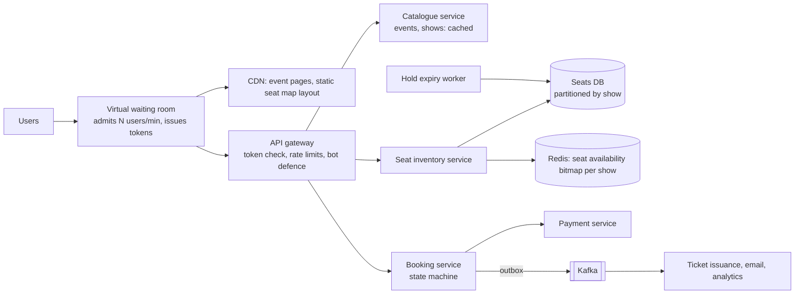

## The brief

Design a **ticket booking system** for movies and live events (think BookMyShow or Ticketmaster):

- Browse events/shows, view a **seat map** with live availability, select seats, pay, receive tickets.
- Selected seats are **held** for a few minutes during payment; abandoned holds are released.
- A seat must **never** be sold twice.
- Popular concert releases: **1M users** arrive at the same minute for **50K seats**.

**Your turn:** 35 minutes on your canvas.

> [!REAL] Think BookMyShow on release day
> When bookings open for a big film's first-day shows, thousands of people tap the same seats at the same second. Exactly one person must get each seat.

## Hints

<details>
<summary>Hint 1: where is the strong consistency boundary?</summary>

Browsing events and showtimes can be cached and slightly stale. Holding and booking a specific seat must be atomic. Design those two paths differently.

</details>

<details>
<summary>Hint 2: how do holds expire?</summary>

A hold is a temporary claim with an expiry time. Think about a status + `held_until` timestamp on the seat, or a TTL key in Redis, and what happens when payment completes just after expiry.

</details>

<details>
<summary>Hint 3: surviving the onsale spike</summary>

1M users for 50K seats means most users will leave without tickets. Protect the system and keep things fair: a **virtual waiting room** that admits users at a controlled rate, bot protection, and per-user limits.

</details>

<details>
<summary>Hint 4: payment failures and timeouts</summary>

What if payment succeeds but the hold has expired? What if the payment result is unknown? Plan the state machine and compensations.

</details>

## Reference design

<details>
<summary>Open the reference design (after you've finished yours)</summary>

**Architecture**



**Seat states and atomic holds**

```text
seats(show_id, seat_id, status FREE|HELD|BOOKED, hold_id, held_until, booking_id, version)
```

Hold seats atomically for all selected seats (all or nothing):

```sql
UPDATE seats SET status='HELD', hold_id=:h, held_until=now() + interval '8 minutes'
WHERE show_id=:s AND seat_id = ANY(:seats)
  AND (status='FREE' OR (status='HELD' AND held_until < now()));
-- if rows updated != number of seats → roll back, tell the user some seats were taken
```

- All seats of one show live in one partition, so a multi-seat hold is a single local transaction.
- Booking converts `HELD → BOOKED` only if `hold_id` matches and the hold hasn't expired.
- An expiry worker frees stale holds (the `held_until < now()` condition already makes expired holds claimable, so the worker is just cleanup).

**Seat map reads**
- The seat layout (geometry) is static: CDN. Availability is a compact bitmap per show in Redis, updated on hold/book/release and pushed or polled every few seconds. Slight staleness is fine because the hold step is authoritative.

**Booking flow**
1. User selects seats → atomic hold (returns hold ID, expiry).
2. Create booking `PENDING` (idempotency key) → authorise payment.
3. On success: `HELD → BOOKED` + booking `CONFIRMED` + outbox `TicketsBooked` in one transaction → capture payment, issue tickets asynchronously.
4. If payment succeeded but the hold had expired (rare, after long payment delays): try to re-claim the same seats; if impossible, refund automatically and apologise.
5. Payment unknown → booking stays `PENDING` while status is resolved; seats stay held for a grace period.

**Onsale spike**
- Waiting room admits users at the rate the booking path can handle and gives queue position; tokens are required to call booking APIs.
- Per-user seat limits, CAPTCHA/bot scoring, and rate limits.
- Pre-scale capacity and pre-warm caches before the onsale.

**Trade-offs**
- Pessimistic holds (seats locked during payment) improve user experience at the cost of seats being temporarily unavailable; keep hold times short.
- Partition by show keeps transactions local; a mega-event with 80K seats in one partition is still fine for a single well-sized database node.

</details>

## Self-review checklist

- [ ] Atomic, all-or-nothing seat holds with expiry.
- [ ] HELD → BOOKED tied to the hold and payment, idempotent.
- [ ] Browsing cached; availability eventually consistent; holds strongly consistent.
- [ ] Waiting room, rate limits and bot protection for onsales.
- [ ] Payment edge cases (unknown, late success after expiry) handled.
