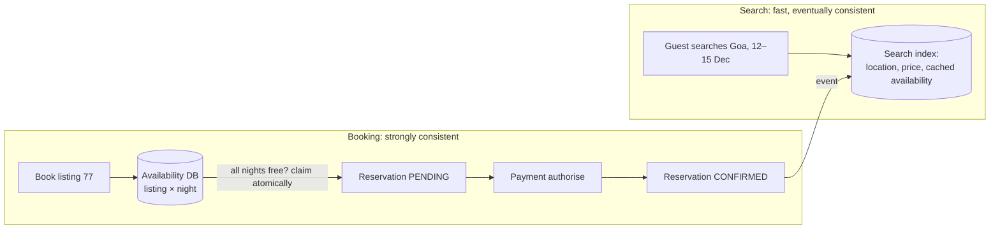

**In one line:** search runs on a fast, eventually consistent index that may be slightly out of date, but the booking itself goes through a strongly consistent availability check that atomically claims the dates. The database, not the search index, makes a double booking impossible.

> [!REAL] Browsing a hotel catalogue vs booking at the desk
> The brochure (search) can be a little out of date. The front desk (booking) checks the actual room register before handing you a key.

## Two paths, two consistency levels

## The ideas that make it work

1. **Search can be stale.** Listings and approximate availability are indexed for fast geo + filter search. If the index briefly shows a just-booked place, the booking step catches it.
2. **Availability per night.** Availability is stored per listing per night (or as date ranges with an exclusion constraint). Booking 12–15 Dec means claiming three specific nights.
3. **Atomic claim of all nights.** In one transaction, update all requested nights from available to held/booked, only if every one is available. If any is taken, nothing changes and the guest is told immediately. Concurrent requests for overlapping dates can't both succeed.
4. **Short holds during payment.** Nights are held briefly while payment is authorised; abandoned attempts release them.
5. **Idempotent booking requests.** A retried "Book" click uses the same request key, so it can't create two reservations.
6. **Calendar sync with other platforms.** Hosts often list on several sites; external calendars sync periodically, and a booking elsewhere blocks the dates here as soon as it's imported. Short sync intervals plus instant blocking reduce cross-platform conflicts.
7. **Events update the index.** Confirmed or cancelled reservations emit events that refresh search availability within seconds.

## What to say in an interview

> "Search is served from an eventually consistent index for speed. Booking goes to the source of truth: availability rows per listing-night, claimed atomically in one transaction (or with a range exclusion constraint) only if every night is free, with a short hold during payment and an idempotency key on the request. Events then refresh the search index."

Related: [Strong vs Eventual Consistency](#/l/09-tradeoffs/strong-vs-eventual).
