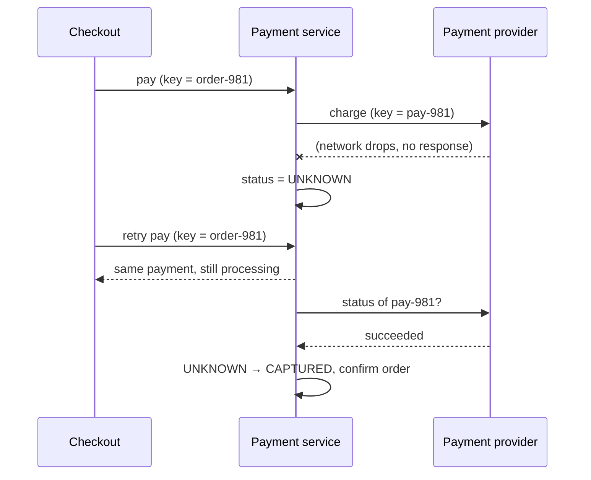

**In one line:** every payment attempt carries a unique idempotency key, a timed-out payment is treated as "unknown" rather than failed and resolved by asking the payment provider, and a state machine plus reconciliation guarantees the customer is charged exactly once.

## When the network drops mid-payment

## The ideas that make it work

1. **Idempotency keys end to end.** The checkout sends a key tied to the order; the payment service passes a derived key to the provider. Retries at any layer return the original result instead of charging again.
2. **"Unknown" is a real state.** A timeout doesn't mean the charge failed, and treating it as failure invites a second charge. The payment waits in an unknown/pending state.
3. **Ask, don't guess.** A recovery process queries the provider's status API (or waits for its webhook) to learn what actually happened.
4. **State machine with atomic transitions.** Payments move through defined states; a late webhook and a retry can't both apply conflicting changes.
5. **Reliable follow-up events.** The status change and the "payment succeeded" event are saved together (outbox), so the order is always confirmed, even if a service crashes right after.
6. **Reconciliation.** Daily comparison with the provider's settlement reports catches anything that slipped through, such as a charge with no order, and fixes it (refund or fulfil).
7. **Friendly UX.** The customer sees "processing" instead of an error, avoiding the instinct to pay again.

## What to say in an interview

> "Idempotency keys from the client through to the payment provider; timeouts move the payment to UNKNOWN and a worker resolves it via the provider's status API or webhook; transitions are atomic in a state machine with an outbox for events; daily reconciliation against settlement files is the final safety net."

Deep version: [Design a Payment System](#/l/11-payments-uploads/payment-architecture).
