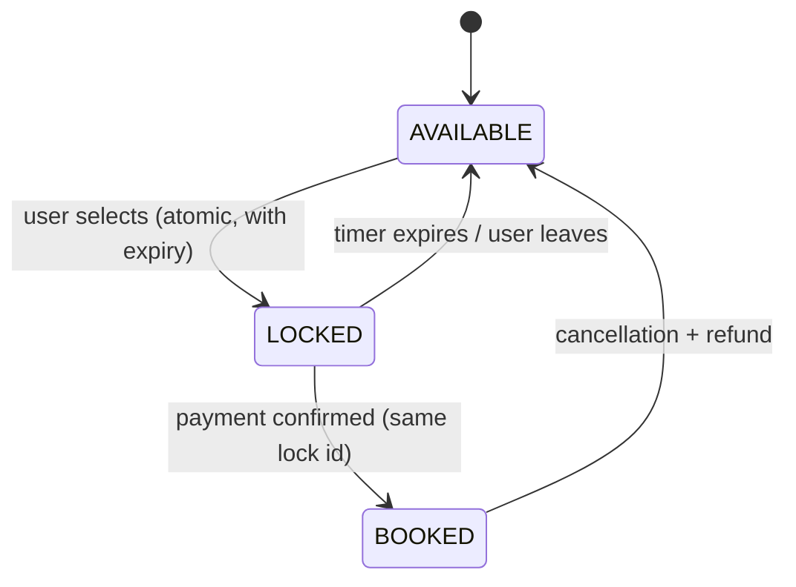

**In one line:** when you pick seats, they're **temporarily locked** for you for a few minutes with an atomic, all-or-nothing operation; the lock either turns into a booking when payment succeeds or expires automatically, so two people can never pay for the same seat.

## The seat lifecycle

## The ideas that make it work

1. **Atomic, all-or-nothing locks.** Selecting seats A5–A8 locks all four in one operation, only if all four are free. Two people tapping the same seat at the same instant: exactly one wins.
2. **Locks expire on their own.** Each lock has a timeout (typically 5–10 minutes). If the user abandons checkout, the seats return automatically; no cleanup job is required for correctness.
3. **Booking is tied to the lock.** Payment confirmation converts LOCKED → BOOKED only for the lock ID that the user holds, and only if it hasn't expired.
4. **Fast lock store.** Locks often live in an in-memory store with atomic operations and TTLs (like Redis), with the booking itself written to the durable database. Or the database row itself holds `status` and `locked_until`.
5. **Partition by show.** All seats of one show live together, so multi-seat locks are local operations, and one blockbuster's traffic doesn't affect other shows.
6. **Seat map is a cached view.** Browsing shows near-live availability from a cache refreshed every few seconds; the lock step is the authoritative check.
7. **Spike protection.** Queues and rate limits for big releases; per-user seat limits to stop hoarding.
8. **Payment edge cases.** If payment succeeds just after a lock expired, the system tries to re-lock the same seats; if they're gone, it refunds automatically.

## What to say in an interview

> "Seat selection takes an atomic, all-or-nothing lock with a TTL, keyed by a lock ID; payment success converts that lock to a booking in the database only if it's still valid; expiry frees seats automatically. Seats are partitioned by show, the seat map is served from cache, and the lock step is the single source of truth for who gets a seat."

Lab version: [Lab: Ticket Booking](#/l/13-design-it-yourself/ticket-booking).
