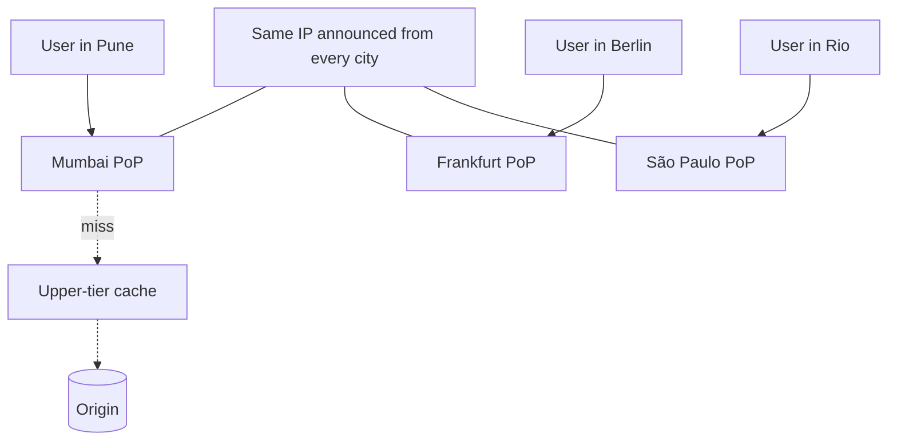

**In one line:** the same IP addresses are announced from hundreds of data centres worldwide (anycast), so internet routing delivers every user to a nearby one; each location runs the full stack (caching, security, compute) and can serve or protect your site without reaching your origin.

> [!REAL] One emergency number, hundreds of control rooms
> Dial 112 anywhere and you reach the nearest control room. Cloudflare announces the same IP from hundreds of cities, so your request reaches the nearest one.

## Anycast: one address, many places

## The ideas that make it work

1. **Anycast routing.** BGP sends each user to the topologically closest location announcing the IP. If a location fails or is withdrawn, traffic automatically flows to the next closest. No DNS changes needed.
2. **Every server does everything.** Each machine in each location runs DNS, TLS termination, WAF, caching, DDoS mitigation and edge compute, so capacity is uniform and any server can handle any request.
3. **TLS close to users.** Handshakes complete nearby, saving round trips across oceans; modern protocols (TLS 1.3, HTTP/3) cut latency further.
4. **Tiered caching.** A miss at a small location goes to a larger upper-tier location before reaching your origin, so the origin sees one request per object instead of one per city.
5. **DDoS absorption by scale.** An attack is spread across all locations by anycast itself; each location filters malicious traffic locally, so no single site is overwhelmed.
6. **Edge compute.** Small programs run at every location to personalise, route, authenticate or even serve whole applications without an origin.
7. **Smart routing for uncached traffic.** Requests that must reach the origin travel over measured, optimised paths between the provider's locations rather than the default internet route.
8. **Fast global config.** Rule changes (purges, firewall rules) propagate to every location within seconds.

## What to say in an interview

> "Anycast announces the same IPs from hundreds of cities, so BGP routes users to the nearest location and fails over automatically. Every server runs the whole stack: TLS, WAF, DDoS filtering, cache and edge compute. Misses go through tiered caching to protect the origin, and attacks are diluted across the entire network."

Related: [CDN Fundamentals & Architecture](#/l/05-cdn/fundamentals).
