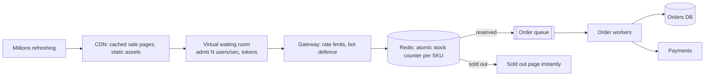

**In one line:** most traffic is absorbed before it reaches the core: pages are cached at the edge, users pass through a virtual waiting room, stock is decremented atomically in memory, and orders are processed asynchronously from a queue, so the database only ever sees a controlled trickle.

## Shaping a stampede into a stream

## The ideas that make it work

1. **Edge caching.** Sale and product pages are cached on the CDN (with stock shown approximately, refreshed every second or two). Refreshing the page costs the origin nothing.
2. **Virtual waiting room.** At sale start, users are placed in a queue and admitted at the rate the backend can handle, with a visible position. Fair, and it protects every downstream service.
3. **Bot and abuse defences.** Rate limits per user/IP/device, bot detection and per-user purchase limits stop scalpers from soaking up capacity.
4. **Atomic in-memory stock.** Each sale SKU has a counter in Redis decremented atomically (only if > 0). Thousands of requests per second resolve instantly to "reserved" or "sold out" without touching the database.
5. **Asynchronous order creation.** A successful reservation enqueues an order; workers write to the database and process payments at a steady pace. The user sees "order placed, confirming payment".
6. **Reservation expiry.** If payment doesn't complete in a few minutes, the unit returns to the counter.
7. **Pre-scaling and pre-warming.** Capacity is scaled up before the sale; caches are warmed; non-essential features (recommendations, reviews) are degraded or turned off via flags during the peak.
8. **Reconciliation.** Redis counters are reconciled with the database afterwards; the database remains the source of truth for orders.

## What to say in an interview

> "We absorb load at each layer: CDN-cached pages, a waiting room that admits users at a sustainable rate, rate limits and bot checks, then an atomic Redis decrement per SKU that instantly answers reserved or sold out. Reservations become queued orders that workers persist and charge at a steady rate, with expiring holds and post-sale reconciliation."

Related: [Find the Flaw: E-commerce Checkout](#/l/12-find-the-flaw/checkout).
