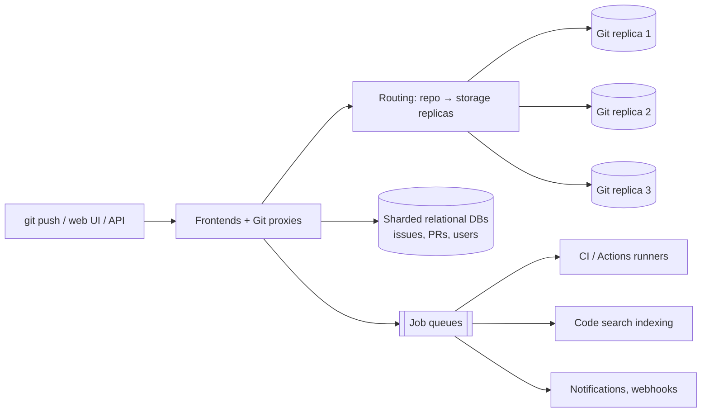

**In one line:** repositories are spread across many storage servers, each replicated to several machines with a consensus-style write protocol; metadata such as issues and pull requests lives in sharded relational databases; and heavy work (CI, search indexing, notifications) runs asynchronously in job queues.

## Two very different kinds of data

| Data | Nature | Where |
|---|---|---|
| **Git repositories** | Files and history; append-mostly; large | Distributed Git storage servers |
| **Metadata** (users, issues, PRs, comments, permissions) | Relational, transactional | Sharded MySQL-style clusters |
| **Derived data** (code search, notifications, feeds) | Rebuildable | Search indexes, caches, queues |

## The ideas that make it work

1. **Repository-level sharding.** Each repository lives on a small set of storage servers; a routing layer knows which. Adding servers adds capacity.
2. **Replicated Git writes.** A push is applied to several replicas and committed only when a majority agree (comparing the resulting ref states), so a server failure doesn't lose pushes and reads can go to any healthy replica.
3. **Forks share objects.** Forks of the same repository share an object store (a "network"), so millions of forks don't mean millions of full copies.
4. **Sharded metadata.** Relational databases are partitioned (by repository/organisation or functional area), with replicas for reads and tooling for online schema changes.
5. **Asynchronous everything heavy.** CI runs, webhook deliveries, search indexing, notification fan-out and repository maintenance (garbage collection, repacking) run through queues on separate fleets.
6. **Caching.** Rendered files, diffs, and expensive API responses are cached; ETags and conditional requests reduce API load.
7. **Rate limits and fairness.** API rate limits per user/token and per-repository protections stop one busy client or repo from hurting others.

## What to say in an interview

> "Git data is sharded by repository across storage nodes, with each repo replicated to three servers and writes committed by majority agreement; forks share object storage. Issues and PRs live in sharded relational databases. CI, webhooks, search and notifications run asynchronously from queues, and caching plus API rate limits protect the hot paths."
