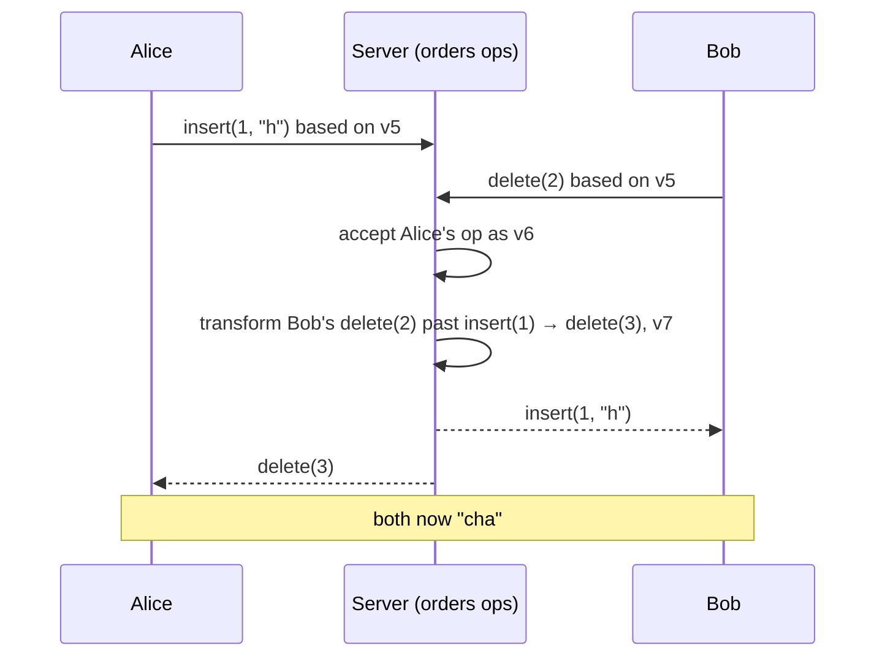

**In one line:** edits are sent as small operations (insert "x" at position 12), a server puts them in a single order, and each operation is **transformed** against concurrent ones so that positions still point to the right place, so everyone ends up with identical text.

> [!REAL] Two people correcting the same printed page
> If you insert a word at the start of a line and your friend deletes a word near its end, their position must shift by your insertion. OT is the bookkeeping that makes both corrections land correctly.

## The problem in one example

Text: `"cat"`. Alice inserts `h` at position 1 → `"chat"`. Simultaneously Bob deletes position 2 (`t`) → `"ca"`. Applying each other's raw operations makes them diverge (`"cht"` vs `"cha"`), because Alice's insert shifted the position Bob meant.

## Operational transformation

## The ideas that make it work

1. **Operations, not documents.** Clients send tiny edit operations, not whole files, so concurrent edits in different places never overwrite each other.
2. **One ordering point per document.** All editors of a document talk to the same server process, which assigns every operation a sequence number.
3. **Transformation.** An operation created against an older version is adjusted (positions shifted) to account for operations that got in first.
4. **Optimistic local editing.** Your keystrokes apply instantly on your screen; the client reconciles when the server's ordered operations come back.
5. **Op log + snapshots.** Every accepted operation is appended to a log (durability and version history); periodic snapshots make loading fast.
6. **Presence on the side.** Cursors and selections are broadcast separately and aren't stored.
7. **An alternative: CRDTs.** Some editors give every character a unique ID so operations commute and merge in any order without a central server, which is great for offline use.

## What to say in an interview

> "Clients send operations; the document's owner server orders them and transforms each against concurrent operations already applied (OT), then broadcasts. Clients apply edits optimistically and rebase on the server's order. Operations are logged for durability and history, with periodic snapshots. CRDTs are the alternative when offline or peer-to-peer editing matters."

Deep version: [Design a Collaborative Editor](#/l/10-hld-case-studies/collaborative-editor).
