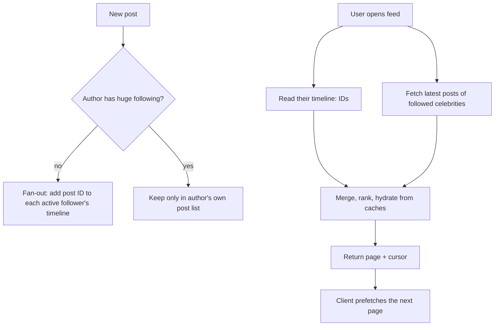

**In one line:** feeds are precomputed: when someone posts, the post ID is pushed into followers' ready-made timelines in an in-memory store, except for celebrities, whose posts are merged in at read time. Scrolling just reads the next page of IDs and fetches cached post details.

## Push for most, pull for celebrities

## The ideas that make it work

1. **Fan-out on write.** Doing the work once at post time (pushing into followers' timelines) makes every read cheap. Reads vastly outnumber posts.
2. **Hybrid for celebrities.** Pushing one post to 100M+ timelines is too slow and wasteful; celebrity posts are pulled at read time and merged.
3. **Timelines hold IDs, not content.** Small lists in memory (e.g. the latest few hundred IDs per user). Details (images, captions, counts) are fetched in batches from caches at read time, so edits and deletes show up correctly.
4. **Ranking on a candidate set.** The feed ranks a few hundred candidates with a model (interest, relationship, recency) rather than scanning everything.
5. **Cursor pagination + prefetching.** The app always has the next page ready before you reach it; images come from a CDN, often preloaded.
6. **Skip inactive users.** Timelines aren't maintained for people who haven't opened the app in weeks; theirs are rebuilt on demand.
7. **Everything cached.** Posts, profiles, counters and images are all served from memory or the edge.

## What to say in an interview

> "Hybrid fan-out: posts from normal accounts are pushed into followers' precomputed timelines in Redis; celebrity posts are pulled and merged at read time. Timelines contain IDs; the feed service hydrates them in batches from caches, ranks the candidates, and paginates with cursors while the client prefetches the next page and images come from the CDN."

Deep version: [Design a Photo-Sharing Service](#/l/10-hld-case-studies/photo-sharing).
