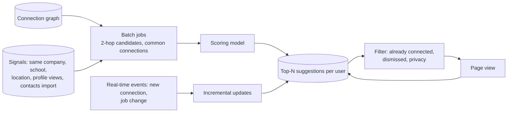

**In one line:** "People You May Know" is mostly **precomputed**: batch graph jobs find friends-of-friends and other signals, a model scores the candidates, and each user's top suggestions are stored ready to serve, then lightly refreshed by real-time events such as a new connection.

## Why not compute it on request?

Friends-of-friends for someone with 500 connections, each with 500 connections, is 250,000 people to consider, and that's before scoring. Doing that on every page view for hundreds of millions of members is wasteful. So the heavy work happens in advance.

## The ideas that make it work

1. **Graph traversal for candidates.** Second-degree connections (friends of friends) are the strongest source; the number of mutual connections is a powerful signal.
2. **Other candidate sources.** Same employer or school at overlapping times, location, imported address books, who viewed whom.
3. **Learned scoring.** A model predicts the likelihood that you'll send an invite and that it'll be accepted, combining all signals.
4. **Batch precomputation.** Distributed graph jobs compute candidates and scores for everyone periodically and store each user's top results in a fast key-value store.
5. **Real-time freshness.** When you make a new connection, your new connection's connections become fresh candidates quickly via streaming updates, without waiting for the next batch.
6. **Serving-time filters.** Remove people you're already connected to, dismissed suggestions, and anyone whose privacy settings exclude them.
7. **Graph partitioning.** The social graph is sharded and partly replicated in memory so 2-hop queries stay fast where they're done online.

## What to say in an interview

> "Candidates come mainly from 2-hop graph traversal plus shared company, school and contact signals; a model scores them; batch jobs precompute each member's top suggestions into a key-value store; streaming updates add fresh candidates after new connections; serving just reads, filters and returns. That keeps the page fast and the heavy graph work offline."
