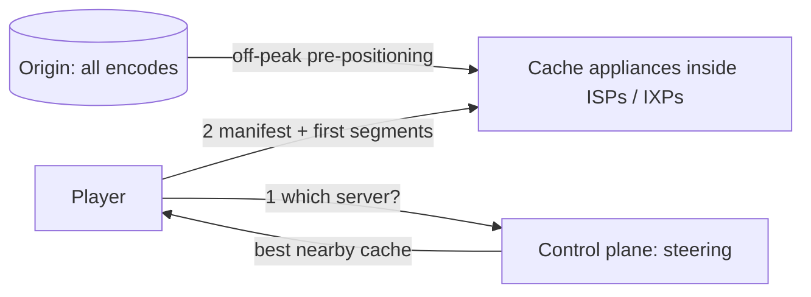

**In one line:** the video is already sitting on a server inside or next to your internet provider, encoded in many qualities, and the player starts with a small, low-bitrate segment and ramps up quality as the buffer fills, so playback begins in about a second.

> [!REAL] The movie is already in your town
> When you press Play, the film is not coming from the US; it's usually on a Netflix box sitting inside your internet provider's network, a few milliseconds away.

## Where the bytes come from

## The ideas that make it work

1. **Content placed before you ask.** A purpose-built CDN puts cache servers inside ISPs and at internet exchange points. Overnight, popular titles (predicted per region) are pre-positioned there. Your stream travels a very short distance.
2. **Control plane vs data plane.** Cloud services handle browsing, recommendations and choosing which cache to use; the cache servers only stream bytes. The steering service picks the best nearby cache based on health, load and network proximity.
3. **Per-title (and per-scene) encoding.** Encoding settings are optimised for each title's complexity: a simple cartoon needs far fewer bits than an action film for the same visual quality. Many bitrate and resolution "ladders", plus efficient codecs.
4. **Adaptive bitrate with a fast start.** The player begins with a lower bitrate to fill the buffer quickly, then steps up as measured throughput allows; it steps down before the buffer runs dry.
5. **Short segments and prefetching.** Segments of a few seconds; the first segments can be prefetched when you hover on a title or when the next episode is likely.
6. **Fast connection setup.** Nearby servers, reused connections and modern TLS minimise handshake time.
7. **Resilience.** If a cache fails mid-stream, the player switches to another source and keeps going from its buffer.

## What to say in an interview

> "Titles are encoded per title into many bitrate/resolution rungs and pre-positioned overnight onto cache appliances inside ISPs. The control plane steers each player to the best nearby cache; the player starts at a modest bitrate to fill the buffer fast and adapts per segment. Separating the cloud control plane from the edge data plane is what makes both scale."

Related: [CDN Fundamentals](#/l/05-cdn/fundamentals).
