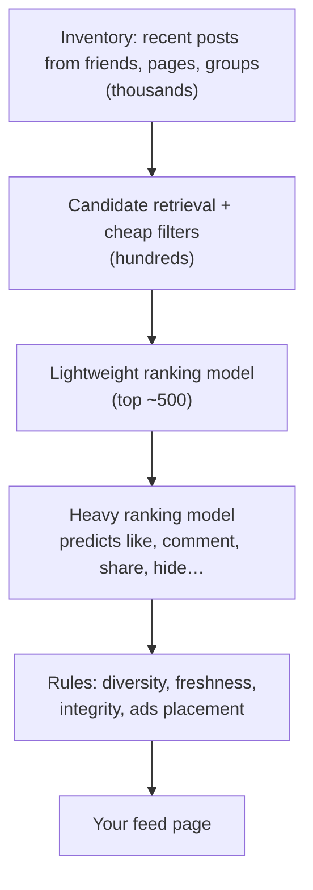

**In one line:** when you open the app, the system gathers a few thousand recent candidate posts from your friends, pages and groups (mostly from precomputed or cached sources), scores each with machine-learned predictions of what you'll engage with, and returns the top results, all in a few hundred milliseconds.

> [!REAL] A personal newspaper editor
> Out of thousands of possible stories, an editor picks the 20 you're most likely to read, in order. The ranking funnel is that editor, working in milliseconds.

## The ranking funnel

## The ideas that make it work

1. **Candidate gathering.** Recent posts from your connections and followed entities are fetched from indexed per-author stores and precomputed caches; very prolific sources are capped.
2. **Multi-stage ranking.** A cheap model prunes thousands of candidates; an expensive model scores only the survivors. That's how heavy machine learning fits in the latency budget.
3. **Predict actions, combine into a score.** Models estimate the probability you'll like, comment, share, watch, or hide each post; a weighted combination (reflecting what the product values) gives the final score.
4. **Features are precomputed.** Your affinity with each friend, post engagement so far and content type are kept in fast feature stores, updated by streaming pipelines.
5. **Diversity and rules after scoring.** Avoid five posts in a row from the same source, keep some freshness, demote low-quality or harmful content.
6. **Caching and pagination.** The ranked result is cached for the session and paginated; the next pages may be ranked lazily as you scroll.
7. **Fan-out still matters.** Posts are indexed by author at write time so retrieval is fast; celebrity and page posts are pulled rather than pushed.
8. **Feedback loop.** Every interaction becomes training data; models are retrained regularly and tested with experiments.

## What to say in an interview

> "Feed generation is a funnel: retrieve a few thousand recent candidates from friends, pages and groups via per-author indexes and caches; prune with a light model; score the top few hundred with a heavier model predicting engagement actions using precomputed features; then apply diversity and integrity rules, cache the ranked list per session and paginate. Retrieval is cheap, ranking is where the compute goes."

Related: [How Instagram Keeps the Feed Instant](#/l/14-crisp-case-studies/instagram-feed).
