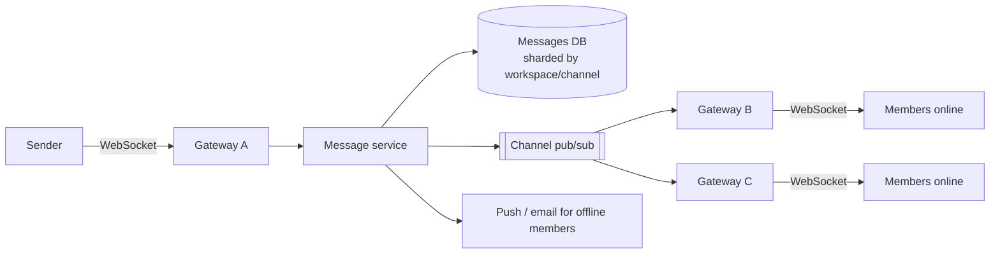

**In one line:** every client keeps one persistent WebSocket to a gateway; messages are saved first, then published to the channel's topic in a pub/sub layer, which fans them out only to the gateway servers that have members of that channel connected.

> [!REAL] An office intercom per room
> A message for #engineering is announced only in the rooms (servers) where engineering people are sitting, not across the whole building.

## The path of one message

## The ideas that make it work

1. **Persistent connections.** Each client holds one WebSocket. Gateways are thin and stateful only about connections; they can hold hundreds of thousands each.
2. **Write first, then fan out.** A message is stored durably and assigned an order within its channel before being broadcast, so nothing shown to anyone can disappear.
3. **Channel-based pub/sub.** Gateways subscribe to the channels their connected users belong to. A message is sent to only those gateways, which forward it to the right sockets. A 10,000-member channel spread across 50 gateways = 50 internal messages, not 10,000.
4. **Presence and typing are ephemeral.** Sent on separate, throttled paths and never stored long-term.
5. **Reconnect and catch up.** Clients track the latest message they've seen per channel; after reconnecting, they fetch what they missed via the API, then resume the live stream.
6. **Sharding by workspace/server.** Data and much of the real-time state are partitioned by team (or "guild"/server for Discord), keeping most traffic local to a shard. Very large communities get special handling (dedicated shards, lazy member lists).
7. **Offline members.** Push notifications or emails for mentions and DMs, governed by user preferences.

## What to say in an interview

> "Clients keep a WebSocket to a gateway. The message service persists each message with a per-channel sequence, then publishes to the channel's pub/sub topic; only gateways with members in that channel subscribe, and they push to the sockets. Presence is ephemeral and throttled. Reconnecting clients catch up from their last sequence via the API, and offline users get push notifications."

Deep version: [Design a Chat System](#/l/10-hld-case-studies/chat-system).
