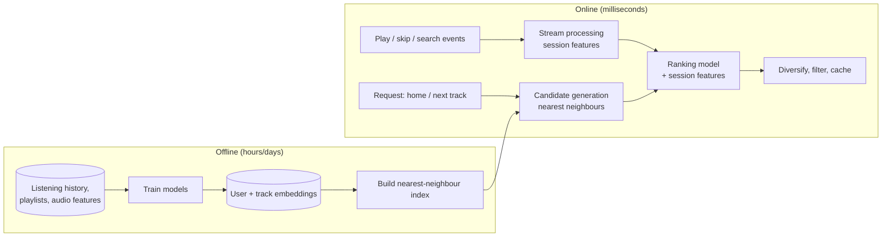

**In one line:** heavy machine learning runs offline to learn compact "taste vectors" for users and tracks; at request time the system quickly retrieves candidate tracks near your vector, ranks them with fresh signals from what you're doing right now, and serves the result from cache.

> [!REAL] A music-shop owner who knows your taste
> Over time the owner learns what you like (offline learning). When you walk in, he quickly pulls a few records you'll probably enjoy today (online serving).

## Two speeds: offline learning, online serving

## The ideas that make it work

1. **Collaborative filtering.** People who listen to similar things predict each other's tastes. Matrix factorisation or neural models compress this into **embeddings**: vectors where similar users and tracks are close together.
2. **Content understanding.** Audio analysis (tempo, energy, mood) and text (playlist titles, descriptions) help with new tracks nobody has played yet (the cold-start problem).
3. **Two-stage retrieval.** First, **candidate generation**: fetch a few hundred tracks from millions using approximate nearest-neighbour search on embeddings. Then **ranking**: a richer model scores just those candidates.
4. **Real-time signals.** Skips, replays and the current session (workout vs focus) stream in and adjust ranking within seconds: "you skipped three slow songs, so skip slow songs".
5. **Precomputation.** Personalised playlists and home shelves are largely built in batch and cached; only the final ordering adapts live.
6. **Exploration and diversity.** Some slots try new artists to learn and avoid repetitive recommendations.
7. **Feedback loop.** Every play and skip becomes training data for the next model update.

## What to say in an interview

> "Offline, we train embeddings for users and tracks from listening behaviour and audio features and build an approximate nearest-neighbour index. Online, we retrieve a few hundred candidates near the user's vector, rank them with a model that includes real-time session signals from the event stream, apply diversity and business rules, and cache results. Heavy computation is offline; the online path is retrieval plus ranking in tens of milliseconds."
