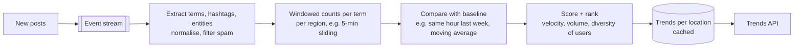

**In one line:** stream every post through a pipeline that extracts terms and hashtags, counts them in short time windows, and ranks terms whose **current rate is unusually high compared with their normal baseline**, not just the most frequent terms.

> [!REAL] Not the loudest, the suddenly loud
> "Good morning" is said a million times every day, so it's never trending. A hashtag that jumps from 100 to 50,000 mentions in an hour, after a last-ball six, is.

## Why "most frequent" isn't "trending"

"Good morning" is said millions of times every day. It's popular, not trending. A trend is a **sudden acceleration**: a term at 40× its usual rate right now.

## The pipeline

## The ideas that make it work

1. **Stream processing with windows.** Counts are kept over sliding windows (e.g. last 5 and 60 minutes) per term and per location.
2. **Approximate counting at scale.** Tracking exact counts for every possible term is expensive. Sketches like **Count-Min Sketch** estimate counts in fixed memory, and **heavy-hitter** algorithms keep only the top candidates.
3. **Baseline comparison.** Score ≈ how many standard deviations above its normal rate a term is, so niche terms that suddenly spike rank above always-popular ones.
4. **Quality filters.** Count distinct users, not posts (one account spamming a hashtag shouldn't trend); downweight bots and coordinated accounts; filter offensive terms.
5. **Clustering.** "#WorldCup", "World Cup" and "WorldCupFinal" are grouped into one trend.
6. **Localisation and personalisation.** Trends computed per country/city, then lightly personalised by interests.
7. **Precompute and cache.** Trends are recomputed every minute or so and served from cache; nobody computes trends on request.

## What to say in an interview

> "Posts flow through a stream processor that extracts and normalises terms and counts them per location in sliding windows, using sketches for memory efficiency. A term trends when its current rate is far above its historical baseline, weighted by the number of distinct users and filtered for spam. Results are recomputed every minute per region and served from cache."

Related: [Batch vs Stream Processing](#/l/09-tradeoffs/batch-vs-stream).
