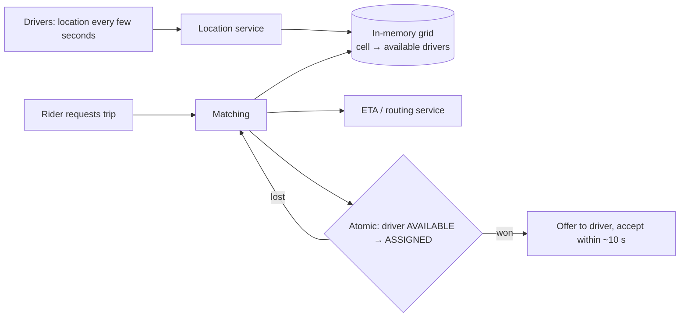

**In one line:** drivers' live positions are kept in memory in a geographic grid, so finding nearby drivers is a lookup of a few grid cells; candidates are ranked by real travel time, and the chosen driver is locked with an atomic state change.

> [!REAL] The auto stand outside the station
> The coordinator doesn't phone every auto in the city; he looks at the autos waiting nearby and sends you to the closest free one. Once he points at an auto, nobody else can take it.

## The flow

## The ideas that make it work

1. **Spatial indexing.** The map is divided into cells (geohash, quadtrees, or hexagonal grids such as H3). Each cell holds the IDs of available drivers. Finding drivers near a pickup = check its cell and neighbours, which is constant time no matter how many drivers exist worldwide.
2. **Only the latest location matters for matching.** Millions of position updates per second are kept in memory (latest value only); the full history is streamed elsewhere for analytics.
3. **Rank by ETA, not distance.** A driver 500 m away across a river or on the wrong side of a highway may be 10 minutes away. A routing engine estimates real arrival times.
4. **Batched matching.** Instead of greedily assigning each request instantly, collecting requests for a second or two and solving the assignment for all of them reduces total waiting time across the city.
5. **No double assignment.** Two riders can't get the same driver: driver state changes atomically from available to assigned; the loser moves to the next candidate.
6. **Partitioning by city/region.** Location indexes and matching run per region, so load and failures stay local.
7. **Supply/demand signals.** The same grid feeds surge pricing and driver positioning suggestions.

## What to say in an interview

> "Driver locations stream into an in-memory geospatial index of cells (H3 or geohash); matching reads the pickup cell and its neighbours, ranks candidates by routing ETA, and claims a driver with an atomic AVAILABLE→ASSIGNED transition before sending the offer. The index is partitioned by region, and requests can be batch-matched for better city-wide pickup times."

Deep version: [Design a Ride-Sharing Service](#/l/10-hld-case-studies/ride-sharing).
