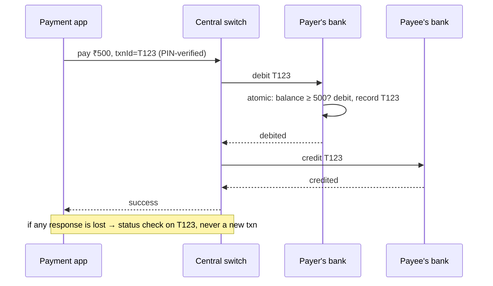

**In one line:** every transaction has a globally unique ID that every party (app, payment switch, banks) uses to deduplicate; the payer's bank debits atomically with a balance check; and when a response is lost, the system **checks status** and reverses automatically instead of retrying blindly, so the same money can't be spent twice.

## The parties

## The ideas that make it work

1. **Unique transaction ID everywhere.** The app generates an ID per payment; banks and the switch store it with a unique constraint. A duplicate request with the same ID returns the original result instead of debiting again.
2. **Atomic debit with a balance check.** The payer's bank debits in a single transaction (`balance >= amount`), serialised per account, so two simultaneous payments can't both spend the same balance.
3. **Strong authentication per transaction.** The PIN is verified by the payer's bank, binding the debit to that transaction ID.
4. **Timeouts → status check, not retry.** If a step times out, the transaction is "pending/deemed"; the switch and app query the status by ID. If the debit happened but the credit failed, an automatic **reversal** returns the money within a defined time window.
5. **Idempotent reversals.** Reversals are keyed by the original transaction ID, so they also happen exactly once.
6. **Settlement and reconciliation.** Interbank money movement happens in settlement cycles; reconciliation between switch and bank records catches mismatches and triggers adjustments.
7. **Wallet apps add their own ledger.** Apps with stored balances use double-entry ledgers with the same idempotency rules.

## What to say in an interview

> "The transaction ID is the idempotency key across the app, switch and both banks. The payer bank debits atomically with a balance check serialised per account. A lost response puts the transaction in pending; the parties resolve it by querying status by ID, and debits without a matching credit are auto-reversed, also keyed by the ID. Settlement reconciliation is the final check."

Related: [How Money Actually Moves](#/l/11-payments-uploads/how-money-moves).
