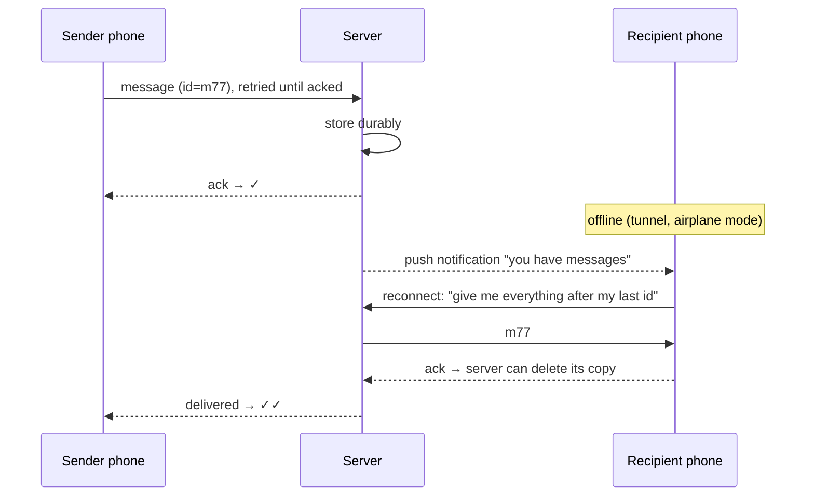

**In one line:** the server stores every message until each recipient device acknowledges it, the sender retries with a unique message ID until the server acknowledges, and devices resync from where they left off when they reconnect. Delivery is "store and forward with acknowledgements at every hop".

> [!REAL] The courier's proof of delivery
> One grey tick: the courier office has your parcel. Two grey ticks: it reached the recipient's door. Blue ticks: they opened it. Each tick is an acknowledgement in the chain.

## The chain of acknowledgements

## The ideas that make it work

1. **Client-generated message IDs.** If the sender's network drops before it gets an ack, it resends the same ID; the server recognises it and doesn't create a duplicate.
2. **Ack only after durable storage.** One tick means "the server has it safely", not "it's in flight".
3. **Per-device offline queues.** Undelivered messages wait on the server, per recipient device, until that device acks them.
4. **Push notifications as a wake-up call.** When the app is backgrounded or the connection is gone, a push tells the phone to reconnect and fetch.
5. **Cursor-based resync.** On reconnect, the device says what it last received; the server sends everything newer, in order.
6. **Persistent, lightweight connection.** While online, a single long-lived connection with heartbeats delivers messages instantly and detects when the phone has gone away.
7. **Ordering by sequence number** per conversation, so a retried or delayed message lands in the right place.
8. **End-to-end encryption**: the server routes and stores ciphertext only; it can guarantee delivery without being able to read anything.

## What to say in an interview

> "Every hop is acknowledged: the client retries with a stable message ID until the server acks after a durable write; the server holds messages per recipient device until that device acks; offline devices are woken by push and resync from their last cursor. Per-conversation sequence numbers keep order, and idempotent IDs prevent duplicates."

Deep version: [Design a Chat System](#/l/10-hld-case-studies/chat-system).
